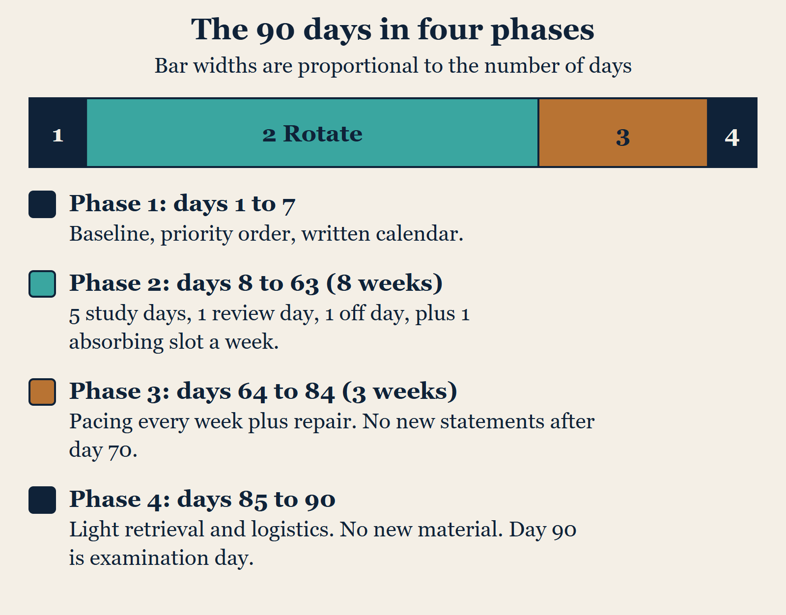
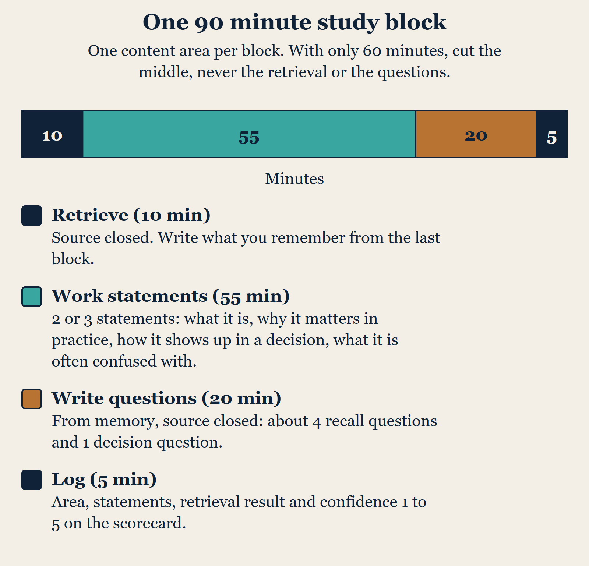
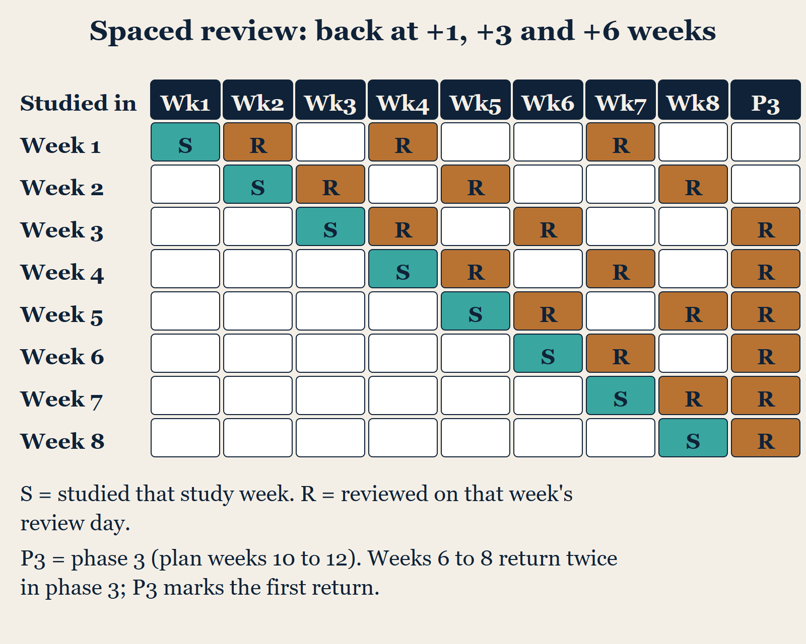
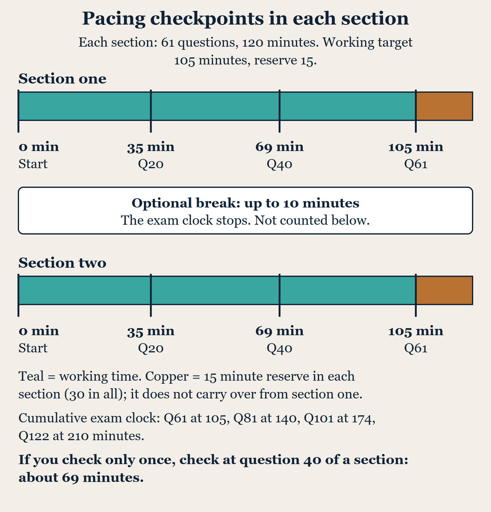
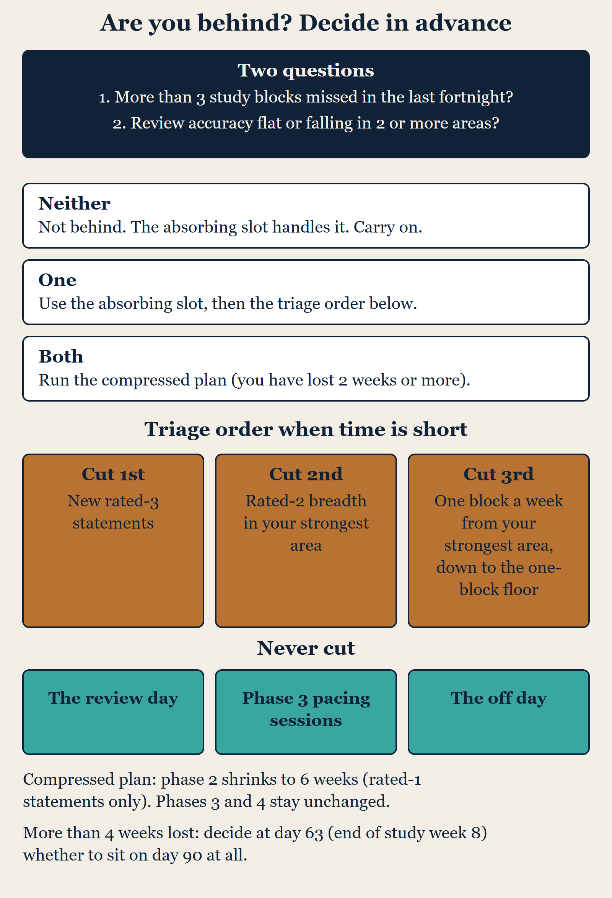

# How to use this book

This is not a book about social work. It is a book about ninety days.

This book is a study plan for the Clinical (LCSW) licensing examination for social workers, one of the Social Work Licensing Examinations set by the Association of Social Work Boards (ASWB). "Clinical" is the name of ASWB's examination category for clinical social work practice. This is not a medical or nursing examination.

Its main reader has just sat the Clinical examination and not passed, so the plan is built around the ninety-day retake window. If you have just sat the Clinical examination and not passed, you have been handed three things: a score report, a waiting period, and a content outline you are free to download. What nobody has handed you is a plan — a decision about what you will study on the fourteenth of next month, and how you will know by then whether it is working.

That is the whole job of this book. Every chapter exists to get you to a calendar with ninety days filled in, and to keep you on it when a week goes wrong.

**If this is your first attempt.** The plan works the same way if you have not sat the examination before: choose your test date and count back ninety days to day 1. The parts written for a retake (the score report in chapter 3, the waiting rule in chapter 1 and the "if you did not pass" section of chapter 22) will not apply to you yet.

## Read it in this order

Read Part I (chapters 1 to 4) before you plan anything. It is short, and it covers the four things that change how you should plan: what the waiting rule actually says, what changed about the examination in 2026, what your score report can and cannot tell you, and the six ways preparation usually fails.

Then work through Part II (chapters 5 to 8) with a calendar open. By the end of chapter 8 you will have a written plan. Parts III (chapters 9 to 13) and IV (chapters 14 to 19) are the daily reference you come back to during the ninety days. Part V (chapters 20 to 22) covers logistics, examination day and what comes after. If you may qualify for a waiver of the waiting period, read chapter 20 in week one; otherwise you can leave Part V until week ten.

## What you need before you start

A calendar you actually look at. A notebook or a plain document for your own questions. The examination guidebook published by ASWB, which is free and contains the content outline and reference list for your examination. Nothing else is required. You do not need to buy anything to follow this plan, including anything from us beyond this book.

## A word about effort

The plan in this book assumes about ten to twelve hours of study a week. That is a deliberate choice. Plans that assume twenty-five hours a week look impressive and collapse in nine days, usually taking the candidate's confidence with them. If you have more time, the book tells you where extra hours actually help, which is often not where the extra hours go.

## One thing to get straight now

Not passing once does not mean you are not capable of this. You hold the degree and you have the supervised hours. ASWB's own guidebook says that most test-takers find preparation involves reviewing areas of practice they might not use frequently, rather than learning something completely unfamiliar (guidebook, p. 29). The gap is usually coverage and recall under time pressure, and both of those are scheduling problems. Scheduling problems are solvable, which is the good news in this book.

# Important: what this book is and is not

Please read this chapter. It is here for your protection as much as ours.

**Not affiliated with ASWB.** This book is an independent study-planning guide published by The Velvet Foundry. It is not affiliated with, endorsed by, approved by, sponsored by or connected to the Association of Social Work Boards (ASWB), Pearson VUE, or any social work licensing board. "ASWB" and the names of its examinations are used here only to identify the examination this plan is designed for.

ASWB makes this point itself, and it is worth knowing. Its published guidebook warns candidates that some private companies give the impression they are affiliated with or approved by ASWB, and states plainly that ASWB has no relationship with any test preparation company or course (guidebook, p. 30). Treat any product that hints otherwise — including any product that hints it knows what is on the paper — with suspicion. That includes ours, which is why we are telling you.

**Which examination this is.** This book is about the Clinical (LCSW) examination, the ASWB examination category for clinical social work licensure. ASWB's guidebook describes the Clinical category as the practice of clinical social work requiring the application of specialized clinical knowledge and advanced clinical skills (guidebook, p. 4). It is a licensing examination for social workers, not a medical examination, and nothing in this book is medical advice.

**This book contains no examination questions.** It contains no examination material of any kind, no reconstructed items, and nothing described as representative of what you will be asked. Every scenario in it was written for this book to demonstrate a method of reasoning. Each one is labelled as such. None is drawn from any examination.

This is not modesty. Examination content is confidential and protected by copyright and other laws, and the confidentiality agreement you signed binds you too: you agree not to share examination content with others, including in study groups, in person, by email or on internet forums and social media (guidebook, p. 19). ASWB's guidebook states that it monitors online information sources and has taken legal steps against people who violate test security, and that people who violate confidentiality can face serious criminal and administrative repercussions (guidebook, p. 30). If you come across a forum, a file or a seller offering you the questions, walking away from it protects your licence.

**No guarantee.** Passing a licensing examination depends on your own knowledge, preparation and performance on the day. This book provides a study structure and nothing more. It cannot and does not guarantee any examination result. We make no claim about pass rates, and you should distrust anyone who does.

**Verify the rules yourself.** Examination format, fees, policies, content outlines and waiting rules are set by ASWB and by your own licensing board, and they change — as the 2026 format change demonstrates. The statements in this book about the examination were checked against ASWB's published material on 7 November 2026: the 08/2026 edition of the ASWB Examination Guidebook and several pages on aswb.org. The book names ASWB as the source of each rule, and the sources section at the end lists the documents and pages that were opened. Before you rely on any of it, confirm it against ASWB's current published material and with your own board. Where this book and ASWB disagree, ASWB is right.

**Not professional advice.** Nothing here is clinical, legal or licensure advice.

## What this book deliberately does not do

It does not teach you clinical content. There is no material here on diagnosis, treatment selection, pharmacology or intervention technique.

That is a deliberate limit and you deserve the reason. This book is published by a small independent publisher. We are competent at designing study schedules, retrieval practice and pacing, and we are not licensed clinical social workers. A licensing examination is the gate to a profession where being wrong has consequences for other people, and we are not willing to write clinical teaching material for it and let you mistake it for authority.

So we have written the part we can stand behind. For clinical content, work from the reference list in ASWB's guidebook — the texts named there, your own graduate course material, and the practice you already have. Chapter 7 covers how to assemble that. This book organises your revision of those sources. It does not try to replace them.

# Chapter 1. The 90-day window, and what the rule actually says

You already know there is a wait. The details are easier to miss, and they change how you plan.

## The rule

ASWB policy states that candidates must wait 90 days between examination attempts (ASWB page "If you fail the exam"; the guidebook, p. 20, says to "wait 90 days before your next testing appointment").

Three practical consequences:

**You cannot test early just because you feel ready.** The ninety days are not a recommendation. Plan for the full window; this book assumes it.

**ASWB's published material states no cap on attempts of its own**, but some licensing boards limit how many times an applicant may take the examination. ASWB says so (guidebook, p. 20) and tells candidates to contact its Candidate Services Center to find out whether their board's approval is needed. Do this in week one. If your board limits attempts, you need to know the number before you decide how to use these ninety days, because it changes how conservative you should be about booking the next date.

**You are also advised to wait before re-registering.** ASWB's page "If you fail the exam" advises waiting seven to ten days after your last exam before registering again, and the examination fee is due at registration. For the Clinical examination that fee is US$260. Chapter 20 covers the sequence.

## The waiver, and when it matters

There is an exception, and it is narrower than rumour suggests. You may request a waiver of the waiting period if your most recent score was within ten correct answers of the passing score (the wording on ASWB's waiver page; the guidebook says "within 10 points"), if your board permits waivers, and if you submit the request online through ASWBCentral. You must wait at least one day (24 hours) after the examination before submitting. ASWB's waiver page adds that California and North Dakota do not permit 90-day waivers and that no more than two waivers may be used in twelve months for any one examination category. Your new test date must still be at least ninety days out unless the waiver is granted.

If you are in that band, read chapter 20 in week one rather than week ten, because it changes your timetable. ASWB also advises not registering until a requested waiver has been granted or denied.

But here is the honest counsel: being within ten answers of passing means you were close, not that you were unlucky. The gap that keeps a candidate ten answers short is usually thin coverage of one area or slow pacing, and both take weeks, not days, to shift. If a waiver gets you a date in six weeks, run the plan in this book compressed — chapter 19 explains how — but do not take the early date simply because it is available.

## Why ninety days is a good length

You may not feel grateful for the wait. From a study-design point of view it is close to ideal.

Ninety days is long enough for spaced repetition to work: material you study in week two can be retested in week three, week five and week eight, which is what moves it into durable recall. It is also long enough to rehearse a four-hour paper more than once without exhausting yourself. And it is short enough to hold a plan in view, which a six-month runway is not.

The risk in ninety days is not that it is too short. It is that weeks one to six feel unhurried, nothing is scheduled, and the work compresses into the last fortnight — where it does the least good. The plan in this book front-loads coverage for exactly that reason.

## Set your dates now

Before you read on, write down three dates: today, your earliest permitted test date, and the date ninety days from today. If your board or a waiver changes the middle one, write that down too. Count carefully: if day 1 of the plan is the day after your last attempt, day 90 falls 89 days after it. ASWB's published pages say "90 days" without saying how the days are counted, so confirm your earliest permitted test date with ASWB's Candidate Services Center and, if in doubt, put day 90 a few days later.

Everything in Parts II and III is numbered relative to day 1, so you can map it onto any start date. Do not skip this. A plan without dates is a wish.

# Chapter 2. What changed in 2026, and why your old materials are the wrong shape

If you prepared for the examination before August 2026, some of your materials now describe a paper that no longer exists. This chapter is about what changed and what it means for your study time. The sources for this chapter are ASWB's own page "Upcoming Changes to the Social Work Licensing Exams", its announcement dated 30 April 2026, its 2026 blueprints page and the 08/2026 guidebook.

## The change

Examination administrations using forms based on the 2026 blueprints began on Monday 3 August
2026. The content is based on ASWB's 2024 analysis of the practice of social work, conducted as part of its census.

What actually changed:

| | Previous format | 2026 format |
|---|---|---|
| Content areas | Four | Three |
| Scored (operational) questions | 150 | 110 |
| Pretest questions | 20 | 12 |
| Total questions | 170 | 122 |
| Answer options | Three or four, most with four | Three or four, with more three-option questions than before |
| Time limit | Four hours | Four hours |

The three content areas are Values and Ethics, Assessment and Planning, and Intervention and Practice. ASWB also says the 2026 exams include a higher proportion of questions that rely on the application of professional knowledge, and that the knowledge, skills and abilities statements (KSAs) were converted to applied knowledge statements, or AKS.

**How the four hours are organised.** The 2026 paper is delivered as two sections of 61 questions, each with its own two-hour limit; 12 of the 122 questions are pretest questions mixed in with the scored ones (guidebook, pp. 3 and 16). When you finish section one you cannot return to it. You then have the option of a scheduled break of up to 10 minutes, during which the exam clock stops. If you take longer than 10 minutes the excess comes out of your exam time; if you take less, the unused minutes are not added to your exam time. To skip the break, end it as soon as the break clock begins (guidebook, p. 17). You may also take unscheduled breaks by raising your hand, but the clock keeps running during those (guidebook, p. 17).

## What this means for your time per question

This is the change with the biggest practical effect, and it is easy to miss.

You now have four hours for 122 questions rather than four hours for 170. That is a little under two minutes per question, against roughly eighty-five seconds before. Pacing pressure has eased considerably.

Do not spend that gift carelessly. Chapter 16 sets out how to use it: the extra seconds are worth most on the questions that ask what you would do first, next or best, where the difference between a right and a nearly-right answer is one careful re-read of the stem.

## What this means for your study allocation

For the Clinical examination the published weights are:

| Content area | Share of the paper | Scored questions, approximately |
|---|---|---|
| Values and Ethics | 36% | 40 |
| Assessment and Planning | 32% | 35 |
| Intervention and Practice | 32% | 35 |

ASWB's guidebook states the Assessment and Planning and Intervention and Practice shares (32 percent each) and says that on a 110-question paper that is about 36 scored questions each (p. 6). Strictly, 32 percent of 110 is 35.2, so this book uses about 35 for each of those two areas; 36 percent of 110 is 39.6, about 40, and the three rows then add to 110. The Values and Ethics share, 36 percent, is the figure printed in the Clinical content outline (guidebook, p. 66).

Read the first row again. **On the Clinical examination, Values and Ethics is the largest content area.** Not assessment. Not intervention. Ethics.

It is easy not to study as though that were true. It is a misallocation this book is designed to correct, and it is why your diagnostic week in chapter 5 spends a full day on ethics before anything else.

If your old materials were built on the four-area format, their proportions are wrong for the paper you will sit, whatever the quality of their content. That is not a criticism of them. It is arithmetic.

## A note on materials claiming to be current

Be careful with anything badged for the current cycle that still describes a 170-question paper, or four content areas. The number of questions is the easiest thing in the world to check against ASWB's published figures, and a product that gets it wrong on the cover has not been revised as thoroughly as its label suggests.

This applies to free material too — blog posts, forum summaries, revision notes passed between cohorts. Check the question count and the number of content areas before you trust the rest.

## What has not changed

The time limit is four hours. Questions remain multiple choice, with three or four options. The registration fee for the Clinical examination in the guidebook is US$260 (p. 10). ASWB's guidebook is free and contains the content outline, a reference list, sample items and a study plan template for each examination level. And ASWB sells its own online practice test, made of actual retired exam questions, for US$85, available to candidates who have registered (guidebook, pp. 10 and 32).

That practice test deserves a word. Of everything you can buy, it is the one made of actual retired exam questions, which makes it the closest thing to the real paper. ASWB states that no preparation company has special access to the examinations and that some commercial practice questions bear little resemblance to actual examination questions (guidebook, p. 19). We cannot offer you anything like it, and neither can anyone else. Chapter 14 tells you when in the ninety days to use it, which matters: used in week two it is a waste, and used in week eleven it is worth a great deal.

# Chapter 3. Reading a score report without over-reading it

Your score report is evidence. It is also a Rorschach test, and it is easy to build a whole study plan on a reading it cannot support. This chapter is about extracting the signal and stopping there.

## What the report gives you

ASWB reports results as pass or fail, with the number of questions needed to pass and the number you answered correctly. If you do not pass, the unofficial score report also shows the number you answered correctly and the total number of questions in each content area (guidebook, p. 18). You learn roughly how you performed across the broad areas. You do not learn which questions you got wrong, or why.

That is how the report works: ASWB's guidebook says you will not be able to review your exam (p. 19), and examination content is confidential.

## What you can legitimately conclude

**One: your weakest area is probably genuinely weaker.** Area-level feedback across roughly thirty-five to forty questions is a reasonable signal. If Values and Ethics came out lowest, treat that as real.

**Two: a near-miss overall means coverage, not capability.** If you were close, you do not need to relearn the profession. You need the areas you skimmed, and you need pacing.

**Three: a wide spread between areas tells you about your preparation, not your ability.** A candidate strong in intervention and weak in ethics has usually studied what they enjoy. That is the most fixable pattern in this book.

## What you cannot conclude

**You cannot rank the three areas finely.** The difference between your second and third area may be two questions, which is noise. Do not build a plan that treats a two-question gap as a finding.

**You cannot diagnose a sub-topic.** The report does not tell you that you are weak on informed consent specifically. If you find yourself concluding something that precise, you are inventing it.

**You cannot conclude you were unlucky.** Possibly you were. It is also the least useful available explanation, because nothing follows from it. Plan as though the result reflected your preparation, because that is the only reading you can act on.

**You cannot conclude the paper was unfair.** It may have felt that way; that feeling is common, and it is a poor guide.

## How to use it in one page

In your notebook, write three lines — one per content area — and against each put:

1. Your area-level result as reported, in ASWB's own words. Not your interpretation.
2. Your own confidence, 1 to 5, recorded *before* you looked at the report. If you did not record it, do it now from memory of how the paper felt, and mark that it is retrospective.
3. One sentence on what you actually did to prepare that area last time: hours, materials, and whether you ever tested yourself on it rather than reading it.

That third line is the one that pays. Look for an area you only ever read about and never once tested yourself on. If you find one, you have found something more useful than any score breakdown.

## Then put it away

Seriously. Photograph the page, close the report, and do not reopen it before day 60. It has given you everything it has, and read repeatedly it becomes a way of feeling bad rather than a way of planning. The coverage map you build in chapter 18 is a better instrument from here on, because it reflects what you have done this time.

# Chapter 4. The six ways preparation goes wrong

These are failure modes, with the schedule change each one implies. Read all six and mark the ones you recognise from your last attempt. You may recognise two or three.

## One: reading instead of retrieving

You read the chapter, it feels familiar, you move on. Familiarity is not recall. The sensation of recognising material is produced by having seen it, and it survives right up until you have to produce the material without it in front of you.

This is a common and costly error, and it is why every study block in this book ends with you answering from memory with the source closed.

*The fix:* no block counts as done until you have produced something from memory. Chapter 10.

## Two: studying the comfortable area

You are good at intervention, so intervention is pleasant to study, so you study it. Three weeks in, you have deepened a strength and left a weakness untouched. On a paper where ethics is 36% of the questions, that is expensive.

*The fix:* the coverage map in chapter 18, which makes neglect visible, and the proportional allocation in chapter 6.

## Three: marching down the outline in order

The outline has an order, so you follow it. You spend three weeks on the first area and reach the third area in the final fortnight, having forgotten the first.

The order of the outline is not a study order. ASWB's guidebook makes a related point: questions are delivered in random order on every examination, and the outline's order does not dictate the order of the paper (guidebook, p. 29). Preparing in strict outline order trains a sequence the examination will not give you.

*The fix:* the rotation in chapter 12, which touches all three areas every week.

## Four: no pacing rehearsal

You know the content and you run out of time, or you rush the last thirty questions. Pacing is a separate skill from knowledge and it needs separate practice, under something like real conditions.

Four hours is also a long time to concentrate. Candidates who have never sat for four hours in one go discover that in hour three, during the examination.

*The fix:* phase 3, chapter 14, where you rehearse timed sessions.

## Five: cramming into the last fortnight

Weeks one to six feel like there is time. Weeks eleven to thirteen become frantic. The work gets done, but at the point in the schedule where it has the least chance of consolidating, and with no room left to discover a weak area.

*The fix:* the dated plan. The plan's main virtue is not what it asks of week twelve; it is what it asks of week two.

## Six: a plan too rigid to survive a bad week

You build a beautiful schedule assuming six study days a week. In week three you get ill, or a case goes wrong, or you are simply flattened. You miss four days, the plan is broken, and you abandon it — not because the plan was too demanding in total but because it had no slack.

This failure mode is a risk after an attempt that did not go well, because a candidate who did not pass can over-correct into a punishing schedule.

*The fix:* every week in this plan has one absorbing slot, and chapter 19 tells you exactly what to drop when you fall behind. Deciding that in advance is what makes it survivable.

## A seventh, which is not about study

Some candidates are not short of preparation. They are anxious to the point that the paper becomes hard to read. If that is closer to your experience — if you knew the material in the room and could not retrieve it — then pacing rehearsal under timed conditions will help you more than more content, and it is worth saying that ASWB has contracted a provider to offer registered test-takers, at no cost, resources for developing what it calls a test mastery mindset (guidebook, p. 32). Look at what your own board and employer offer too. This book cannot treat examination anxiety, and will not pretend to.

# Chapter 5. The diagnostic week

Phase 1 is days 1 to 7. Its output is a written plan, a baseline, and a priority order. You will study very little content this week, and that is correct.

The temptation is to open a textbook on day 1 and feel productive. Resist it for a week. A week spent deciding what to study saves a fortnight of studying the wrong thing.

## What the week produces

By the end of day 7 you should have five things:

1. Your three dates, from chapter 1.
2. A priority order across the three content areas, from your own assessment and your score report.
3. A materials list — what you have, what you need, where each lives. Chapter 7.
4. A ninety-day calendar with every day assigned. Chapter 8.
5. A first weekly scorecard, with your baseline recorded. Chapter 18.

## The self-assessment, and how to do it honestly

Download ASWB's guidebook for your examination level if you have not already. It contains the content outline — the competencies and the applied knowledge statements underneath them. This is the authoritative list of what the examination is built from. We do not reproduce it here, both because it is ASWB's copyrighted work and because you should be working from the current version rather than our snapshot of it.

Work through the outline one statement at a time. For each, rate yourself 1 to 5 on a single question: *could I explain this to a colleague right now, with nothing in front of me?*

- **1** — I do not recognise this.
- **2** — I recognise the words and could not explain it.
- **3** — I could explain roughly, with gaps.
- **4** — I could explain it clearly.
- **5** — I could explain it, and apply it to an unfamiliar case.

Two rules make this useful rather than comforting.

**Rate on production, not recognition.** The question is whether you could say it, not whether it looks familiar. If you catch yourself thinking "yes, I've seen that", that is a 2.

**Do it in one or two sittings, not spread over the week.** Your standards drift. If you rate ethics on Monday and intervention on Friday, the two scores are not comparable, and comparability is the entire point.

Expect this to take up to six hours for the Clinical outline, which is why days 2 and 3 in the table below carry three hours each.

## Turning ratings into a priority order

For each content area, count how many statements you rated 1 or 2. Those are your gaps. Then look at the area weights from chapter 2 — 36% ethics, 32% assessment and planning, 32% intervention and practice — and compute, roughly, how many questions on the paper your gaps put at risk.

A statement rated 1 inside a 36% area matters more than a statement rated 1 inside a 32% area. Not dramatically more, but enough to break ties.

Rank the three areas by exposure: gaps weighted by area share. That ranking is your priority order and it drives the time allocation in chapter 12.

## The week, day by day

| Day | Work | Hours |
|---|---|---|
| 1 | Read Part I of this book (chapters 1 to 4). Write your three dates. Contact your board about attempt limits. Check whether you are inside the waiver band. | 2 |
| 2 | Download the guidebook. Self-assess Values and Ethics, the whole area. | 3 |
| 3 | Self-assess Assessment and Planning, and Intervention and Practice. | 3 |
| 4 | Score report review, chapter 3, one page. Compute your priority order. | 1.5 |
| 5 | Materials: gather, list, find the gaps. Chapter 7. | 2 |
| 6 | Build the calendar. Chapter 8. Write it down properly. | 2 |
| 7 | Rest, or finish anything unfinished. Set up your scorecard. | 0.5 |

Note that ethics is assessed on day 2 rather than last. On a paper where it is the largest area, assessing it while you are fresh produces a more honest rating.

## If you cannot face this week

Some candidates come out of a failed attempt unable to look at the material for a while. If that is you, take days 1 to 7 as rest, start the diagnostic on day 8, and shorten phase 2 by one week using the triage order in chapter 19 (the six-week compressed plan there is for two weeks or more lost). A plan begun in week two and followed is worth more than a plan begun on day 1 and abandoned on day 9.

What you should not do is spend three weeks not deciding. The cost of the wait is small; the cost of drifting is the whole window.

# Chapter 6. Turning the content outline into a priority order

Chapter 5 gave you ratings. This chapter turns them into a decision about where your hours go.

## The instrument

Build a table with one row per content area:

| Area | Share of paper | Statements rated 1–2 | Total statements | Gap rate | Questions at risk |
|---|---|---|---|---|---|
| Values and Ethics | 36% | | | | |
| Assessment and Planning | 32% | | | | |
| Intervention and Practice | 32% | | | | |

**Gap rate** is statements rated 1–2 divided by total statements in that area. **Questions at risk** is the gap rate multiplied by that area's approximate scored questions — 40, 35 and 35 respectively on the Clinical paper.

That last column is the number that should drive your plan. It converts "I feel shaky on ethics" into "about fourteen scored questions are at risk in ethics", which is a thing you can act on and compare.

## Worked example

A candidate rates 22 of 70 ethics statements at 1–2, 10 of 60 assessment statements, and 18 of 62 intervention statements.

| Area | Share | Gaps | Total | Gap rate | At risk |
|---|---|---|---|---|---|
| Values and Ethics | 36% | 22 | 70 | 31% | ~12.6 |
| Assessment and Planning | 32% | 10 | 60 | 17% | ~5.8 |
| Intervention and Practice | 32% | 18 | 62 | 29% | ~10.2 |

Priority order: ethics, then intervention, then assessment. Roughly 29 scored questions at risk in total, which on a 110-question paper is worth taking seriously and is also entirely recoverable in ninety days.

Note what the arithmetic did. By raw gap count ethics and intervention look similar — 22 against
18. Weighted by area share, ethics pulls clearly ahead. That is the kind of tie the weighting is there to break.

## From priority order to hours

Phase 2 gives you roughly ten to twelve study hours a week across eight weeks. Allocate them in proportion to questions at risk, with two adjustments:

**A floor.** No area gets fewer than one block a week, however strong you are. In a six-block week that is about 17% of your blocks. Strengths decay, and an area you have not touched for six weeks is no longer a strength. In the example that means assessment keeps its one block even though its exposure is lowest.

**A ceiling.** No area gets more than half of your blocks in any single week (three of six). An area that needs more than half your time needs more weeks, not a bigger slice — and a week spent 70% on one area breaks the rotation that keeps the other two alive.

For the worked example, that gives, in a six-block week, three ethics blocks, two intervention blocks and one assessment block. Ethics sits exactly at the ceiling and assessment at the floor. Precision beyond whole blocks is false.

## Recompute every two weeks

This allocation is a starting hypothesis, not a settled fact. Your weekly scorecard will tell you where your retrieval accuracy is actually moving, and that evidence beats a day-3 self-rating. Chapter 18 gives three rules for when to reallocate, and chapter 12 tells you which weeks to do it in.

## Do not sub-prioritise below the area

You may be tempted to rank the competencies within an area, or the individual statements. Resist it beyond a simple two-pile sort: statements you rated 1–2, and the rest. Finer ranking than that is not supported by a self-assessment you did in an afternoon, and acting on a false precision costs you more than the ordering gains.

# Chapter 7. Gathering your materials

You need less than you think, and most of what you need you already own or can get free. This chapter is about assembling a working set in one afternoon and then not shopping again.

## Start with what ASWB gives you

Two things, and they are the backbone of your materials list.

**The examination guidebook.** Free. It contains, for each examination level, the content outline, a list of suggested references per content area, sample items showing how questions are built, and a study plan template. Download the current version — not a copy a colleague sent you in 2024, which describes the previous format.

**The practice test.** US$85, available once you have registered, made of actual retired exam questions. It exists for the Bachelors, Masters and Clinical examinations; there is none for Advanced Generalist, and candidates registered for the Associate examination may buy the Bachelors one, which shares its content outline, though the Bachelors passing score is applied.

Buy it. It is the one practice product made of actual retired exam questions rather than someone's impression of them. Chapter 14 tells you when to use it, and the timing matters more than people expect.

## Then your own course material

The guidebook's own advice on gathering materials is to pull together class notes, syllabi and curricula from your social work education alongside textbooks and other resources. This is better advice than it looks, for two reasons.

Your graduate material is pitched at the right level and you have already met it, so reviewing it is genuinely review rather than new learning. And it is free, and you own it.

Dig out: your practice and ethics course notes, your assessment and diagnosis material, your syllabi — the syllabus is often a better outline of a topic than your notes are — and any case write-ups you did under supervision. Those last are more useful than they look, because the examination asks what you would do, and your own case notes are a record of you deciding what to do.

## Then one or two reference texts, not six

The guidebook names suggested references for each content area. Pick one general desk reference and at most one area-specific text for your weakest area. That is the whole shopping list.

The temptation is to buy a stack. Resist it, for a scheduling reason rather than a financial one. Each additional source multiplies the time you spend deciding which source to use and reconciling differences between them, and that time comes straight out of retrieval practice. Two good sources you work through properly beat six you sample.

Your university library may still give you access, and the guidebook notes that some online reference resources offer free material by keyword. Check before you buy.

## What to leave alone

**Anything offering you examination questions.** Covered in the "Important" note at the front of this book, and worth repeating: accepting items presented as real examination material may breach the confidentiality statement you agree to. ASWB's guidebook says test-takers found to have violated security measures can have their scores invalidated, be reported to their board and face administrative, civil and criminal charges (pp. 16 and 19).

**Forum reconstructions.** Threads where candidates try to remember what they were asked are unreliable, and they are also the kind of online material ASWB says it monitors (guidebook, p. 30). Avoid them.

**Material badged for the current cycle that describes the previous format.** Apply the chapter 2 test: if it says 170 questions or four content areas as though that were current, its revision is not thorough.

**More than one commercial preparation product.** If you own one and it is current, use it as a secondary source against your priority order. Do not buy a second. Two products disagree, and reconciling them is not studying.

## The materials list

One page, in your notebook:

| Area | Primary source | Secondary | Where it lives | Gap? |
|---|---|---|---|---|
| Values and Ethics | | | | |
| Assessment and Planning | | | | |
| Intervention and Practice | | | | |

"Where it lives" matters more than it sounds. A source you have to go and find is a source you will not open on a Tuesday evening in week six. Put everything in one folder, physical or digital, before day 7.

The "Gap?" column is for areas where you genuinely have nothing usable. Expect at most one. Fill it from the guidebook's reference list, then stop shopping.

# Chapter 8. Writing your plan on a calendar

This is the chapter that produces the thing this book exists for. Day 6 of your diagnostic week. Allow two hours and do it properly.

## Why on a calendar, and not in your head

A plan held in your head has no dates, so it cannot be behind. That sounds like an advantage and is the reason most preparation drifts. The purpose of putting ninety days on a calendar is not organisation for its own sake; it is to create the possibility of being behind, early enough to do something about it.

ASWB's guidebook provides a study plan template with space for a regular review schedule, and recommends setting one up to break the work into manageable units. That is the right instinct. The template is a blank grid, though — it asks you what you will study and when, and leaves you to decide. This chapter is the answer to those columns.

## The four phases

| Phase | Days | What you are doing | Weekly shape |
|---|---|---|---|
| 1. Diagnose | 1–7 | Baseline, priority order, build this plan | One light pass over everything |
| 2. Rotate | 8–63 | The main work: eight weeks of rotation with spaced review | 5 study, 1 review, 1 off |
| 3. Consolidate | 64–84 | Pacing rehearsals, targeted repair | Pacing every week (two half-length sessions, the practice test, one full-length session), plus repair |
| 4. Taper | 85–90 | Light retrieval, logistics, process. No new material | Deliberately low |

Phase 2 is eight weeks and carries most of the load. Phase 3 is three weeks and is where pacing becomes the priority. Phase 4 is six days and its job is to get you to the room intact.

**Week numbers.** A "plan week" counts from day 1: plan week 1 is days 1 to 7 and plan week 13 is days 85 to 90 (six days). Chapters 12 and 13 number the eight weeks of phase 2 from one, as "study weeks": study week 1 is days 8 to 14, which is plan week 2. Phase 3 keeps plan-week numbers (weeks 10, 11 and 12). Phrases such as "week one", "week ten" and "week twelve" in the logistics chapters are plan weeks.

*Figure 1. The ninety days in four phases. Bar widths are proportional to the number of days.*

## Laying it out

Take your calendar and do this in order.

**One: mark the fixed points.** Your test date. Your registration date, from chapter 20 — you cannot schedule a date you have not registered for. You may register before day 90 as long as the appointment you book is at least ninety days after your last attempt. Any week you already know will be bad: a holiday, a court date, a family commitment. Mark those now, honestly. A plan that pretends week seven is normal when you know it will not be is a plan that breaks in week seven.

**Two: mark the off days.** One per week, fifty-six days through phase 2, so eight off days. Put them on the same weekday each week if you can. These are not optional and they are not buffer — they are what makes ninety days sustainable.

**Three: mark the review days.** One per week in phase 2, also on a fixed weekday. Chapter 13 specifies what happens on them. Do not merge the review day into a study day; its separation is the point.

**Four: mark the absorbing slot.** One slot per week, in addition to the off day, which you will use to catch up when you miss something — and which becomes a second off day in a week when you have not. This is the single feature that most determines whether you are still following this plan in week nine.

**Five: fill the study days.** Five per week in phase 2. Each gets one or two blocks of ninety minutes, allocated across the three content areas in the proportions from chapter 6, following the rotation in chapter 12.

**Six: write the phase 3 and 4 dates in** from chapters 14 and 15, including which day you sit the practice test.

## What a block looks like

A block is ninety minutes, one content area, and a fixed internal shape — covered properly in chapter 10:

- 10 minutes: retrieve last session's material from memory, source closed.
- 55 minutes: work through new statements from your priority list.
- 20 minutes: write your own questions on what you just covered, from memory.
- 5 minutes: log it on the scorecard.

*Figure 2. One ninety-minute study block.*

Ninety minutes is chosen because it fits one evening, holds attention, and produces a unit you can log. If you have only sixty, cut the middle section, not the retrieval or the questions. Those are the parts that do the work.

## Write it where you will see it

A plan in a document you have to open is weaker than a plan on a wall. Whatever system you use, you should be able to answer "what am I doing on day 34?" in under five seconds without thinking.

If you use a digital calendar, put the block titles in the event names — "Ethics block 2: informed consent", not "study". A vague event gets ignored because deciding what to do is work, and you will not do that work at eight in the evening.

## Expect to revise it twice

You will revise this plan at the end of study week 2 and again at the end of study week 6, using the rules in chapter 18. Those revisions are part of the design, not evidence that the plan was wrong. Build it in pencil.

# Chapter 9. The shape of a study week

Phase 2 runs the same weekly shape eight times. Learning the shape once means you never again have to decide how a week goes, which is most of the value.

## Five, one, one

**Five study days.** One or two blocks each, ninety minutes per block, allocated across the three areas by your chapter 6 proportions.

**One review day.** No new material at all. You work only through the spaced review schedule in chapter 13 — retrieving material from earlier weeks. Usually sixty to ninety minutes, and often the most uncomfortable day of the week, because it is the day you find out what did not stick.

**One off day.** Nothing. No reading, no cards, no browsing the outline. Spacing is doing work on your off day and you cannot feel it happening.

Plus the absorbing slot: one further ninety-minute window, placed wherever your week is most flexible, unassigned by default.

## Why not six study days

Because of failure mode six in chapter 4. A six-day week has no room for a bad day, so the first bad day puts you behind, and being behind is the main reason candidates abandon plans.

A five-day week with an absorbing slot can lose one day without consequence. Over eight weeks of phase 2 it will need that capacity at least twice. The total hours are lower than a punishing schedule, and the hours actually completed are higher, which is the only number that matters.

## How to use the absorbing slot

Three legitimate uses, in order of priority:

1. **Catch up a missed block.** Same content, same shape.
2. **Repair something the review day exposed.** If the review day showed that study week 3's ethics material has gone, spend the slot there rather than on new content.
3. **Nothing.** If you are on track and the review day was clean, take it. A plan that never lets you bank a win is a plan you will come to resent.

The one thing not to do is let the slot become a sixth study day by default. Then you have a six-day week with extra steps, and no absorbing capacity.

## Ordering the week

Put your hardest area on your best day, not your worst. It is easy to get this backwards, saving the difficult area for when they will have more energy, which is never.

If your priority order is ethics, intervention, assessment, and your best study day is Sunday morning, then Sunday morning is ethics. Permanently. Removing that decision from each week is worth real hours over the plan.

Put the review day two or three days after your heaviest study day, not immediately after. The gap is the point: retrieving something you studied yesterday tests short-term memory, and retrieving something from four days ago tests what you will actually have in the room.

## A sample week

| Day | Work | Hours |
|---|---|---|
| Monday | Ethics block | 1.5 |
| Tuesday | Intervention block | 1.5 |
| Wednesday | Off | — |
| Thursday | Ethics block, assessment block | 3.0 |
| Friday | Intervention block, then the absorbing slot if you need it (catch up, repair, or leave it empty) | 1.5, plus 0–1.5 |
| Saturday | Ethics block | 1.5 |
| Sunday | Review day: spaced retrieval only | 1.5 |

Ten and a half hours without the slot (nine hours of blocks plus one and a half of review) and twelve with it. That is the sustainable band of ten to twelve hours. This sample is a three ethics, two intervention, one assessment week; in a two, two, two week, give one of the ethics blocks to assessment. If you can genuinely do more, chapter 14 tells you where the extra hours pay — which is phase 3, not phase 2.

# Chapter 10. How to study a content area, not read about one

This chapter is the method. If you take only one thing from this book, take this chapter, because it addresses the failure mode that costs candidates the most.

## The problem with reading

You read about informed consent. The text is clear, you follow it, you feel you understand it. You close the book. Three weeks later you meet a question that turns on informed consent and you cannot produce the distinction the text made.

Nothing went wrong in your reading. The problem is that reading produces recognition, and the examination asks for production. These are different capacities, and practising one does not build the other. Worse, recognition feels like competence while you are doing it, so reading is both ineffective and reassuring — the most dangerous combination available.

## The block shape, and why each part is there

**Ten minutes: retrieve, source closed.** Before you open anything, write down what you remember from your last block in this area. Not a summary you can see — a blank page and whatever comes. It will be uncomfortable for the first week and then it becomes the most informative ten minutes of your day, because it tells you what is actually there.

**Fifty-five minutes: work through statements.** Take two or three statements from your priority list for this area. For each, work until you can state it, explain why it matters in practice, and say what it would look like if it were done badly. That last part matters: the examination tends to ask you to choose among plausible actions, and knowing the failure modes of a principle is what distinguishes among them.

Two or three statements in fifty-five minutes feels slow. It is the right pace. A candidate who covers twelve statements in a block has read about twelve statements.

**Twenty minutes: write your own questions.** From memory, source closed. Chapter 11 covers how.

**Five minutes: log it.** Area, statements covered, how the retrieval went, confidence 1–5. Chapter 18.

## Working a statement properly

For each statement, produce four things in your own words, in writing:

1. **What it is.** One or two sentences. If you cannot do it in two sentences you do not have it yet.
2. **Why it matters in practice.** What goes wrong for a client if a social worker ignores this.
3. **How it shows up in a decision.** What a practitioner would actually do differently.
4. **What it is often confused with.** The neighbouring idea people mix it up with.

The fourth is the highest-value one and the most commonly skipped. Questions that ask what you would do first, next or best are usually built around a distinction, and being able to name the distinction is what makes the right option visible.

## On the word "best"

ASWB says the 2026 exams include a higher proportion of questions that rely on the application of professional knowledge. In practice that means questions that present a situation and ask what you should do first, or next, or which response is best.

These are not trick questions and there are no patterns to exploit — ASWB states plainly that correct answers are not more likely to sit under a particular letter and that there are no patterns to the questions (guidebook, p. 29). What they test is whether you can order plausible actions by priority. "What would I do first?" is a different mental operation from "what do I know about this?", and you should practise it directly. Chapter 17 does.

## Signs a block went well

- Your opening retrieval produced more than last time for the same area.
- You wrote four parts for each statement, including the fourth.
- Your own questions were about distinctions, not definitions.
- You covered fewer statements than you planned and understood them.

## Signs a block went badly

- You read for an hour and wrote nothing.
- You covered everything you planned, comfortably.
- Your questions were all of the form "what is X?".
- You skipped the opening retrieval because you already knew what was in it.

That last one is the warning sign to take most seriously. The retrieval is skipped precisely when it would have been most informative.

# Chapter 11. Making your own retrieval questions

You cannot lawfully have the examination's material, and you should not want someone else's guess at it. What you can have is better for learning anyway: questions you wrote yourself.

## Why your own are better

Writing a question forces you to decide what the point of a piece of material is. That decision is most of the learning. A candidate who writes fifty questions over eight weeks has made fifty judgements about what matters; a candidate who answers someone else's five hundred has made none.

Your questions also target your gaps exactly, because you wrote them from the statements you rated 1 and 2.

## The two kinds to write

**Recall questions.** Direct. "What are the limits of confidentiality, and what triggers each?" These build the factual base. Write them fast, two minutes each, and write many.

**Decision questions.** A short situation and a choice: what would you do first? These build the skill the paper actually tests. Slower — ten minutes each — and you want fewer. One per block.

Roughly four recall to one decision. Recall is cheap and necessary; decision questions are expensive and are where the marks move.

## How to write a decision question

1. **Take one statement** from the material you just covered.
2. **Invent a situation** where that statement is the thing at stake. Keep it to three or four sentences. Use your own practice experience — anonymised and altered — rather than inventing from nothing. It will be more realistic and faster to write.
3. **Write four plausible actions.** This is the hard part and the valuable part. All four must be things a reasonable practitioner might do. If one is obviously absurd, the question teaches you nothing.
4. **Decide which comes first, and write down why** — one sentence naming the principle that makes it first.
5. **Write down why each other option is not first.** Usually: right action, wrong order; right instinct, wrong authority; addresses the symptom not the risk.

Step 5 is where the learning concentrates. Most wrong answers on this kind of question are not wrong actions; they are actions in the wrong order. Practising the ordering is the point.

## Storage

One file or one page per content area. For each question: the question, your answer, the principle, and the date you wrote it. The date matters because chapter 13's review schedule works off it.

Do not use flashcard software that only shows you the front. You want to see the whole thing when you review, including why the other options were not first.

## How many

Over phase 2, a realistic target is about sixty recall questions and fifteen decision questions per content area, and more if your blocks run well. That sounds like a lot and arrives naturally at about four recall questions and one decision question per block: eight minutes for the recall questions and ten for the decision question fit the twenty-minute slot.

Do not push for volume at the cost of the fourth part of the statement work in chapter 10. Twenty good decision questions beat sixty thin ones, and a candidate chasing sixty has usually stopped doing step 5.

## What not to do

**Do not try to write down material you remember from your attempt.** You agreed not to, it would breach the confidentiality statement, and your memory of it is unreliable anyway. If a memory surfaces while you write, set it aside and build your question from the outline statement instead.

**Do not write questions with one obviously correct answer.** You will get them all right and learn nothing. If you cannot make four plausible options, the statement may be a recall item rather than a decision item. Write it as one.

# Chapter 12. Phase 2: days 8 to 63, week by week

Eight weeks. This is the body of the work. Each week follows the shape in chapter 9; what changes is which statements you take and what comes up for review. Weeks in this chapter and in chapter 13 are numbered within phase 2: study week 1 is days 8 to 14 (plan week 2).

The block counts below assume the worked example from chapter 6: in a six-block week, three ethics, two intervention and one assessment block, or two of each in the weeks marked 2 / 2 / 2. Substitute your own proportions, keeping at least one block for every area.

## Study week 1 (plan week 2) — days 8 to 14

**New material:** your highest-priority area only, the statements you rated 1. Start where the exposure is worst.

**Blocks:** 3 ethics, 2 intervention, 1 assessment.

**Review day:** nothing to review yet. Use it to re-do your weakest self-assessment ratings now that you have seen the material properly. Expect some 2s to become 3s and some 4s to drop to 3 — that second movement is the valuable one.

**Watch for:** going too fast. Two or three statements per block, not ten. Candidates coming off a failed attempt can over-cover in the first week and burn out by the third.

## Study week 2 (plan week 3) — days 15 to 21

**New material:** continue priority area; begin the second area's rated-1 statements.

**Blocks:** 3 ethics, 2 intervention, 1 assessment.

**Review day:** week 1 material. Your first real review, and your first honest signal. Expect to have lost more than you would like. That is normal and is the mechanism working, not failing.

**End of week 2: first plan revision.** Apply the rules in chapter 18. A common finding at this point is that the allocation was roughly right and the pace was too fast.

## Study week 3 (plan week 4) — days 22 to 28

**New material:** all three areas now in rotation, rated-1 statements.

**Blocks:** 2 ethics, 2 intervention, 2 assessment.

**Review day:** week 2 material (week 1 is next due in study week 4).

**Watch for:** the comfortable-area pull. By week 3 you know which area is pleasant and you will start drifting toward it. Check the coverage map, not your feelings.

## Study week 4 (plan week 5) — days 29 to 35

**New material:** finish rated-1 statements across all areas. This is the milestone: by day 35 every statement you could not explain at all should have been worked properly at least once.

**Blocks:** 3 ethics, 2 intervention, 1 assessment.

**Review day:** weeks 3 and 1. First time you review material from three weeks back, which is where spacing starts to pay.

**Watch for:** the day-35 milestone slipping. If you are more than four statements short, use the absorbing slot. If you are more than fifteen short, your pace is wrong rather than your week — go to chapter 19.

## Study week 5 (plan week 6) — days 36 to 42

**New material:** rated-2 statements, highest-priority area first.

**Blocks:** 2 ethics, 2 intervention, 2 assessment.

**Review day:** weeks 4 and 2.

**Note:** rated-2 material moves faster than rated-1 — you recognised it, you just could not produce it. Expect to cover four or five statements per block rather than two or three. This is the one place in the plan where going faster is correct.

## Study week 6 (plan week 7) — days 43 to 49

**New material:** continue rated-2 statements across all areas.

**Blocks:** 2 ethics, 2 intervention, 2 assessment.

**Review day:** weeks 5 and 3.

**End of week 6: second plan revision.** The important one. You now have four weeks of scorecard data, which is far better evidence than your day-3 self-ratings. Reallocate on the data. If an area's retrieval accuracy has not moved in three weeks, the problem is method rather than time — re-read chapter 10 and check you are not reading instead of retrieving.

## Study week 7 (plan week 8) — days 50 to 56

**New material:** finish rated-2 statements. Begin a light pass over rated-3 statements in your highest-weighted area.

**Blocks:** 3 ethics, 2 intervention, 1 assessment.

**Review day:** weeks 6, 4 and 1, plus a re-test of anything that failed review twice.

**Watch for:** material that has now failed review twice. Those items need a different approach, not another pass. Usually it means you learned a definition without the distinction — go back to part four of the statement work.

## Study week 8 (plan week 9) — days 57 to 63

**New material:** rated-3 statements, all areas, light. Keep this light: the hard stop for new statements is day 70 (chapter 14).

**Blocks:** 2 ethics, 2 intervention, 2 assessment.

**Review day:** a full sweep: the material due under chapter 13 (weeks 7, 5 and 2) plus one question from every other week so far. Longer than usual, perhaps two hours. This is your pre-phase-3 baseline and you want it honest.

**End of phase 2 checklist:**

- Every rated-1 and rated-2 statement worked at least once, in writing.
- Your own question set: sixty-plus recall and fifteen-plus decision questions per area.
- Eight weekly scorecards completed.
- Coverage map showing no area untouched for more than eight days.
- Full-sweep review accuracy recorded.

If three or more of those are missing, read chapter 19 before starting phase 3.

## The one thing not to do in phase 2

Do not sit the practice test. It is tempting around week 4 to find out where you stand. Used then it tells you something you already know — that you are mid-preparation — and spends a resource you cannot replace. Chapter 14 is the right place for it.

# Chapter 13. The spaced review schedule

Review days are where the plan either works or quietly does not. This chapter is what happens on them.

## The intervals

Material studied in study week n comes back in study weeks n+1, n+3 and n+6; "phase 3" means plan weeks 10 to 12.

| Studied in | Reviewed in |
|---|---|
| Week 1 | Weeks 2, 4, 7 |
| Week 2 | Weeks 3, 5, 8 |
| Week 3 | Weeks 4, 6, and phase 3 |
| Week 4 | Weeks 5, 7, and phase 3 |
| Week 5 | Weeks 6, 8, and phase 3 |
| Week 6 | Week 7, and phase 3 twice |
| Week 7 | Week 8, and phase 3 twice |
| Week 8 | Phase 3, twice |

*Figure 3. Spaced review. Material studied in a study week returns one, three and six weeks later.*

Expanding intervals — one week, then two, then three — are standard practice in study design, because each successful retrieval at a longer gap buys you a longer gap still. The exact numbers are not magic; the expansion is the point.

## What a review day looks like

**Not re-reading.** You do not open the source material. This is the rule that makes the day work.

1. **Pull the questions** you wrote in the weeks due for review.
2. **Answer them cold**, in writing, source closed. Recall questions fast; decision questions properly, including why the other options are not first.
3. **Score strictly.** Right or wrong, nothing in between. "I nearly had it" is wrong. "I would have got it in the room" is wrong. Strictness here is what makes your accuracy figure worth anything.
4. **Sort the failures** into two piles: forgotten (you knew it once) and never properly learned (you cannot reconstruct it at all).
5. **Schedule them.** Forgotten items go back into next week's review. Never-learned items get a fresh block in the next study week — they need chapter 10 again, not another review.
6. **Log the accuracy** per area on your scorecard.

Sixty to ninety minutes in early weeks, up to two hours by week 8.

## Scoring strictly, and why it is hard

Self-scored accuracy drifts optimistic. Everyone's does. The three habits that counter it:

**Write the answer before you check.** If you check first, you will reliably feel you knew it.

**Score from what you wrote, not what you meant.** The examination marks what you choose.

**Never score from recognition.** If your answer was "something about informed consent" and the answer involves informed consent, that is wrong.

Treat 55 to 70 per cent on a first review as a reasonable working target rather than a disappointment, and 85 or better by a third review as the aim. These are planning targets for your own tracking, not published figures about anyone. If you are seeing 95 on first review, you are scoring generously rather than performing brilliantly — and you will find out which in the examination room, where it is too late to adjust.

## When review accuracy will not move

If an area sits flat across three review days, the problem is not spacing. Usually one of:

- You are reviewing material you never properly worked — go back to chapter 10.
- Your questions are definitional, so you are testing recognition — chapter 11.
- You are scoring generously — see above.
- The area genuinely needs more study time — reallocate, chapter 18.

In that order. Candidates usually reach for the fourth when it is one of the first three.

# Chapter 14. Phase 3: days 64 to 84 — pacing and repair

Three weeks. The work shifts from coverage to performance. You largely stop learning new material and start practising doing it under time pressure. Weeks in this chapter are plan weeks (week 10 is days 64 to 70).

## What changes

**Pacing every week.** Timed, under something like real conditions: two half-length sessions in week 10, ASWB's practice test in week 11 and one full-length session in week 12.

**Repair blocks** instead of new-material blocks, targeting what phase 2's full sweep exposed.

**Review continues** on the same expanding intervals, now covering all eight weeks.

**No new statements after day 70.** Anything untouched by then stays untouched. This is a hard rule and it is there because new material learned in the last fortnight displaces consolidation of material you already half-have, which is a bad trade.

## The pacing sessions

You need to rehearse three separate things: minutes per question, four hours of concentration, and the two-section structure.

**Week 10, days 64 to 70: two half-length sessions.** Sixty-one questions in two hours (one section's worth, the limit for each section of the real paper), from your own question set — mostly decision questions, mixed across all three areas in random order. Chapter 16 covers the arithmetic.

**Week 11, days 71 to 77: the practice test.** This is the week to use ASWB's own practice test. By now you have covered everything, you have rehearsed pacing twice, and the result is informative rather than merely discouraging. Sit it in one go, timed, in the morning if your examination is in the morning. The software keeps time, and you can check in and out over its 30-day subscription (guidebook, p. 32), so decide in advance to sit it in one go.

Treat the result as a signal about pacing and area balance, not as a prediction. It is made of actual retired exam questions, which makes it the closest thing to the real paper you can buy — and a single sitting is still a single sitting.

**Week 12, days 78 to 84: one full-length session**, built from your own questions, 122 items, four hours, two sections. Not for the score. For the four hours. Take the optional ten-minute break after the first 61 items if you intend to take it on the day.

## Repair blocks

After each pacing session, spend one block on the two areas where you lost most. Not the area where you feel worst — the area where you actually lost most, from the count.

Repair means chapter 10's statement work on specific statements, not a general re-read. If your pacing session showed six losses in ethics and four of them turned on confidentiality limits, your repair block is confidentiality limits. Precision here is worth more than effort.

## A sample phase 3 week (week 10)

| Day | Work | Hours |
|---|---|---|
| Monday | Repair block, weakest area | 1.5 |
| Tuesday | Pacing session, half length | 2.0 |
| Wednesday | Off | — |
| Thursday | Repair block from Tuesday's losses | 1.5 |
| Friday | Absorbing slot | 0–1.5 |
| Saturday | Pacing session, half length | 2.0 |
| Sunday | Review day, all weeks | 2.0 |

Nine hours, ten and a half with the absorbing slot. This is where extra hours genuinely pay, if you have them — add a third pacing session rather than more reading.

## What phase 3 is for, honestly

Phase 3 does not add much knowledge. It converts knowledge you have into marks you can get in four hours, which is a different thing and something many candidates have not practised. A candidate who knows the material and has never rehearsed four hours of it is in real danger in hour three; a candidate who has rehearsed it is better placed.

# Chapter 15. Phase 4: days 85 to 90 — the taper

Six days. The job is to arrive able to think. Everything here is designed to lower load.

## The rules

**No new material. None.** Not a statement, not a chapter, not a topic a forum post worried you about on day 86. Learning something new now cannot help you and reliably costs you confidence.

**No full-length sessions.** You have done them. Another one this week buys nothing and takes a day to recover from.

**Light retrieval only.** Thirty to forty-five minutes a day, your own questions, the ones you reliably get right. This is deliberate: the aim is to keep the machinery warm and to walk in having recently succeeded, not to find new holes.

**Sleep is part of the plan.** Treat the week's sleep as seriously as a study block. A rested candidate reads a stem correctly; a tired one re-reads it three times and loses the pacing.

## The six days

| Day | Work |
|---|---|
| 85 | 45 min light retrieval, ethics. Confirm logistics: location, time, identification, what to bring. |
| 86 | 45 min light retrieval, assessment and planning. Practise the journey or the check-in if you can. |
| 87 | 45 min light retrieval, intervention and practice. Read chapter 21. |
| 88 | 30 min. Your own one-page summary per area — written from memory, not copied. |
| 89 | Nothing study-related. Rest properly. Prepare what you are taking. Sleep early. |
| 90 | Examination day. Chapter 21. |

Day 88's one-page summaries are the only writing task of the week, and they are useful precisely because they are from memory. If a page comes out thin, that is information you can no longer act on — note it, let it go, and do not spend day 89 on it.

## The day-89 temptation

On day 89 you will want to do one more review. Everything in your history as a student says that cramming the day before is what you do.

Do not. You are not sitting a test of what you revised yesterday; you are sitting a four-hour test of durable recall and sustained judgement, and both are degraded by a tired, anxious evening. The single highest-value thing you can do on day 89 is sleep well.

## If you are not ready

If you reach day 85 and genuinely believe you are not ready, that is a real decision and this is the point to make it deliberately rather than by default. The relevant facts: ASWB's published material states no cap on attempts of its own, though some boards limit them; rescheduling and re-registration have their own costs and timing rules; and the fee is due again.

What should not drive the decision is how day 85 feels. Many candidates feel unready in the final week, including some who go on to pass. Look at your evidence instead: your phase 3 pacing results, your review accuracy trend, your coverage map. If those have been moving in the right direction, the feeling is noise. If they have been flat for three weeks and you have an attempt limit to protect, talk to your board before you decide.

# Chapter 16. Pacing for 122 questions in four hours

Pacing is a skill, it is separate from knowledge, and it can turn a near-miss into a pass. This chapter is the arithmetic and the habits.

## The arithmetic

The 2026 examination is 122 questions — 110 scored and 12 pretest — in a four-hour limit. ASWB's exam page gives all three numbers (122 questions, 110 scored, 12 unscored, a 4-hour limit), and the guidebook describes the paper as two sections of 61 questions (pp. 3 and 16).

Four hours is 240 minutes. Divide by 122 and you get just under two minutes per question, or about 118 seconds.

Do not plan to use all of it. Build your pacing around a target that leaves room:

| | Minutes | Per question |
|---|---|---|
| Total limit | 240 | 118 sec |
| Working target | 210 | 103 sec |
| Reserve (15 per section) | 30 | — |

A thirty-minute reserve sounds generous. It is there for three things: the ten or so questions that genuinely need longer, the review of anything you flagged, and the fact that your reading speed in hour four is not your reading speed in hour one. Because each section has its own two-hour limit, the reserve is really two reserves of fifteen minutes, one per section: time left over in section one does not carry into section two, and once you finish section one you cannot return to it (guidebook, pp. 16 and 17). Flag-and-return therefore has to happen inside each section, before you submit it.

## The checkpoints

You cannot feel your pace. You have to check it, and the checks have to be simple enough to do while tired.

With two sections of 61 questions, the clean checkpoints are:

| After question | Elapsed should be about |
|---|---|
| 20 | 35 min |
| 40 | 69 min |
| 61 (end of section one) | 105 min |
| 81 | 140 min |
| 101 | 174 min |
| 122 | 210 min |

*Figure 4. Pacing checkpoints in each two-hour section; the scheduled break is not counted.*

The times are exam-clock minutes: the scheduled break stops the clock and is not counted. Section two starts with a fresh two hours, so its checkpoints are the same first three (35, 69 and 105 minutes) counted from the start of that section; the table adds them to the 105 minutes of section one. Memorise one of them. If you only ever check once, check at question 40 of a section: you should be at roughly 69 minutes. If you are at 85, you have a problem you can still fix. If you discover it at question 55 of a section, you cannot.

## The three-pass method

**Pass one: answer, or flag and move.** Read the stem, read the options, and if you know it, answer it. If you do not have it within about ninety seconds, choose your best option, flag it, and move on. Leaving nothing unanswered matters: a question without an answer is always counted as incorrect, and points are not deducted for incorrect answers (guidebook, pp. 28 and 29).

The discipline here is the whole thing: a candidate who will not leave a hard question is a candidate who runs out of time, and the question they spent six minutes on was worth exactly as much as the three easy ones they never reached.

**Pass two: the flagged ones.** With your section's reserve, return to what you flagged in that section. ASWB's guidebook suggests a similar approach: answer what you are sure of, flag the rest, and return to the flagged questions before you finish the section (p. 33). You will find that a good proportion are now easier — partly because the pressure of "I must solve this now" is off, and partly because later questions sometimes remind you of the relevant distinction.

**Pass three: only if time remains.** Re-read only questions where you flagged genuine uncertainty between two options. Do not re-read questions you were confident about. Changing a confident answer on a second look, without a specific reason, risks turning a right answer into a wrong one. (ASWB's guidebook says not to be afraid to change answers you have doubts about, and suggests using spare time to check your work, p. 33; this book asks you to spend that time on genuine uncertainties.)

## Practising it

In phase 3 you run this against your own question set. The point is not the score — your questions are yours, so the score means little. The point is the clock.

After each pacing session, record three numbers on your scorecard:

1. **Did you finish?** Yes or no.
2. **Where were you at the end of section one (question 61)?**
3. **How many did you flag, and how many did you change on pass two?**

If you are consistently over time, the usual cause is that you are not leaving hard questions. Practise leaving them. It feels like giving up and it is the opposite.

## The four hours themselves

Train for the duration, not just the rate. Hour three is where candidates who have never sat four hours discover that sustained reading is itself tiring, and the symptom is re-reading the same stem three times without taking it in.

The practice test in week 11 and the full-length session in week 12 are your two full-length rehearsals; with the half-length sessions they are meant to remove the surprise. Treat them properly: same time of day as your examination, no phone, no interruptions, no coffee top-ups you will not get in the room.

ASWB notes that some test-takers find its own practice test useful for getting a sense of the pace at which they should move (guidebook, p. 32). That matches the point of this chapter. Use the practice test for pace as much as for content.

# Chapter 17. Reasoning through a decision question

ASWB says the 2026 exams include a higher proportion of questions that rely on the application of professional knowledge. This chapter is a method for working through that kind of question, demonstrated on scenarios we wrote.

A word on what follows. The scenarios are ours, written to show the method. The reasoning demonstrated is about **ordering plausible actions**, which is a procedural skill. Where a scenario turns on a professional principle, confirm that principle in your own references and course material — this book organises your revision, it does not substitute for your sources.

## The method, in five steps

1. **Read the stem for the question being asked.** First, next, best, most appropriate — these are not interchangeable. "First" asks about sequence. "Best" asks about quality among acceptable options. Candidates lose marks by answering a different question from the one asked, and the commonest version of that is answering "best" when the stem said "first".
2. **Identify who the client is and what the immediate risk is.** Before looking at the options.
3. **Predict your answer before reading the options.** This is the highest-value habit in this chapter. Options are written to be plausible, and reading them first lets them pull you around.
4. **Eliminate on principle, not on feel.** For each option, name the reason it is not first.
5. **Check your answer against the stem's verb** one more time.

## Worked scenarios

**Scenario 1 — a question about sequence.**

*Written for this book to demonstrate a method of reasoning. It is not an examination question and is not drawn from any examination.*

A social worker in an outpatient setting is seeing an adult client for a third session. The client mentions, in passing, that they have been feeling so low that they have thought about "not being here any more". The worker has forty minutes of the session left and a planned agenda for the session.

Four plausible actions:

- A. Complete the planned agenda and raise the comment at the next session.
- B. Ask directly about what the client meant.
- C. Contact the client's GP after the session.
- D. Note the comment in the record and arrange a review appointment.

**Working it.** The stem asks what the worker should do *first*. Step two: the client is the adult in the room, and the immediate matter is an ambiguous statement that may indicate risk. Step three, before reading the options: the obvious first move is to find out what the client actually meant, because every other action depends on that answer.

Now eliminate on principle:

- **A** defers the only thing that would tell you whether anything else is needed. Right instinct about structure, wrong priority.
- **C** may well be appropriate — but acting on an interpretation before you have checked it, and potentially sharing information outside the room, is a step out of sequence.
- **D** records and defers. Documentation is necessary and is not an assessment.
- **B** is the step that produces the information every other option needs.

The answer is B, and the *reason* is the useful part: in a "what first" question, the action that generates the information the other actions depend on usually comes first.

Note how little clinical knowledge the question required. It required knowing what order to do things in. That is the pattern worth drilling. Confirm the principle behind this ordering in your own references and course material; this scenario demonstrates a method, not clinical practice.

**Scenario 2 — a question about scope.**

*Written for this book to demonstrate a method of reasoning. It is not an examination question and is not drawn from any examination.*

A clinical social worker has been seeing a client for six weeks for anxiety. The client discloses a history that the worker recognises as falling outside anything they have been trained to treat. The client says they do not want to start again with someone new.

Four plausible actions:

- A. Continue, and read up on the area between sessions.
- B. Tell the client they must transfer to another practitioner.
- C. Raise it in supervision before deciding anything.
- D. Continue while seeking consultation, and discuss options openly with the client.

**Working it.** Predict first: the tension is between competence and continuity, and the client has stated a preference that matters.

- **A** treats a competence boundary as a reading gap, and does it without telling anyone.
- **B** resolves competence by overriding the client's stated preference, and presents a transfer as the only possibility without exploring it.
- **C** is genuinely sound — and if the stem asked what the worker should do *first*, it would be a strong candidate. Note that.
- **D** addresses competence, continuity and the client's involvement together.

If the stem asks for the **best** response, D. If it asks what the worker should do **first**, C.

This is why step one is step one. Two defensible answers, and the stem's verb decides between them. When you review a decision question you got wrong, check whether you misread the verb before you conclude you did not know the material — it is a common cause and the easiest to fix.

**Scenario 3 — a question where the attractive answer is not first.**

*Written for this book to demonstrate a method of reasoning. It is not an examination question and is not drawn from any examination.*

A worker receives a call from the adult sibling of a client, asking how the client is getting on. The sibling is clearly concerned and is named in the record as a supportive family member.

Four plausible actions:

- A. Give a general reassurance without specific detail.
- B. Decline to confirm whether the person is a client.
- C. Thank the sibling, take any information they offer, and share nothing.
- D. Tell the sibling to ask the client directly.

**Working it.** Predict: the governing matter is confidentiality, and the fact that the caller is named in the record as supportive does not by itself authorise disclosure.

- **A** discloses. "General" reassurance still confirms that the person is a client and says something about their progress.
- **D** is reasonable as a *next* step and it has already conceded the point, because it implies there is something to ask about.
- **B** protects confidentiality, and is the narrowest correct first move.
- **C** is interesting: receiving information is not disclosing it. Depending on how the stem is framed, this can be the better answer, because it protects confidentiality while not discarding information relevant to the client's welfare.

Between B and C, the deciding factor is what the stem emphasises. If the emphasis is on protecting confidentiality, B. If the emphasis is on the worker's handling of the whole contact, C.

**The general lesson from all three.** The wrong answers were rarely wrong actions. They were actions in the wrong order, or actions that quietly conceded something. Train the ordering, and train the habit of asking what each option gives away.

## Applying this in your own practice questions

When you write a decision question (chapter 11), write the stem verb deliberately — and sometimes write the same situation twice, once asking "first" and once asking "best". Seeing how the answer changes is the single most efficient way to internalise the distinction.

# Chapter 18. Tracking progress, and three rules for changing the plan

A plan without measurement is a wish with dates. This chapter is the three instruments and the rules that act on them.

## Instrument one: the weekly scorecard

One row per content area, filled in on the review day.

| Area | Blocks done | Statements worked | Review accuracy | Confidence 1–5 | Hardest thing this week |
|---|---|---|---|---|---|
| Values and Ethics | | | | | |
| Assessment and Planning | | | | | |
| Intervention and Practice | | | | | |

**Review accuracy** is the number you got right on the review day divided by the number attempted, scored strictly per chapter 13. It is the most important number in the book, because it is the only one that measures output rather than effort.

**Confidence** is your own 1–5. Its value is in the gap between it and accuracy. A candidate reporting confidence 4 and accuracy 55% has a calibration problem, and calibration problems are dangerous: they are how a candidate walks into the room believing they are ready.

**Hardest thing this week** is one sentence, and it is the row you will be glad of in phase 3, when you are deciding what to repair.

## Instrument two: the coverage map

A grid: content areas down the side, your statement groups across the top. Three marks per cell — studied, reviewed once, reviewed twice.

Its single job is to make neglect visible. Feelings about coverage are unreliable; a grid with an empty column is not. Update it on the review day, and look at it before you plan the next week.

The rule: **no area goes more than eight days without a block.** If the map shows nine days, next week starts there regardless of what your priority order says.

## Instrument three: the trend

Three numbers per week — review accuracy per area — plotted or simply listed. Four weeks of this is better evidence than anything else you have, including your original self-assessment.

What you are looking for is direction, not level. An area at 60% and rising is in better shape than an area at 75% and flat.

## The three rules for changing the plan

Apply these at the end of study week 2 and study week 6 of phase 2, and after each phase 3 pacing session.

**Rule one — reallocate.** If one area's accuracy is more than fifteen points below the others for two consecutive weeks, move one block a week into it, taken from the highest-scoring area. Respect the one-block floor and the half-of-blocks ceiling from chapter 6.

**Rule two — slow down.** If accuracy is falling in *two or more* areas, you are covering too much too fast. Cut new statements per block by a third and add a second review day. Do not add hours; reduce intake. Falling accuracy across multiple areas usually indicates an intake problem rather than an effort problem.

**Rule three — move early.** If all three areas are above 80% and rising by the end of week 6, move into phase 3 a week early and extend phase 3 to four weeks. Extra pacing practice is worth more than extra coverage once accuracy is high. This is the happy case and you should take it when it appears.

## What not to measure

**Hours studied.** It feels like the obvious metric and it measures input. A candidate can read for fifteen hours and retrieve nothing. Log blocks completed if you want a volume number; hours will flatter you.

**Pages or chapters covered.** Same problem, worse. Coverage of a source is not coverage of a content area.

**How you feel about an area.** Record it as confidence, because the gap against accuracy is informative. Never act on it alone.

## A worked revision

End of week 6. A candidate's trend:

| Area | Wk 3 | Wk 4 | Wk 5 | Wk 6 |
|---|---|---|---|---|
| Ethics | 52% | 58% | 61% | 66% |
| Assessment | 71% | 74% | 72% | 75% |
| Intervention | 68% | 62% | 59% | 57% |

Ethics is low but rising steadily — the allocation is working, leave it. Assessment is flat and high, which is fine; it is being maintained. Intervention is falling, which is the signal that matters.

Falling in one area only, so rule two does not apply. Rule one does not strictly fire either, since intervention is not fifteen points below both others. But a four-week decline is a real trend, and the likely cause is that intervention blocks were cut in weeks 5 and 6 to feed ethics. Check the coverage map: if intervention has gone eight or nine days between blocks, that is the answer, and the fix is restoring its floor rather than adding hours.

Note what the numbers did here that feeling would not: they distinguished "low but improving" from "high but decaying", and pointed at the second.

# Chapter 19. When you are not on track

Expect to fall behind at least once. This chapter is what to do about it, decided in advance so you are not deciding it while demoralised.

## First, establish whether you are actually behind

Two questions:

1. Have you missed more than three study blocks in the last fortnight?
2. Is your review accuracy flat or falling across two or more areas?

If neither, you are not behind — you are having a normal stretch of the plan and your absorbing slot will absorb it. Carry on.

If one, use the slot and the triage below. If both, you need the compressed plan.

## The triage order

When you have less time than the plan assumes, cut in this order. The order matters, because the instinct is to cut in exactly the wrong one.

**Cut first: new rated-3 statements.** Material you can already explain roughly. Lowest return.

**Cut second: breadth within rated-2.** Take the rated-2 statements in your *strongest* area off the list entirely.

**Cut third: one block a week from your strongest area**, down to the one-block floor and no further.

**Never cut: the review day.** The temptation when behind is to drop review and use the day for new material. This is the single worst available decision. Review is what makes the previous six weeks count; dropping it means re-learning instead of retaining, which costs more time than it saves.

**Never cut: pacing sessions in phase 3.** Running out of time costs marks that extra knowledge may not recover.

**Never cut: the off day.** Behind is exactly when you most need it.

*Figure 5. When you are behind: what to cut, what never to cut, and the compressed plan.*

## The compressed plan

If you have lost two weeks or more, run this instead of trying to catch up:

- **Phase 2 compressed to six weeks.** Rated-1 statements only, all areas. Accept that rated-2 material in your two strongest areas will not be covered.
- **Review days unchanged.** One a week, same intervals.
- **Phase 3 unchanged at three weeks.** Do not compress this one. It is where the marks are.
- **Phase 4 unchanged.** Do not compress the taper either; arriving tired costs more than the extra sessions gain.

So compression comes entirely out of breadth in phase 2, and nothing else. That is deliberate.

## If you have lost more than four weeks

Then the honest question is whether to sit on day 90 at all, and it should be asked at the end of study week 8 (day 63) rather than on day 85.

The facts that bear on it: ASWB's published material states no cap on attempts of its own, but some boards limit them, and you should know your board's number before deciding. Each attempt costs the fee again. And a deferred attempt with a real plan generally beats a rushed one.

If you have an attempt limit and you are four weeks behind, deferring is usually the better decision, and it is not a failure of nerve. It is the same reasoning you would apply to a client's case: do not force a timetable that the evidence says will not work.

## A note on morale

Falling behind after a failed attempt carries a weight that falling behind in graduate school did not, because it feels like confirmation. It is not. It is a scheduling event, and this chapter is the scheduling response.

What helps, concretely: look at your trend rather than your feeling, take the absorbing slot as a rest rather than a catch-up at least once, and tell one person what you are doing. What does not help is a punishing new schedule built on day 41 out of guilt — it is failure mode six, and it is how candidates lose the second half of the window as well as the first.

# Chapter 20. Re-registering, the waiting period and the waiver

Logistics. Dull, and worth getting right, because a sequencing mistake here can cost you weeks. Everything in this chapter comes from ASWB's published guidance (the 08/2026 guidebook and the ASWB web pages listed in the sources section); confirm the current detail with ASWB and your board before acting, because these are exactly the things that change.

## The sequence

**One: check with your board.** Whether your board must approve a retake, and whether it limits attempts. ASWB's guidebook says to contact its Candidate Services Center to find out whether you need further approval from your board (p. 20). Do this in week one; it affects your whole plan.

**Two: wait before registering.** ASWB's page "If you fail the exam" advises waiting seven to ten days after your last exam before registering again. The same page says you may register any time after ASWB receives your official exam results, provided you do not need further approval from your board.

**Three: decide about a waiver, if you are eligible.** If your most recent score was within ten correct answers of passing and your board permits waivers, you may request one online (ASWB's waiver page). You must wait at least one day after the examination before submitting. ASWB advises not registering until the waiver is granted or denied — so if you are requesting one, that decision comes before step four, not after.

**Four: register and pay.** The fee is due at registration. For the Clinical examination it is US$260. Fees are nonrefundable, and ASWB accepts Mastercard, Visa and Discover.

**Five: receive your Authorization to Test.** ASWB sends this by email, generally within two business days of registering. It contains what you need to schedule, and the eligibility and expiry dates for your appointment. Keep it.

**Six: schedule with Pearson VUE**, inside the window your Authorization to Test specifies.

**Seven: confirm nonstandard arrangements, if any.** If you were approved for nonstandard testing arrangements previously, contact ASWB's Candidate Services Center to confirm whether they still apply to this attempt. Do not assume they carry over automatically. ASWB publishes a handbook on these arrangements, including for candidates who are not primarily English speakers.

## The ninety days, counted

The waiting period runs from your previous attempt, and your new test date must be at least ninety days after it unless a waiver is granted. ASWB's published pages say "90 days" and do not say how the days are counted, so do not assume; confirm the earliest date you may test with ASWB's Candidate Services Center and your board.

Two practical points. The ninety days govern your **test date**, not your registration date — which is why you can register before day 90 and schedule a later appointment. And do not schedule for your first permitted day exactly if you can avoid it: leave yourself a few days of slack, because a test centre may not have your preferred slot on the exact day, and discovering that in week twelve is avoidable stress.

## Booking the appointment itself

Three choices worth making deliberately:

**Time of day.** Match it to when you rehearsed. If your phase 3 full-length sessions were morning sessions, book a morning slot.

**Day of week.** Avoid the day after a working night shift, and avoid Mondays if your weekends are busy.

**Location.** If you can visit the centre beforehand, do. Removing the uncertainty of the journey and the check-in is worth more than another study hour, because it is one fewer thing consuming attention on the day.

## Keep a logistics page

One page in your notebook, written in week one and updated as things settle:

- Board contact, and what they said about approval and attempt limits, with the date.
- Waiver eligibility: yes, no, or not applicable. If requested, the date and the outcome.
- Registration date and fee paid.
- Authorization to Test: date received, eligibility window, expiry.
- Appointment: date, time, centre address, travel time.
- What to bring, from your Authorization to Test and the current guidebook.
- Nonstandard arrangements: confirmed or not applicable, with the date confirmed.

In week twelve you will be glad this exists, because that is when candidates start worrying about whether they have missed a step. A page that answers it is worth a great deal at that point.

# Chapter 21. Examination day, start to finish

The aim is to make the day boring. Every decision you can make in advance is one that will not consume attention in the room.

## The night before

Pack what you are bringing: identification exactly as your Authorization to Test specifies, your appointment details, and the address. Set two alarms. Go to bed at your normal time rather than unusually early, which tends to produce a worse night.

Do not study. Chapter 15 explains why, and it is worth repeating here because this is the evening you will be tempted.

## Arriving

Leave early enough that traffic is irrelevant. Arrive with time to sit quietly rather than time to rush. ASWB's guidebook says to arrive 30 minutes before your appointment time, and that late arrivals are treated as no-shows and forfeit the exam fee (p. 12). If there is a queue, use it to do nothing in particular — not to quiz yourself, which raises arousal at exactly the wrong moment.

You will be asked to agree to a confidentiality statement before you start. Read it. It is the agreement that you are taking the examination for the purposes of licensure and that you will not share exam content with others (guidebook, p. 16), and it binds you afterwards as well — including on social media (guidebook, p. 19). Taking it seriously protects the licence you are sitting for.

## The first ten minutes

Two habits, both practised in phase 3:

**Know your checkpoints** before question one: in each section, roughly 35 minutes at question 20, 69 at question 40 and 105 at question 61. Test centre staff supply an erasable note board, but you may not write on it before the exam begins (guidebook, p. 16), so fix the numbers in your mind beforehand.

**Answer the first question slowly.** Deliberately slower than your target pace. It settles reading speed and it stops the common pattern of rushing the opening questions through nerves and making avoidable errors on items you knew.

## Through the paper

Run the three-pass method from chapter 16. Answer, flag, move. Check at your checkpoint. Keep the reserve.

**Between the two sections.** When you finish section one you will be prompted to review and submit your answers for that section, and you cannot go back to it afterwards. You then have the option of a scheduled break of up to 10 minutes, during which the exam clock stops. It is optional: to skip it, end the break as soon as the break clock begins. During breaks you may leave the testing room only for the closest restroom and a drink and snack, you must take your photo ID with you, and you may not leave the building. If you take more than 10 minutes the excess is taken out of your exam time; if you take less, the unused minutes are not added to it. Decide in advance whether you will take the break, and if you do, be back early (guidebook, pp. 16 to 18).

Three things to expect, so they do not surprise you:

**Questions you have never seen the topic of.** Twelve of the 122 are pretest items and do not count toward your score, and you cannot tell which. So an unfamiliar question may be one of them. Either way, flag it and move on; it is worth no more than any other.

**A stretch where you feel you are getting everything wrong.** It happens, and it is a poor guide: how a stretch of questions feels while you are sitting it is weak evidence about how you actually did on it.

**Hour three.** This is where concentration dips. You will have rehearsed it. Take the deliberate pause your rehearsals included — thirty seconds, eyes off the screen, breathe — and continue. A thirty-second pause that restores reading accuracy pays for itself in two questions.

## The last twenty questions

Protect the last twenty questions of each section. A classic pacing failure is arriving at question 41 of a section with eighteen minutes left, because the last twenty questions are worth the same as the first twenty and are answered worse under panic.

If you are short on time, switch mode: read the stem, read the options, choose, move. Do not re-read. Twenty quick considered answers beat eight careful ones and twelve blanks.

## When you finish

If you have time left, use pass three on genuine two-option uncertainties only. Then stop. Re-reading confident answers without a specific reason risks turning good answers into bad ones.

Follow the centre's process for finishing. After a brief exit survey you receive your exam result on the testing computer, and your unofficial score report appears in your ASWBCentral dashboard about 24 hours later (guidebook, p. 18). ASWB and Pearson conduct continual statistical reviews of exam scores, and if there is any indication of irregularity the official score report may be delayed pending further review (guidebook, p. 19).

## Afterwards, that same day

Do not reconstruct the paper. Not in a notebook, not in a forum, not in a group chat. You have just agreed not to share its content, and "discussing what came up" is exactly what the agreement covers. It also does nothing for you.

Go and do something unrelated. You have earned it either way.

# Chapter 22. After the examination

Two outcomes, and both deserve a plan.

## If you passed

Then the plan worked, and so did you. Finish the licensure steps with your board promptly — registration, fees and paperwork have their own timelines and it is a shame to lose weeks at the last step.

One request, and it costs you nothing. If any part of this plan helped, the thing that helps the next candidate most is an honest account of what you actually did: your weekly hours, which phase mattered, and what you would change. Honest accounts of real schedules are rare and they are worth more than confident advice.

And keep your own question set. It is a map of your own reasoning, and some of it will be useful in practice and in supervision long after the examination.

## If you did not pass

First: this is a setback and not a verdict. ASWB's guidebook says that it is possible to succeed on a subsequent attempt (p. 19), and ASWB's published material states no cap on attempts of its own, though your board may limit them. ASWB publishes its own pass-rate information on its website; this book quotes none.

Second: do the chapter 3 exercise again, properly, within a week. Your new score report plus the ninety days of scorecards you now have is a much better evidence base than you had last time. In particular, compare your review accuracy trend against your result. If accuracy was genuinely high across all three areas and the result did not follow, the issue is more likely pacing or examination conditions than coverage, and phase 3 is where your next window should concentrate.

Third: do not simply run this plan again unchanged. Look at which of the six failure modes in chapter 4 applied this time. On a second run the change needed is often not more hours — it is stricter scoring on review days, or more pacing rehearsal, or finally fixing the area they have twice found unpleasant.

Fourth: consider whether something other than preparation is in the way. If you knew the material in the room and could not retrieve it, more content will not fix that. ASWB has contracted a provider to offer registered test-takers, at no cost, resources for developing what it calls a test mastery mindset (guidebook, p. 32), and your board or employer may offer support too. That is a sensible avenue and not an admission of anything.

## Either way

You spent ninety days doing something difficult on purpose, in a structured way, after a setback. That is the same capability the work itself asks for, and it is worth recognising regardless of what the report says.

## A closing note from the publisher

This book was written to fill one gap: ASWB publishes the content outline, a reference list and a blank study-plan template, and when we looked we did not find a published, dated, day-by-day plan built on them. If it has done its job, you had a calendar with ninety days on it and a way of knowing whether it was working.

We have deliberately not told you anything about clinical practice, and we have deliberately not offered you anything resembling examination content. If you want to tell us where the plan held up and where it did not, that is the feedback that improves the next edition.

Good luck.

# Conclusion

You now have the whole method, so here it is on one page. If you remember nothing else from this book, remember these.

**Put ninety days on a calendar before you study anything.** A plan without dates cannot tell you that you are behind, and finding out in week four is the difference between an adjustment and a crisis.

**Retrieve, do not read.** Recognition feels like knowing and is not. Every block ends with you producing something from memory with the source closed. This is the single highest-return habit in the book.

**Allocate by the published weights, then correct on your own data.** On the Clinical examination Values and Ethics is the largest area at 36 per cent. It is easy not to study as though that were true.

**Review on named days, at expanding gaps.** One week, three weeks, six weeks. Material reviewed on a schedule stays; material you intend to revise regularly does not.

**Score strictly.** A generous accuracy figure is worse than no figure, because it tells you that you are ready when you are not.

**Rehearse the clock, not just the content.** Four hours and 122 questions is a performance, and phase 3 exists because knowing the material and never rehearsing the paper is how prepared candidates still run out of time.

**Keep one slot a week empty.** The plan you can miss a day on is the plan you will still be following in week nine.

**Taper.** The last six days are for arriving able to think, not for one more pass.

That is the whole book. The rest is detail, and the detail is there for when you need it.

One honest closing observation. Nothing in this book is a secret, and none of it is clever. It is ordinary study design applied to a particular examination and a particular ninety-day window. What makes it work is not insight; it is that the decisions are made in advance, written down, and measured. That is unglamorous, and it is the reason it survives a bad week.

# Recommended next steps and further resources

Deliberately short, because a long list of recommendations is how candidates end up with six sources and no schedule.

## Use these, in this order

**ASWB's examination guidebook.** Free, and the only authoritative statement of what your examination is built from: the content outline, suggested references for each content area, sample items and a study plan template. Download the current version at the start of your diagnostic week. If you read only one thing besides this book, read that.

**ASWB's online practice test.** US$85 once you have registered, made of actual retired exam questions (guidebook, p. 32). Use it in week eleven, as chapter 14 sets out.

**Your own graduate material.** Course notes, syllabi, and your own supervised case write-ups. Free, pitched at the right level, and already familiar.

**One or two reference texts** from the guidebook's suggested list. One general desk reference, plus one text for your weakest area. Stop there.

**Your own licensing board.** For attempt limits, retake approval and any jurisdiction-specific requirement. Contact them in week one.

## What we are not recommending

We are not recommending any commercial preparation product, including any other title from us. This book is meant to work without buying anything else.

We are not recommending any source of practice questions beyond ASWB's own practice test and the questions you write yourself. Chapter 11 explains why your own are better for learning, and the "Important" note at the front of this book explains why material presented as examination content is a risk to your licence rather than a shortcut to it.

## If this plan did not fit you

It assumes roughly ten to twelve hours a week over ninety days, a candidate with an MSW and supervised experience, and the Clinical examination specifically. If your circumstances differ — a different examination level, much less time, or a waiver that moved your date — chapters 1, 6 and 19 are the three that tell you how to adapt it. The structure survives compression; what it does not survive is being abandoned because one week went badly.

## Sources opened for this edition

Every source below was opened on 7 November 2026 (accessed 2026-11-07). Guidebook page numbers are the numbers printed in the guidebook's footer. This list names only what was actually opened; it is not a list of everything ASWB publishes. Confirm every rule against ASWB's current pages and with your own licensing board before you rely on it.

1. **ASWB, Examination Guidebook, edition 08/2026** (PDF), https://www.aswb.org/wp-content/uploads/2026/05/2026-Social-Work-Licensing-Exam-Guidebook-5.4.2026.pdf, accessed 2026-11-07. Supports: the two 61-question sections, 12 pretest questions and four-hour limit (pp. 3 and 16); the Clinical category description (p. 4); the 2024 practice analysis (p. 5); the 32 percent content-area shares and the "about 36" figure (p. 6); fees of US$260 and US$85 and the Authorization to Test (p. 10); arrival time (p. 12); sections, the optional scheduled 10-minute break and unscheduled breaks (pp. 16 to 17); score reporting, the 90-day wait and the waiver wording (pp. 18 and 20); security, confidentiality and the unsuccessful attempt (p. 19); no pattern to answers and random question order (p. 29); no deduction for incorrect answers and unanswered questions counted as incorrect (pp. 28 to 29); that preparation mostly means reviewing areas of practice (p. 29); no relationship between ASWB and preparation companies, and monitoring of online sources (p. 30); the practice test and the test mastery resources (p. 32); passes through a section (p. 33); and the Clinical content outline with Values and Ethics at 36 percent (p. 66).
2. **ASWB, "Exam"**, https://www.aswb.org/exam/, accessed 2026-11-07. Supports: 122 questions, of which 110 are scored and 12 unscored; a mixture of three- and four-option questions; a four-hour time limit.
3. **ASWB, "Upcoming Changes to the Social Work Licensing Exams"**, https://www.aswb.org/upcoming-changes-to-the-social-work-licensing-exams/, accessed 2026-11-07. Supports: the previous and 2026 question counts (150 and 20, 110 and 12), four content areas becoming three, more three-option questions, a higher proportion of questions that rely on the application of professional knowledge, and the unchanged four-hour limit.
4. **ASWB, announcement dated 30 April 2026, new exams begin 3 August 2026**, https://www.aswb.org/new-social-work-licensing-exam-begins-august-3/, accessed 2026-11-07. Supports: the 3 August 2026 start and the 2018 and 2026 question counts and answer-option mix.
5. **ASWB, "Blueprints for the 2026 competence assessments" (dated 20 February 2025)**, https://www.aswb.org/2026-blueprints/, accessed 2026-11-07. Supports: four content areas updated to three; knowledge, skills and abilities statements converted to applied knowledge statements; Values and Ethics carrying the highest share of questions.
6. **ASWB, "If you fail the exam"**, https://www.aswb.org/exam/exam-scoring/if-you-fail-the-exam/, accessed 2026-11-07. Supports: the 90-day wait between attempts; waiting seven to ten days before registering again; registering any time after ASWB receives your official results; the waiver wording "within 10 correct answers"; board limits on attempts. The page does not say how the 90 days are counted.
7. **ASWB, "Request a 90-day waiting period waiver"**, https://www.aswb.org/exam/exam-scoring/if-you-fail-the-exam/request-a-90-day-waiting-period-waiver/, accessed 2026-11-07. Supports: waiver eligibility, waiting at least one day after the exam, no more than two waivers in twelve months per examination category, and that California and North Dakota do not permit waivers.
8. **ASWB, "Exam pass rates"**, https://www.aswb.org/exam/exam-scoring/exam-pass-rates/, accessed 2026-11-07. Opened only to confirm that ASWB publishes its own pass-rate information; this book quotes no figure from it and makes no claim about pass rates.

# About the publisher

The Velvet Foundry publishes practical, independent study and planning guides. We are a small publisher.

**What we do.** We take situations where the authoritative information is already public but the implementation is missing, and we publish the implementation. In this case: ASWB publishes the content outline, the reference list and a blank study-plan template, and when we looked we did not find a published, dated ninety-day plan that turns those into daily work. That gap is the book.

**What we do not do.** We do not write clinical teaching material, and this book contains none. The Velvet Foundry has no licensed social worker on staff, and we take the view that a publisher should not write clinical content for a licensing examination it is not qualified to teach and let readers mistake it for authority. We have written the part we can stand behind — planning, retrieval method, pacing, tracking and process — and we point you to ASWB's own reference list for the rest.

We do not sell practice questions in this book. For the reasons, see the "Important" note at the front of this book.

**How facts in this book were checked.** The statements about the examination in this book — the ninety-day rule, the waiver conditions, the 2026 format change, the question counts, the content area weights, the fees, the registration sequence and the examination-day format — were checked against ASWB's own published material on 7 November 2026. The book names ASWB as the source, and the sources section lists the documents and pages that were opened, with access dates. Where this book and ASWB's current material disagree, ASWB is correct, and we would be glad to be told so we can fix it.

**Corrections and feedback.** If you find an error, or if you followed this plan and want to tell us where it held up and where it did not, we want to hear it. Honest accounts of real schedules are what improve the next edition.

# Copyright

**The 90-Day Clinical Licensing Exam Study Plan**
A structured, independent preparation schedule for the 2026 ASWB Clinical (LCSW) examination

Copyright © 2026 The Velvet Foundry. All rights reserved.

Published by The Velvet Foundry.
First edition, version 1.0.0.
Product reference TVF-EXAM-0001.

No part of this publication may be reproduced, distributed or transmitted in any form or by any
means, including photocopying, recording or other electronic or mechanical methods, without the
prior written permission of the publisher, except for brief quotations in a review and certain
other non-commercial uses permitted by copyright law.

## Trademarks and independence

ASWB and the Association of Social Work Boards are the property of their respective owner. Pearson
VUE is the property of its respective owner. These names are used in this book only to identify
the examination and the testing provider this study plan is designed for.

This book is an independent publication. It is not affiliated with, endorsed by, approved by,
sponsored by or connected to the Association of Social Work Boards, Pearson VUE, or any social work
licensing board.

## No examination content

This book contains no examination questions, no examination material, and no confidential
examination content of any kind. Every scenario in it was written for this book to demonstrate a
method of reasoning, is labelled as such, and is not drawn from any examination.

## No guarantee

Passing a licensing examination depends on the reader's own knowledge, preparation and performance.
This book provides a study structure only. It cannot and does not guarantee any examination result.
No claim is made about pass rates.

## Accuracy and liability

Examination formats, fees, policies, content outlines and waiting-period rules are set by the
Association of Social Work Boards and by individual licensing boards, and they change. Factual
statements in this book were checked against ASWB's published material on 7 November 2026. Readers
must verify all such details against ASWB's current published material and their own licensing
board before relying on them.

Nothing in this book constitutes clinical, legal or licensure advice. The publisher accepts no
liability for any action taken on the basis of this book.
