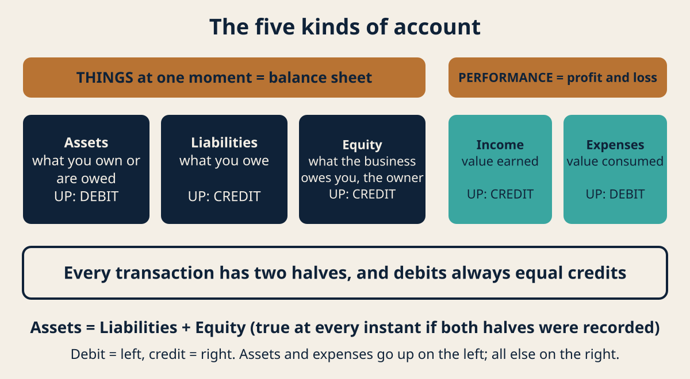
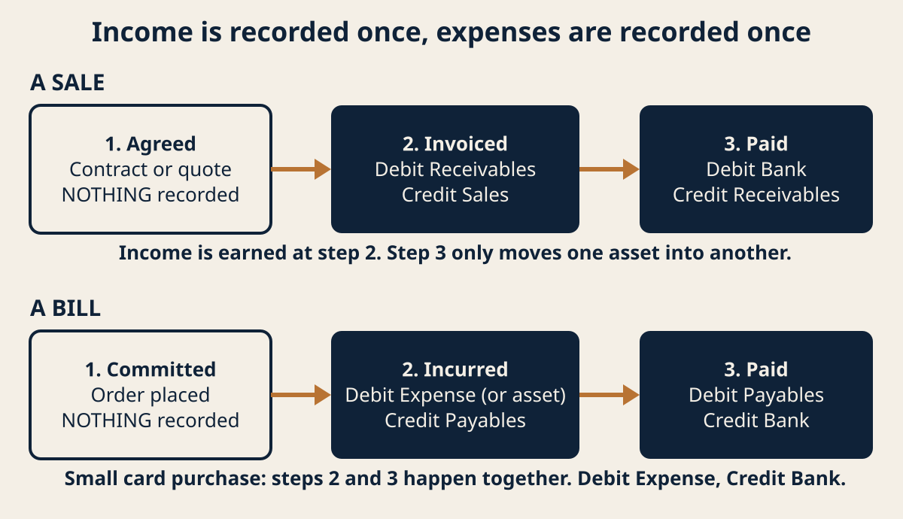
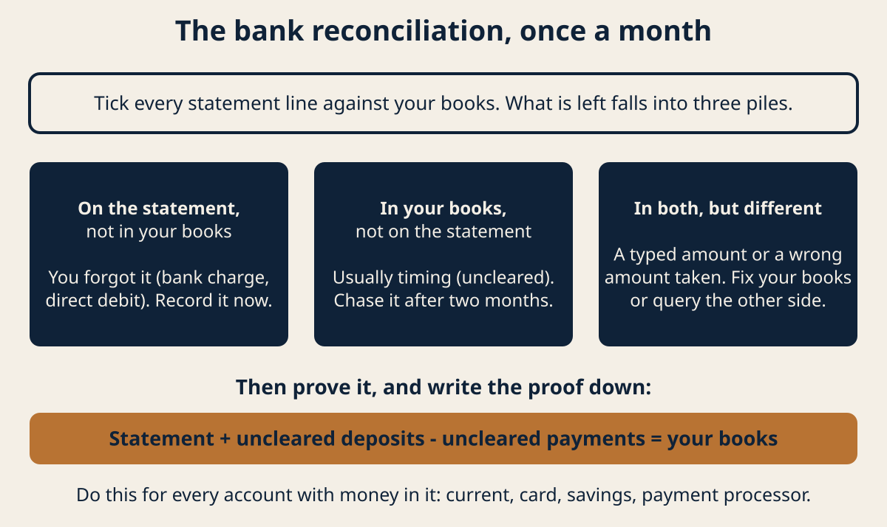
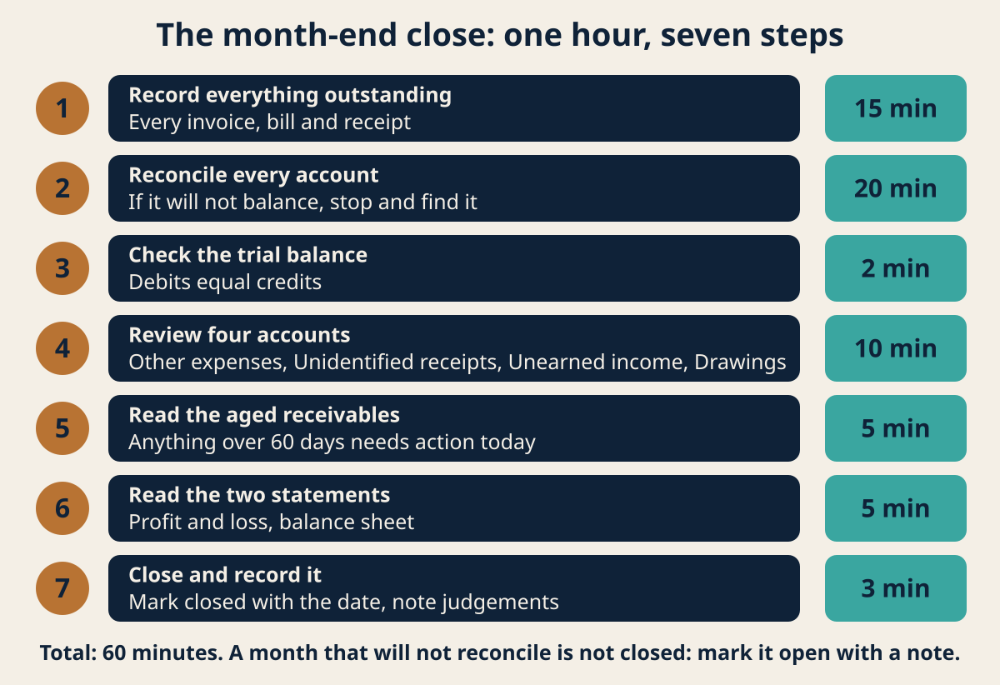
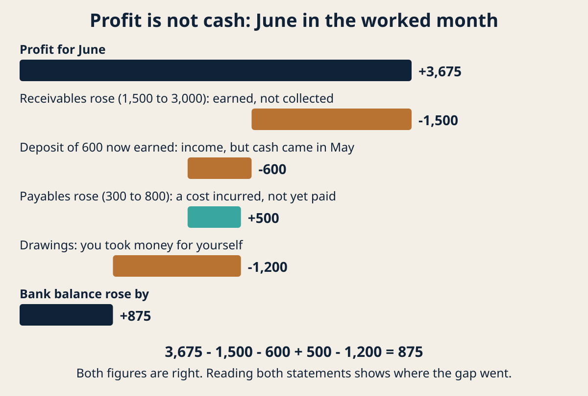

# How to use this book

You have started working for yourself, and at some point somebody said the words "keep your books".
Nobody explained what that meant. You now have a bank account with business money in it, a folder
of receipts, possibly a spreadsheet you started and abandoned, and a quiet worry that you are doing
something wrong.

This book fixes that worry by teaching you one system. Not software. A system — the same system
every accountant in the world uses, which is about four hundred years old, has five moving parts,
and can be learned in an afternoon by anyone who can add.

By the end you will be able to record any transaction your business can produce, prove your records
against your bank statement, close a month in about an hour, and read your own profit and loss and
balance sheet without anyone translating them for you.

## Read it in this order

Chapters 1 to 4 are the foundation and they are not optional. They are short, and everything after
them depends on them. If you skip to the month-end routine because that is the bit you think you
need, the routine will look like arbitrary ritual instead of the obvious consequence of how the
system works.

Chapters 5 to 9 are the daily work: money in, money out, and the two things that confuse everyone —
when a transaction actually counts, and what happens when you take money out of your own business.

Chapters 10 to 13 are the monthly and yearly rhythm. Chapters 14 to 16 are about other people: your
accountant, your records, and the point at which you should hand this over.

Work through it once with your own bank statement open. Reading it without doing it will feel like
it worked and will not stick.

## What you need

Your business bank statements. Whatever record you have now, however bad. Something to record in —
a spreadsheet is entirely adequate for a one-person business and this book does not require you to
buy software. If you already use bookkeeping software, everything here still applies; the software
is doing exactly these steps behind a friendlier screen, and understanding them is how you stop
being at its mercy.

## One promise and one warning

The promise: there is nothing conceptually hard in here. Bookkeeping has a reputation for difficulty
that it does not deserve. It is fiddly, it rewards consistency, and it punishes being left for three
months, but it is not clever.

The warning: this book teaches you to keep records. It does not tell you what tax you owe. Those are
two genuinely different jobs, and the next chapter explains why mixing them up is the most expensive
mistake in this whole subject.

# What this book does not do

Read this chapter. It is short, and it is here for your protection.

**This book does not give tax advice, and it contains no tax rules.** You will not find a single tax
rate, threshold, allowance, deadline or filing instruction in these pages. That is deliberate, and it
is not laziness.

Tax rules are specific to your country, often to your state or region, frequently to your particular
trade, and they change. A book that told you "the threshold is X" would be wrong for most readers on
the day it was published and wrong for all of them within a few years. Worse, it would be wrong in a
way that looked authoritative.

So this book teaches the part that does not change and is the same everywhere: how to record what
happened. Bookkeeping is the discipline of producing a true record of your business's transactions.
Tax is the separate question of what you owe a government based on that record. You need the record
before anyone — you, your accountant, your tax authority — can answer the tax question at all.

Put plainly: this book gets your records right. Your tax rules come from your own tax authority or a
qualified professional in your jurisdiction. If this book saves you money, it will be because your
records were good enough that a professional spent their time on your actual situation instead of
reconstructing your year from a carrier bag.

**What else is out of scope.** Payroll, if you employ people, is a specialist subject with legal
obligations attached and it is not covered here. Nor is sales tax or VAT mechanics, which depend
entirely on your jurisdiction and your registration status. Nor are company accounts if you run an
incorporated company with filing obligations — that book has a different reader. This book assumes
you are a sole trader, a freelancer, an independent contractor or a very small single-owner business
doing your own books.

**Where to get the rules that do apply to you.** Your national tax authority publishes guidance for
small businesses, free, and it is written for your situation specifically. An accountant or licensed
tax professional in your jurisdiction can tell you which rules you fall under. A professional body
in your country can usually refer you to one. None of those are expensive compared with getting it
wrong, and all of them work better when you arrive with the records this book teaches you to keep.

**One honest limitation.** Because this book avoids jurisdiction, it cannot tell you which of two
permitted methods your tax authority requires you to use. Chapter 7 explains cash basis and accrual,
and what each one means; which one you are allowed or required to use is a question for your own
authority. The book flags every such point rather than quietly guessing.

# What bookkeeping actually is

Bookkeeping is the practice of writing down every movement of money and value through your business,
in a way that lets you prove it later and summarise it on demand.

That is the whole job. Not judgement, not forecasting, not advice. A record.

## Why anyone bothers

Three reasons, in the order they will matter to you.

**So you can be paid and can pay.** You need to know who owes you money and how long they have owed
it. Businesses that fail rarely fail because they were unprofitable on paper; they fail because they
ran out of cash while waiting to be paid, and did not see it coming.

**So you can answer questions about the past.** What did I earn last year? Is this month better than
the same month last year? Which of my clients is actually worth the trouble? None of these are
answerable from memory, and all of them are answerable in seconds from decent records.

**So someone else can check it.** A tax authority, a lender, a buyer, an accountant. The test of
bookkeeping is not whether it looks tidy. It is whether a stranger can follow a number in your
summary back to the event that caused it, and find the evidence. That is the standard this book
holds you to, and it has a name: an audit trail.

## The method behind the method

Here is the idea the whole system rests on, and it is worth reading twice.

Every transaction a business can make does two things at once. Nothing happens on its own.

You invoice a client for 500. Your sales have gone up by 500, and the amount owed to you has gone up
by 500. Two things.

The client pays. The amount owed to you goes down by 500, and your bank balance goes up by 500. Two
things again.

You buy a laptop for 900. Your bank balance goes down by 900, and you now own a 900 asset. Two
things.

This is not a convention somebody invented to make life hard. It is a description of reality. Money
never evaporates; it moves from one place to another, or it turns into something. Bookkeeping records
both halves of every movement, which is why it is called double entry, and why it can catch its own
mistakes. If you only ever wrote down one half, nothing would ever check against anything.

## What a transaction needs to be worth recording

Four things, every time. Miss one and you will be guessing about it in eleven months.

**A date.** The date the thing happened, which is often not the date you got round to typing it in.

**An amount.** In the currency you keep your books in. If you were paid in another currency, record
what actually landed in your account and note the original.

**A description that will mean something to a stranger.** "Payment" is useless. "Invoice 014 —
Henderson — website copy" is evidence.

**Which accounts it affects.** Both halves. This is what chapter 4 is about, and it is the only part
that takes any practice.

And one more thing, which is not part of the entry but must exist beside it: the document. The
invoice, the receipt, the contract, the bank statement line. The entry is your claim about what
happened. The document is the proof.

## The one rule that makes all of this easier

Open a separate bank account for the business, and run everything through it.

If you do nothing else in this book, do that. Every hour of bookkeeping misery I have ever seen
traces back to one bank account doing double duty for a life and a business. It is not a legal
technicality, it is not about looking professional, and for a sole trader in most places it is not
even required. It is simply the difference between a month-end that takes an hour and a month-end
that takes a weekend and still ends in doubt.

Chapter 12 deals with untangling mixed spending, because most readers arrive having already mixed
it. But it is a chapter about repairing damage, and you can skip it entirely by opening an account
this week.

## When it goes wrong

**"I have six months of nothing."** Normal, and recoverable. Do not start by trying to fix it. Start
recording from today forward so the hole stops getting bigger, then work backwards one month at a
time from your bank statements, oldest hole last. A year of gaps closed at one month a week is done
in three months, and you will be fast by the end.

**"I do not know what some of these old transactions were."** Record them honestly as unidentified
rather than inventing a plausible description. A record that says "unknown, 240, no document" is
worth more than a confident fiction, because it tells the truth about what you know. Then look for
the document. Your bank may be able to tell you the merchant.

**"My records and my bank do not agree."** That is expected and it is the system working. Chapter 10
is entirely about finding the difference, and it lists the usual causes.

## Checklist

- One bank account used only for the business, with nothing personal in it.
- Every transaction has a date, an amount, a description a stranger could follow, and both halves.
- Every entry has a document stored somewhere you can find it by date.
- Nothing is invented. Unknown is recorded as unknown.
- You can pick any number in any summary and walk it back to the event that caused it.

# The five kinds of account

Everything in bookkeeping goes into one of five buckets. There are no others, and once you can sort
a transaction into the right bucket, the rest is mechanical.

## The five

**Assets.** Things the business owns or is owed. Cash in the bank. Money clients owe you. Equipment,
stock, a vehicle. If it has value and it is yours, it is an asset.

**Liabilities.** Things the business owes. A supplier bill you have not paid. A bank loan. A credit
card balance. Tax you have collected or accrued but not yet handed over. If you will have to part
with value later, it is a liability.

**Equity.** What the business owes you, its owner. The money you put in to start it, plus profits it
has made and not yet paid out to you, minus what you have taken out. This is the bucket that
confuses people most and chapter 8 is devoted to it.

**Income.** Value earned by doing the work. Sales, fees, commission. Note the word earned, which is
not the same as received, and chapter 7 explains why that distinction matters.

**Expenses.** Value consumed in doing the work. Rent, software, materials, the accountant's fee, the
electricity. Consumed is the operative word: something you consume this month is an expense,
something you will use for years is an asset that gets consumed gradually.

## The test that sorts almost everything

Ask two questions in order.

First: is this about a *thing* or about *performance*? Assets, liabilities and equity are things you
hold or owe at a moment in time. Income and expenses are about how you performed over a period.

Second, if it is a thing: do I own it, owe it, or is it mine as the owner? Asset, liability, equity.

If it is performance: did I earn it or consume it? Income, expense.

Two awkward cases, because they come up constantly.

*The laptop.* You spent money, so it feels like an expense. But you still own a laptop afterwards —
you converted cash into a different asset. It becomes an expense gradually as it wears out, which is
depreciation, and chapter 13 touches on it. For a small purchase this distinction may not be worth
the effort, and your jurisdiction may let you treat small items as an outright expense. That is a
tax rule, so ask.

*The deposit a client pays you upfront.* Money arrived, so it feels like income. But you have not
done the work, so you have not earned it. Until you do, you owe that client either the work or their
money back, which makes it a liability. Treating unearned deposits as income is how a business
convinces itself it had a good quarter and then cannot afford the quarter that follows.

## Why the buckets are grouped the way they are

Assets, liabilities and equity are a snapshot: what the business looks like right now. Put them on
one page and you have a balance sheet.

Income and expenses are a film: what happened between two dates. Put them on one page and you have a
profit and loss.

That is genuinely all those two documents are, and chapters 14 and 15 read them properly. If anyone
has ever made them sound mysterious to you, this is the sentence that dissolves it: one is a photo of
what you hold, the other is a video of how you did.

## The equation underneath

Assets = Liabilities + Equity.

What the business holds equals what it owes other people plus what it owes you. This is true at every
instant, for every business, by construction — because every transaction records both halves, and the
two halves keep the equation in balance by construction.

You do not need to do anything with this equation. You need to know it exists, because it is the
reason your books can be checked at all, and the reason chapter 15 can tell you something is wrong.

## When it goes wrong

**"I cannot tell if something is an asset or an expense."** Ask how long it lasts. Consumed within
the year, expense. Useful for years, asset. If it is borderline and small, consistency matters more
than correctness: pick one treatment, apply it to everything similar, and tell your accountant what
you did.

**"Where does the money I took out go?"** Not expenses. It is a reduction of equity, called drawings,
and putting it in expenses overstates your costs and understates your profit. Chapter 8.

**"My client paid for materials I bought for them."** Two separate transactions, not one. You bought
materials (expense or asset), and you were paid (income, or a reduction of what they owe). Recording
it as a single net amount hides both and makes the month impossible to reconcile.

**"I have no idea which bucket a bank fee goes in."** Expense. So are interest, card charges, and the
cost of the bank account itself. Anything the business consumes to operate.

## Checklist

- Every account you use is clearly one of the five, and you could say which if asked.
- Assets and liabilities are things held or owed; income and expenses are performance over a period.
- Unearned deposits sit in liabilities until the work is done.
- Money you take for yourself is drawings against equity, never an expense.
- You know that Assets = Liabilities + Equity, and that it is how errors get caught.

# Double entry, without the jargon

This is the chapter people dread, and it contains exactly one idea: write every transaction down
twice, once in each account it affects, so the two sides balance.

You already met the idea in chapter 2. This chapter gives you the mechanics and the vocabulary, so
that you can read anything else written about bookkeeping without being lost.

## Debit and credit mean nothing. Use them anyway.

The two sides of every entry are called debit and credit. Here is the single most useful thing anyone
can tell you about those words: **they do not mean increase and decrease, and they do not mean good
and bad.** They mean left and right. That is all. Debit is the left column, credit is the right
column, and which one increases an account depends on which bucket the account is in.

If that sounds arbitrary, it is, slightly. The words are a four-hundred-year-old inheritance and
arguing with them is not productive. What matters is the pattern, which never varies:

| Bucket | Increases on the | Decreases on the |
|---|---|---|
| Assets | Debit (left) | Credit (right) |
| Expenses | Debit (left) | Credit (right) |
| Liabilities | Credit (right) | Debit (left) |
| Equity | Credit (right) | Debit (left) |
| Income | Credit (right) | Debit (left) |

Two groups. Assets and expenses behave one way; liabilities, equity and income behave the other.
Learn it as two groups rather than five rows and it takes about a minute.

And the iron rule that makes the system work: **in every single transaction, the debits and the
credits are equal.** If they are not, you have made an error, and you have made it right now, which
is the best possible time to find it.

## Why your bank statement feels backwards

Because it is written from the bank's point of view, not yours.

Your bank balance is an asset to you — the bank owes you that money. But to the bank, your deposit is
a liability, because the bank owes it to you. So when the bank says "credit" it means money went into
your account, while in your own books money arriving in the bank is a debit to your bank account.

This confuses nearly everyone exactly once. Once you know the reason, it stops mattering: your books
are kept from your point of view, and the bank statement is just evidence you compare against.

## Five transactions, worked

Every example uses round numbers and a single currency. Follow each one and check that both sides
match.

**1. You invoice a client 500 for work you have completed.**

You have earned income, and the client now owes you. The amount owed to you by clients is an asset,
usually called accounts receivable or just receivables.

- Debit Receivables 500 (an asset goes up)
- Credit Sales 500 (income goes up)

Note what has *not* happened: no money has moved. You have recorded that you earned something and
that somebody owes you for it.

**2. The client pays the 500 into your bank.**

- Debit Bank 500 (an asset goes up)
- Credit Receivables 500 (a different asset goes down)

Income is not touched, because you already recorded earning it in transaction 1. Recording income
again here would double your sales for the month. This is the single most common error made by people
who have half-learned the system.

**3. You receive a supplier bill for 120, due next month.**

- Debit Expenses 120 (an expense goes up)
- Credit Payables 120 (a liability goes up — you owe them)

**4. You pay that supplier.**

- Debit Payables 120 (the liability goes down)
- Credit Bank 120 (an asset goes down)

Again, the expense is not touched. It was recorded when you incurred it.

**5. You take 300 out of the business for yourself.**

- Debit Drawings 300 (equity goes down)
- Credit Bank 300 (an asset goes down)

No expense anywhere. The business did not consume anything; its owner removed value.

## The thing the two columns buy you

Add up every debit you have ever recorded and every credit you have ever recorded. If the system has
been kept honestly, the totals are identical. A list of every account with its balance, debits in one
column and credits in the other, is called a trial balance, and the fact that it balances is your
first proof that nothing was recorded one-sided.

It is a weak proof — it catches half-entered transactions and arithmetic slips, and it cannot catch a
transaction entered correctly into the wrong account, or one never entered at all. Chapter 10 handles
those. But it is free, it is instant, and it fails loudly.

## If you use software, or a spreadsheet

Software hides all of this. When you click "record payment", it writes both halves for you. This is
genuinely good, and it is also why so many people using bookkeeping software cannot explain their own
numbers: the system works until something unusual happens, and then there is no mental model to fall
back on.

In a spreadsheet, give yourself one row per half-entry: date, description, account, debit, credit,
document reference. Two rows per transaction, minimum. Sum the debit and credit columns at the bottom
and keep them in view. The day they stop matching is the day you want to know.

## When it goes wrong

**"My debits and credits do not match."** You have either typed one number wrong or entered only one
half. Check the most recent entries first; the error is usually the newest thing you did. If
the difference is divisible by nine, suspect two digits swapped (a transposition), which is a
famously common slip.

**"I recorded income twice."** You recorded it at invoice and again at payment. The fix is the entry
in example 2: the payment touches bank and receivables only. Check whether your receivables balance
is suspiciously large, which is the symptom.

**"My receivables never go down."** You are recording payments as fresh income instead of settling
the invoice. Same error, seen from the other side.

**"Debit and credit will not stay in my head."** Stop trying to memorise five rows. Remember that
assets and expenses go up on the left, and that everything else goes up on the right. Then remember
the one you use most: money into the bank is a debit to bank, every time.

## Checklist

- Every transaction has two halves, and they are equal.
- Assets and expenses increase on the debit side; liabilities, equity and income increase on the
  credit side.
- Invoicing records income; being paid does not. Being paid moves one asset into another.
- Incurring a bill records the expense; paying it does not.
- Your debit and credit totals are visible and equal, and you check them before you close a month.

# Your chart of accounts

A chart of accounts is the list of accounts you record into. That is all it is: a list, grouped by
the five buckets, which you write once and then mostly leave alone.

It is easy to make one of two mistakes here. They either use three accounts for everything, which
tells them nothing, or they build ninety accounts in a burst of enthusiasm and then cannot remember
which one they put software subscriptions in, so it ends up in four of them.

## The principle

**Create an account when you would want to see that number on its own, and not before.**

That is the entire design rule. If you would never ask "how much did I spend on that?", it does not
need its own account. If you would ask it every quarter, it does.

## A starting chart for a one-person business

This is a complete, working chart. Start here, and add only when the principle above says to.

**Assets**
- Bank — current account
- Bank — savings or tax reserve, if you keep one
- Receivables (money clients owe you)
- Equipment (things you own that last years)

**Liabilities**
- Payables (bills you have received and not paid)
- Credit card
- Unearned income (deposits taken for work not yet done)
- Tax payable (amounts you have set aside or accrued but not yet paid over)

**Equity**
- Owner's capital (what you put in)
- Drawings (what you take out)
- Retained earnings (accumulated profit left in the business)

**Income**
- Sales — services
- Sales — products, if you sell any
- Other income (interest, refunds of expenses, anything not from trading)

**Expenses**
- Subcontractors and freelancers
- Materials and direct costs
- Software and subscriptions
- Professional fees (accountant, legal)
- Insurance
- Premises and utilities
- Travel
- Marketing and advertising
- Bank charges and interest
- Equipment under your capitalisation limit
- Training and professional development
- Other expenses

Around thirty accounts. That is the right order of magnitude for a one-person business, and it will
serve you for years.

## Why those particular expense lines

Each of them answers a question you will actually ask.

Subcontractors is separate because it is usually the largest and most variable line, and because in
many jurisdictions payments to other people carry reporting obligations of their own — which is a
rule to ask about, not one this book states.

Materials and direct costs is separate from everything else because it moves with your revenue. The
difference between costs that scale with work and costs you pay regardless is the most useful
distinction in your whole chart, and chapter 14 uses it.

Professional fees is separate because it is the one expense that reliably pays for itself and you
should be able to see whether you are under-spending on it.

Other expenses exists so that you never have to invent an account at eleven at night. If it grows
past a few percent of your spending, look at what is in it and promote the recurring items.

## Numbering, and whether you need it

Traditional charts number accounts in bands: assets in the 1000s, liabilities 2000s, equity 3000s,
income 4000s, expenses 5000s and up. The number tells you the bucket at a glance and keeps reports
in a sensible order.

For thirty accounts in a spreadsheet, numbering is optional and mildly useful. If you ever move to
software or hand the books to an accountant, it helps. Use it if you like order; skip it without
guilt if you do not.

## The rule that keeps a chart useful

**Never change what an account means.** Rename it, merge it, retire it — but do not quietly start
putting a different kind of thing in it, because that destroys your ability to compare this year
with last year. If a category genuinely changes, open a new account and leave the old one with its
history intact.

And its companion: **put a transaction in the same place every time.** A consistent chart with
imperfect categories beats a perfect chart applied inconsistently, every time, because at least the
first one can be corrected in bulk.

## When it goes wrong

**"I do not know where to put this."** Put it in Other expenses, note what it was, and move on. Do
not stop the month for one transaction. Review Other at month end and promote anything that recurs.

**"I have the same thing in two accounts."** Pick the one you want to keep, move everything into it,
retire the other. Do this at a month boundary so your comparisons stay clean, and write down that
you did it.

**"My accountant wants different categories."** Ask them for their list before you build yours, if
you have one. Five minutes of their time now saves a reorganisation later, and they will usually
send it free because it makes their own job easier.

**"My chart has grown to seventy accounts."** Most of them have nearly nothing in them. Merge
anything that has not seen a transaction in a year into its nearest neighbour.

## Checklist

- Your chart is written down in one place and grouped by the five buckets.
- Every account exists because you would want to see that number alone.
- Costs that scale with revenue are separate from costs you pay regardless.
- There is an Other expenses account, and it is reviewed monthly rather than ignored.
- No account has ever quietly changed meaning.

# Recording money coming in

This chapter covers the full life of a sale: agreeing it, invoicing it, being paid, and the three
situations where it does not go cleanly.

## The sequence

For most service businesses, a sale passes through three states.

**Agreed.** You have a contract or an accepted quote. Nothing is recorded in your books yet. A
promise to buy is not a transaction. Keep the document; it is evidence for later.

**Invoiced.** You have done the work, or a defined part of it, and sent a bill. This is the moment
income is earned and recorded:

- Debit Receivables
- Credit Sales

**Paid.** Money arrives:

- Debit Bank
- Credit Receivables

Income is recorded once, at invoice. The payment is purely a movement between two assets. If you
remember one thing from this book, let it be that.

## What an invoice has to contain

Your jurisdiction may require specific details — a tax registration number, particular wording, a
sequential number — and that is a rule to look up rather than one this book can give you. But every
invoice, everywhere, needs these to be useful to your own books:

- A unique number, in sequence, with no gaps. Gaps look like deleted sales to anyone checking.
- The date issued, and the date payment is due. "Due on receipt" is a date; "net 30" is a calculation
  you should do for the reader.
- Who it is to, in enough detail to identify the legal entity, not just a person's first name.
- What it is for, specifically enough that the client's finance department can approve it without
  asking you.
- The amount, and any tax shown separately if that applies to you.
- How to pay, including your bank details if you take transfers.

The unique sequential number is the one people skip and the one that matters most to your records.
It is the handle you use to connect an entry to a document and a payment to an invoice.

## Being paid is not one thing

Four common variations, each recorded differently.

**Paid in full, on time.** The clean case above.

**Paid in part.** Debit Bank for what arrived, credit Receivables for the same. The invoice remains
open for the balance. Do not adjust the sale; the client still owes the rest.

**Paid late.** Nothing special in the books. The entry is identical; only the dates differ. What
changes is your management of it, and the aged receivables list in chapter 13 is how you see it.

**Paid short, deliberately — a discount or a write-off.** Debit Bank for what arrived, debit a
separate expense or income-reduction account for the shortfall, credit Receivables for the full
original amount. Keep the shortfall visible in its own account. Discounts hidden inside sales mean
you never learn what you are giving away.

## Deposits and money for work not yet done

This is the case that most often misleads a small business, so it gets its own section.

A client pays you 1,000 in advance for work starting next month.

- Debit Bank 1,000
- Credit Unearned income 1,000 — a liability

You have the cash. You have earned nothing. You owe the client either the work or the money.

When you complete the work and invoice it:

- Debit Unearned income 1,000
- Credit Sales 1,000

Now it is income, in the period you earned it.

Why this matters beyond bookkeeping neatness: a business that counts deposits as income sees a
profitable month, draws money out on the strength of it, and then has to deliver the work in a month
with no new cash coming in. The accounting error and the cash crisis are the same mistake.

## Refunds, credit notes and cancelled work

A refund is not a negative expense and it is not deleted. Record it as a reduction of income, with
its own document — a credit note with its own number, referencing the invoice it cancels.

- Debit Sales returns or Sales (reducing income)
- Credit Bank, if you paid money back, or Receivables if you cancelled an unpaid invoice

Never delete the original invoice. Deleting a sale leaves a gap in your numbering and destroys the
audit trail. The correct record of a cancelled sale is a sale and a cancellation, both visible.

## Money that is not income

Some money arrives that is not a sale, and misfiling it inflates your revenue.

- A client reimbursing an expense you paid on their behalf: reduce the expense, or record it as
  other income — but be consistent, and be aware the two treatments change your reported revenue.
- A loan arriving: a liability, not income.
- Your own money being put in: equity, not income.
- A refund from a supplier: a reduction of the original expense.
- Bank interest: other income, kept separate from trading sales.

Trading revenue is what you earned by doing the work. Keeping that line clean is what lets you tell
whether the business is working.

## When it goes wrong

**"My sales number looks too high."** Three suspects, in order of likelihood: payments recorded as
fresh income on top of the invoice; deposits treated as income; non-income receipts such as loans or
your own capital sitting in sales.

**"A client paid two invoices in one transfer."** Record one bank receipt and split the credit across
both invoices. Your spreadsheet needs three rows, not two. Do not leave it as a lump against one
invoice or the other will look unpaid forever.

**"I was paid in a different currency."** Record what actually arrived in your account, in your own
currency, and keep a note of the original amount and the rate. Any difference between the invoiced
value and the received value is a foreign exchange gain or loss and belongs in its own account.

**"A payment arrived and I cannot tell who it is from."** Do not guess. Record it to a holding
account — a liability called Unidentified receipts — and chase the identification. Guessing creates
two errors: one client marked paid who has not, and one who has but is still being chased.

**"The client paid the invoice but also kept a fee."** Common with platforms and payment processors.
Record the gross invoice, the fee as an expense, and the net to bank. Three lines. Recording only the
net understates both your revenue and your costs.

## Checklist

- Income is recorded when invoiced, never again when paid.
- Invoice numbers are sequential with no gaps, and nothing is ever deleted.
- Deposits for undelivered work sit in a liability until the work is done.
- Discounts and write-offs are visible in their own account, not buried in sales.
- Loans, your own capital and expense reimbursements are kept out of trading sales.
- Unidentified money goes to a holding account, not to a guess.

# Recording money going out

The mirror image of the last chapter, with one extra complication: you have to decide what something
*is* before you can record it.

## The sequence

**Committed.** You have ordered something. Nothing is recorded. An order is not a transaction.

**Incurred.** The supplier has delivered, and you have a bill. The expense belongs to this moment:

- Debit the relevant expense (or asset)
- Credit Payables

**Paid.** Money leaves:

- Debit Payables
- Credit Bank

The expense is recorded once, when incurred. The payment settles the liability. Exactly the same
shape as money in, reflected.

For small immediate purchases — you tap a card for materials — incurred and paid are the same
instant, and you can record it in one entry:

- Debit the expense
- Credit Bank

That is not a different rule. It is the two steps collapsed because no time passed between them.

## Expense or asset: the decision you make first

Before recording, ask: will the business still be getting value from this in a year?

**No** — it is an expense. Materials, subscriptions, rent, fuel, the accountant.

**Yes** — it is an asset, and it becomes an expense gradually as it is used up. A laptop, a vehicle,
a machine.

Every business sets a threshold below which it treats long-lived items as an outright expense,
because tracking a 40 stapler over five years is absurd. That threshold is a policy, and in many
places tax rules influence or set it. **Ask your own authority or accountant what yours should be**,
write it down, and apply it consistently. This book cannot tell you the number.

## Spreading an asset's cost: depreciation, briefly

When you hold an asset that wears out, you move a slice of its cost into expenses each period. The
simplest method spreads the cost evenly over the years you expect to use it.

- Debit Depreciation expense
- Credit Accumulated depreciation (which sits against the asset, reducing it)

A 2,000 laptop over four years is 500 a year, or about 42 a month.

Two honest warnings. The number of years, the method you are permitted to use, and whether your tax
authority accepts your figure at all are jurisdiction rules. And for a very small business, this is
usually the one entry your accountant prefers to make at year end. Record the asset correctly; leave
the depreciation to them unless you know your rules.

## Receipts, and what to keep

Keep a document for everything. The entry is your claim; the receipt is the proof. A bank statement
line showing 90 to a supermarket does not establish what it was for.

Practically: photograph receipts the day you get them and file them by month. A folder per month,
named by year and month, is enough. Thermal till receipts fade to blank within a year or two, so a
photograph is not a convenience, it is preservation.

How long you must keep records is set by your jurisdiction and is usually several years. Find out
yours and keep them at least that long. Do not delete anything on a guess.

## The expenses people get wrong

**Things used for business and personal life both.** A phone, a car, a room in your home. Only the
business share is a business expense, the method for working out the share is a jurisdiction rule,
and the records you need to support it are usually specific. This is the single most common area of
dispute with tax authorities. Record the full cost, record your business proportion and the basis for
it, and ask a professional whether your method is acceptable where you live.

**Entertainment and meals.** Treated very differently in different places, and often not deductible
at all. Record them in their own account so the question can be answered later without digging.

**Paying yourself.** Not an expense. Drawings, against equity. Chapter 8.

**Buying stock you have not sold.** An asset until it is sold, then it becomes a cost of sale. If you
expense stock when you buy it, a month where you stocked up looks like a loss and the month you sell
looks like pure profit.

**Fines and penalties.** Record them in their own account. Many jurisdictions disallow them, and your
accountant will need to find them.

**A single payment covering a year ahead.** Insurance paid annually in advance is partly a prepaid
asset at the moment you pay it, and becomes an expense month by month. For a small business, the
usual pragmatic treatment is to expense it when paid and let the accountant adjust at year end if it
matters. Be consistent and say what you did.

## When it goes wrong

**"My expenses look too low."** Check for costs paid from a personal account and never recorded, the
commonest gap of all. Also check whether you expensed something you should have, and whether a month
of card transactions was skipped.

**"I paid a supplier before the bill arrived."** Debit Payables, credit Bank. The Payables account
goes temporarily negative, meaning the supplier owes you, which is true. It clears when the bill
arrives.

**"One payment covered several bills."** One bank line, several credits to Payables. Split it.

**"A subscription renewed and I did not notice."** Record it from the bank statement as normal, then
decide whether you wanted it. Reconciliation is the control that finds these, which is the next
chapter and a decent argument for doing it monthly.

**"I bought something, returned it, and got a refund."** Reverse the original entry rather than
recording the refund as income. Debit Bank, credit the same expense you originally charged.

## Checklist

- Expenses are recorded when incurred, not when paid, unless the two are the same instant.
- Every purchase has been judged: consumed within a year, or held for longer.
- You have a written capitalisation threshold, obtained from someone who knows your rules.
- Every entry has a document, photographed and filed by month.
- Mixed-use costs record the full amount, the business share, and the basis for that share.
- Stock is an asset until it is sold.
- Money taken for yourself is nowhere near the expense accounts.

# Cash basis and accrual, and which one you are using

Two chapters ago you recorded income when you invoiced. That is a choice, and this chapter is about
what the choice means, because it changes every number you produce.

## The two methods

**Cash basis.** Record income when money arrives and expenses when money leaves. Nothing else is
recorded. No receivables, no payables.

**Accrual basis.** Record income when it is earned and expenses when they are incurred, regardless of
when money moves. This is what chapters 5 and 6 taught.

The same year, same business, two very different pictures.

## The same December, both ways

You invoice 10,000 on 20 December. The client pays on 15 January. You receive a 2,000 supplier bill
on 28 December and pay it on 10 January.

*Cash basis:* December shows nothing at all. January shows 10,000 income and 2,000 expense.

*Accrual basis:* December shows 10,000 income and 2,000 expense, and a profit of 8,000 earned in the
year it was worked for. January shows no profit, just money moving.

Neither is a lie. They answer different questions. Cash basis answers "what moved?". Accrual answers
"what did I actually do?".

## Which is better, honestly

**Accrual tells you the truth about performance.** It matches income to the period you earned it and
costs to the period you consumed them, so a month's profit reflects that month's work. For any
business that invoices and waits, it is the only method that gives a usable monthly figure.

**Cash basis tells you the truth about survival, and it is simpler.** It is far less work, it is
impossible to be profitable on paper and broke in reality, and for a business paid immediately — a
shop, many consumer services — the two methods barely differ anyway.

The honest answer for most one-person service businesses: keep accrual records, and watch cash
separately. You get real performance figures and you still see the bank balance, because the bank
balance is right there in your books as an asset.

## The part this book cannot answer

**Which method you are permitted or required to use for tax is a rule of your jurisdiction.** Many
places allow small businesses to use cash basis and offer it as a simplification, often with
eligibility limits. Some require accrual above a size threshold. Some let you choose once and then
hold you to it.

So: ask your tax authority or a professional where you live, and write the answer down in your
records. And know that there is no contradiction in keeping accrual books for your own management
while reporting on whichever basis your authority requires — the second is derived from the first,
and that is a normal thing for an accountant to do.

## A practical hybrid that works

Many small businesses do this and it is sensible:

- Record sales on accrual, because you need to know who owes you money. You cannot chase a debt you
  have not recorded.
- Record small routine expenses as they are paid, because the difference is immaterial and the saving
  in effort is real.
- Record large or straddling expenses on accrual, so a big bill lands in the period it belongs to.

That is not sloppiness, provided you are consistent and you tell your accountant what your policy is.
What is sloppiness is switching method silently, which makes two periods incomparable and is very
hard to detect later.

## When it goes wrong

**"My profit is good but I have no money."** Classic accrual picture, and it means your receivables
are growing — you are earning and not collecting. Chapter 13's aged receivables list is the
diagnostic. This is the single most common way a profitable small business gets into trouble.

**"I have money but my profit is poor."** Often deposits for work not yet done, which are cash in
hand and a liability. Check your unearned income balance before concluding the business is failing.

**"My December and January look mad."** Expected if you switched method, or if you recorded an
invoice in one basis and its payment in another. Pick one treatment for sales and hold it.

**"I do not know which basis I have been using."** Look for a receivables balance. If you have one
and it moves, you are on accrual for sales. If every entry touches the bank, you are on cash.

## Checklist

- You can say which basis you use for sales, and which for expenses, and you wrote it down.
- The basis has not changed mid-year without a note explaining it.
- You have asked a qualified source which basis your jurisdiction requires of you.
- Sales are on accrual, so you know who owes you money at any moment.
- You check unearned income before celebrating a cash-rich month.

# The bank reconciliation

This is the most valuable hour in bookkeeping. It is the step that turns your records from a claim
into something verified, and it is the step most often skipped.

## What it is

You compare your own bank account record, line by line, against the statement the bank sends. Every
line should appear in both. Where they differ, you find out why.

That is it. The power is in what it catches: transactions you forgot, duplicates, typed amounts,
charges you did not know about, and — occasionally — money leaving your account that you did not
authorise.

## Doing it

Once a month, as soon as the statement is available.

**1. Start from a known-good point.** The closing balance of the last reconciliation you completed.
The first time, use your opening balance when you started these records.

**2. Tick off matching lines.** Go down the statement. For each line, find it in your books and mark
both. A column in your spreadsheet headed "reconciled" with the statement date in it works perfectly.

**3. Deal with what is left.** When you reach the end you have three piles.

*On the statement, not in your books.* Something happened that you did not record. Bank charges,
interest, a direct debit, a card payment you forgot. Record it now — it is real, the bank is the
evidence.

*In your books, not on the statement.* Usually timing: a cheque not yet cleared, a payment made on
the last day. Legitimately outstanding, and it should appear on next month's statement. If it is
still unmatched two months later, investigate — it may never have happened.

*In both, but different.* A typed amount, or a payment that was taken for a different sum than
agreed. Correct your books if you typed it wrong. Query it with the bank or supplier if they took
the wrong amount.

**4. Prove it.** Your book balance, adjusted for the genuinely outstanding items, must equal the
statement's closing balance. Write that calculation down and keep it. It is your evidence that the
month was checked.

## The arithmetic that proves it

    Balance per bank statement
    plus  deposits you have recorded that have not yet cleared
    minus payments you have recorded that have not yet cleared
    =     balance per your books

When those two sides agree, the month is reconciled. When they do not, the difference is the amount
you are looking for, and knowing the exact figure is most of the work — see the troubleshooting below.

## Do the same for every account

Not just the current account. The credit card, the savings account, the payment processor that holds
your money for a few days, any account with money in it. Each one gets the same treatment against
its own statement.

Payment processors are the ones people neglect, and they are where money quietly goes missing in
fees nobody looked at. If a platform takes its cut before paying you, your reconciliation is the only
place you will ever notice how much.

## Why monthly, not yearly

Three reasons, all practical.

An error found within a month is a five-minute fix with the context still in your head. The same
error found in March of the following year is an afternoon of archaeology.

Unauthorised transactions have time limits for disputes in most places. Finding a fraudulent charge
eleven months late may mean you simply absorb it.

And a reconciled month is a month you never have to think about again. The real cost of unreconciled
books is not the error rate; it is that nothing is ever finished.

## When it goes wrong

**"The difference is divisible by nine."** Almost certainly two digits swapped: 540 typed as 450, or
1,278 as 1,728. Scan for amounts with the right digits in the wrong order.

**"The difference is exactly twice a transaction I can see."** You recorded it on the wrong side, so
it is out by double. Or you recorded it twice.

**"The difference is exactly a round number I recognise."** Look for a transaction of exactly that
amount missing entirely. The brain tends to skip the familiar.

**"I cannot find it at all."** Narrow by halves. Reconcile only the first half of the month; if that
balances, the error is in the second half. Repeat. Four rounds will localise almost any error, and it
beats re-reading the whole month a fifth time.

**"There are old uncleared items from months ago."** A payment that never cleared may never have
happened — a cheque lost, a transfer rejected. After two months, chase it. Do not carry phantom
outstanding items forever; they hide real differences behind fake ones.

**"The bank made a mistake."** It happens, and it is rare. Report it, record what you believe is
correct, and note the dispute in your records so next month's reconciliation does not fail
mysteriously.

## Checklist

- Every account with money in it is reconciled every month against its own statement.
- The proving calculation is written down and kept with the month.
- Nothing on the statement is missing from your books.
- Items outstanding more than two months have been chased rather than carried.
- Processor fees have been seen, recorded, and are visible as an expense.

# Owner's money: drawings and contributions

This chapter exists because getting this wrong is the single most common bookkeeping error made by
people working for themselves, and it quietly corrupts every profit figure you produce.

## The rule

**Money you take out of your business for yourself is not an expense. Money you put in is not
income.**

Both are movements of equity — the account that represents your stake in the business.

## Why it feels wrong, and why the rule is right

It feels like an expense because the money left and it is gone. But look at what the business
consumed: nothing. No service was bought, no material used. The owner removed value that already
belonged to them.

Think of it from the business's point of view. The business owes you — its owner — whatever you put
in plus whatever it has earned and not yet handed over. When you take money, you are reducing a debt
the business owes you, not buying anything.

The practical consequence: if you record 2,000 of drawings as an expense, your profit is understated
by 2,000. You then make decisions — about pricing, about whether the business works, possibly about
tax — on a profit figure that is wrong by exactly the amount you paid yourself. Few errors are more
consequential.

## The entries

**You put 5,000 of your own money in to start.**

- Debit Bank 5,000
- Credit Owner's capital 5,000

**You take 800 for yourself.**

- Debit Drawings 800
- Credit Bank 800

**You pay a personal bill from the business account.** Identical to taking the money — because that
is what it is:

- Debit Drawings
- Credit Bank

**You pay a business cost from your personal account.** The reverse. The business now owes you more:

- Debit the relevant expense
- Credit Owner's capital (or a Director's/Owner's loan account)

That last one matters enormously and gets missed constantly. Every business cost you paid personally
and never recorded is a cost your business never saw, which overstates your profit and may cost you
money. Go looking for these.

## Capital, drawings and retained earnings

Three equity accounts, doing three jobs.

**Owner's capital** is what you have put in.

**Drawings** is what you have taken out, accumulating through the year.

**Retained earnings** is profit the business has made in past periods and not paid out.

At year end, the year's profit is added to retained earnings and the drawings account is usually
cleared against equity, starting the new year at zero so the next year's drawings are visible on
their own. That closing entry is typically your accountant's job, and you do not need to perform it
to keep good records — you need to keep drawings and capital separate and accurate so that it can be
performed correctly.

## A note on business structure

This chapter describes a sole trader or single-owner unincorporated business, where the owner and the
business are not legally separate persons and taking money is simply drawings.

**If you run an incorporated company, this is different and it matters.** A company is a separate
legal person, money taken from it is salary, dividend, loan or expense reimbursement, each with its
own rules and its own tax treatment, and getting it wrong can have real consequences. The mechanics
in this chapter do not transfer. Take advice specific to your structure and your jurisdiction.

## When it goes wrong

**"My profit is much lower than it feels."** Look in your expense accounts for your own pay. It is
the first place to check and it is there more often than not.

**"I have a 'wages' expense and I am the only person in the business."** Unless you are incorporated
and genuinely on a payroll, that is drawings in the wrong place.

**"I cannot work out what I have taken this year."** If drawings have been scattered through expense
accounts, you will have to go through the bank statement and identify every transfer to yourself.
Tedious once, then never again if you keep a dedicated account.

**"I paid for business things on my personal card for months."** Reconstruct from the card statements,
record each as the relevant expense with a credit to Owner's capital, and keep the statements as
evidence. This usually *increases* your recorded costs, which is in your favour.

**"I moved money to my tax savings account."** That is a movement between two of the business's own
accounts — debit one bank account, credit the other. Not drawings, because it is still the business's
money. Only when it leaves for your own use does it become drawings.

## Checklist

- Drawings has its own equity account and nothing else lives in it.
- No expense account contains payments to yourself.
- Money you introduced is recorded as capital, not income.
- Business costs paid from personal funds have been found and recorded.
- Transfers between the business's own accounts are not treated as drawings.
- If you are incorporated, you have taken advice rather than following this chapter.

# Mixed personal and business spending

Chapter 2 told you to open a separate account. This chapter is for readers who did not, or who did it
late. It is a repair manual.

## The honest assessment first

If your personal and business spending share one account, you have three options, and only one of
them is good.

**Separate now, repair the past.** Open the business account this week, move all business activity to
it, and reconstruct the mixed period once. Finite work, permanent fix.

**Keep going as you are.** Every month costs you an hour of sorting, every month carries the risk of
misclassification, and if your records are ever examined the burden of proving which transactions
were business will be entirely yours. This compounds.

**Stop recording and hope.** Not an option, and the reason this book exists.

## Reconstructing a mixed period

Work one month at a time, from the statement.

**1. Print or export the statement** and go line by line. Every line gets exactly one label:
business, personal, or unknown.

**2. Record the business lines** as normal entries against the relevant accounts.

**3. Record nothing for the personal lines,** if it is a personal account. If it is the business
account, each personal line is drawings — debit Drawings, credit Bank.

**4. Chase the unknowns.** Your bank can often identify a merchant. Card statements, email receipts
and calendar entries help. For what remains genuinely unidentifiable, do not invent a category.
Record it honestly — in a personal account, as nothing; in a business account, as drawings, which is
the conservative treatment because it claims no deduction you cannot support.

**5. Keep your working.** The annotated statement is the evidence for every judgement you made. Save
it with the month.

## Genuinely mixed items

Some costs really are both, and that is different from a muddled account.

A phone used for work and life. A car. A room in your home. Internet. For each, only the business
proportion is a business cost.

**The method for determining the proportion, the records required to support it, and whether it is
accepted at all are jurisdiction rules.** This is the most frequently challenged area in small
business tax, anywhere. What this book can tell you is what good practice looks like regardless:

- Record the full cost and your business share separately, never just the net figure.
- Write down the basis — "38% of mileage was business, log kept" or "one room of five used as an
  office". A number without a basis is indefensible.
- Keep the contemporaneous evidence that supports the basis. A mileage log written as you go is
  evidence; a figure reconstructed from memory a year later is an estimate.
- Review the proportion annually. Circumstances change, and a stale percentage carried for five
  years looks like what it is.

Then ask a professional in your jurisdiction whether your method is acceptable. Do that once, write
down the answer, and apply it consistently.

## The separation that is not optional

Whatever your structure, keep these three things apart in your records: the business's money, your
money, and the money the business owes to other people. The account structure in chapter 4 does that
for you, and the moment they blur, nothing downstream can be trusted.

## When it goes wrong

**"I have years of mixed records."** Do not attempt all of it at once. Secure the present first —
separate accounts, clean records from today. Then repair backwards, most recent year first, since
that is the one most likely to be asked about.

**"I cannot tell business from personal for a whole category."** Be conservative: treat it as personal
or as drawings. Claiming a cost you cannot support is a worse position than failing to claim one you
could have.

**"My accountant says my records are unusable."** Ask them specifically which period and which
accounts, then fix that scope rather than everything. And ask what format they want, because
rebuilding to the wrong shape twice is a genuine risk here.

**"I used the business card for something personal by accident."** Drawings, recorded the day it
happened, with a note. It is not a crime and it does not need hiding; an unexplained personal
purchase sitting in office supplies is a far worse record than an honest drawing.

## Checklist

- Business and personal money are in different accounts from today onward.
- The mixed period has been reconstructed line by line, with the annotated statement kept.
- Nothing has been invented; unidentifiable items are recorded conservatively.
- Mixed-use items record full cost, business share, and the written basis for the share.
- The basis is supported by contemporaneous evidence and reviewed annually.
- A professional has confirmed your apportionment method is acceptable where you are.

# The month-end close, in one hour

Everything so far has been technique. This chapter is the routine that uses it, and it is the habit
that separates books that work from books that exist.

## Why close a month at all

Closing means declaring a period finished, checked and not to be revisited. Without it, your records
are a permanently provisional pile and you never know which numbers you can rely on.

A closed month gives you three things: a profit figure you can trust, a date before which you need
never look again, and an early warning system. Problems found at month end are small.

## The routine

Book an hour, the same slot every month, within the first week after the month ends. Treat it as an
appointment. In order:

**1. Record everything outstanding (15 minutes).** Every invoice issued, every bill received, every
receipt not yet entered. Clear the pile. Nothing from the month may be left unentered.

**2. Reconcile every account (20 minutes).** Chapter 7, for every account with money in it. If
something does not balance, this is where you stop and find it. A month that will not reconcile is
not closed.

**3. Check the trial balance (2 minutes).** Total debits equal total credits. Instant, and it fails
loudly.

**4. Review four accounts specifically (10 minutes).** These four hide most errors:

- *Other expenses* — anything recurring gets promoted to its own account.
- *Unidentified receipts* — should be empty. If not, chase.
- *Unearned income* — does the balance match work genuinely not yet delivered?
- *Drawings* — does it match what you actually took? Does anything personal lurk elsewhere?

**5. Look at the aged receivables (5 minutes).** List every unpaid invoice by how old it is. Thirty
days, sixty, ninety. Anything over sixty days needs an action today, and this list is the reason
profitable businesses do not quietly run out of money.

**6. Read the two statements (5 minutes).** Profit and loss for the month, balance sheet as at
month end. Chapters 11 and 12 teach you what to look for. Compare against last month and the same
month last year.

**7. Close and record it (3 minutes).** Mark the month closed with the date you did it. File the
month's documents. Note anything you had to judge, so that in a year you can remember why.

## What to do with what you see

The review is not decoration. Three questions each month:

**Is anything moving in a direction I did not expect?** An expense line up by half, revenue down two
months running, receivables growing faster than sales.

**Is anyone taking too long to pay?** Act on the aged list before it becomes a bad debt. The best
time to chase an invoice is the week it falls due.

**Can I afford what I am about to take out?** Profit is not cash and cash is not all yours. Some of
that balance is money you owe — to suppliers, and potentially to a tax authority. Knowing the
difference is what the balance sheet is for.

## Quarterly and annually

**Each quarter,** add: a review of your chart of accounts for merges; a check on any set-aside for
tax, against whatever your obligation turns out to be; a look at pricing against your actual costs
per job.

**Each year,** add: depreciation, if you handle it; writing off genuinely bad debts; a stock count if
you hold stock; the handover pack in chapter 15. And re-examine your mixed-use proportions.

## When it goes wrong

**"I have missed three months."** Do them oldest first, one sitting each, and do not try to do all
three in one evening. You will make errors in the third and not notice. Then put the recurring
appointment in the calendar, because missing three months is a scheduling failure, not a bookkeeping
one.

**"It takes four hours, not one."** Usually transaction volume that was not entered as it
happened. Enter weekly rather than monthly and the close shrinks to the reconciliation. Also check
whether you are categorising from memory instead of from documents, which is slow and unreliable.

**"It will not reconcile and I am out of time."** Do not close it. Mark the month open with a note of
the difference and come back. A month closed over a known discrepancy is worse than an open one,
because it looks finished.

**"I close it but never look at the numbers."** Then you are doing the work and skipping the payoff.
Steps 5 and 6 are the only ones that change a decision. If you cut anything, cut nothing — but if you
must, never cut those.

## Checklist

- A recurring appointment exists for the close, in the first week after month end.
- Nothing from the month is left unentered.
- Every account is reconciled, and the proof is written down.
- Other expenses, Unidentified receipts, Unearned income and Drawings are reviewed every month.
- The aged receivables list is produced, read, and acted on.
- The month is marked closed with a date, and judgements are noted.

# Reading your profit and loss

Your profit and loss statement — also called an income statement — covers a period and answers one
question: did the work pay?

## The shape

    Revenue                     the value you earned in the period
    less  Direct costs          what it cost to deliver that specific work
    =     Gross profit          what the work itself earns before running the business
    less  Operating expenses    what it costs to exist regardless of volume
    =     Operating profit      what the business made
    plus/less  Other income and costs    interest, one-offs
    =     Profit before tax

The split between direct costs and operating expenses is the one that teaches you something, which
is why chapter 4 insisted on separating them.

## Gross profit is the number to watch

Gross profit is revenue minus the costs that only exist because you did that work: subcontractors,
materials, per-project licences, delivery.

Expressed as a percentage of revenue, it tells you whether your pricing works. And unlike your
overall profit, it does not move around because you bought a laptop this month.

If your gross margin is falling while revenue rises, you are buying work — taking on more at worse
terms. That is a trap a business can stay in for years while feeling busy, and the margin line is the
only place it shows up early.

## Reading it properly: three comparisons

A single month's figures mean very little. Read it three ways.

**Against last month.** Catches sudden change. Be careful of noise: one large invoice can distort a
month entirely.

**Against the same month last year.** Catches seasonality. Most businesses have a rhythm, and
December against November tells you less than December against December.

**Against the year to date.** Smooths the noise and shows the trend that actually matters.

## What to look for, specifically

**Revenue concentration.** Not visible on the statement itself, but ask it monthly: what share came
from one client? Above roughly a third from a single client, their decisions control your business.

**Expense lines that have crept.** Subscriptions are the usual culprits. Compare each line against
the same period last year, not against your expectation, because expectations drift with the
spending.

**The ratio of direct costs to revenue**, which is the margin question above.

**Anything in Other expenses.** It should be small and boring. If it is neither, there is a category
you have not created yet.

**A loss, and why.** A loss because you invested in something is a decision. A loss because pricing
does not cover costs is a problem. The statement does not distinguish them; you have to.

## What it does not tell you

This is the important part.

**It does not tell you how much cash you have.** A profitable month can coincide with an empty
account, because profit is earned and cash is collected. That is the balance sheet's job.

**It does not tell you what you owe.** Tax, suppliers, deposits for undelivered work. All balance
sheet.

**It does not tell you whether you can afford to take money out.** Profit is not available cash.

**It does not tell you anything about tax.** Your profit before tax is an input to a tax calculation
performed under rules this book does not cover. Do not treat your profit figure as a tax figure.

## When it goes wrong

**"My revenue looks far too high."** Chapter 5's troubleshooting: payments double-counted as income,
deposits counted early, or loans and capital in the wrong place.

**"My profit swings wildly month to month."** Usually asset purchases expensed in one hit, annual
bills landing in a single month, or revenue recorded on a cash basis while expenses are on accrual.
Consistency fixes most of it.

**"My profit does not match my bank balance."** It is not supposed to. If this still feels wrong,
read the next chapter; the difference is fully explained by the balance sheet.

**"Two periods are not comparable."** Something changed: a category's meaning, your basis, or your
chart. This is why chapter 4 forbids quietly repurposing an account.

## Checklist

- Direct costs are separated from operating expenses.
- Gross margin is calculated as a percentage and tracked over time.
- Every month is read against last month, the same month last year, and the year to date.
- Revenue concentration by client is known.
- Other expenses is small.
- Nobody is treating the profit figure as a tax figure.

# Reading your balance sheet

The balance sheet is a photograph taken at one instant: what the business holds, what it owes, and
what is left for you.

## The shape

    Assets
      Bank accounts
      Receivables
      Equipment, less accumulated depreciation
      Stock, if any
    = Total assets

    Liabilities
      Payables
      Credit card
      Unearned income
      Tax payable
    = Total liabilities

    Equity
      Owner's capital
      plus Retained earnings
      less Drawings
    = Total equity

And without exception: **Total assets = Total liabilities + Total equity.**

## What it is for

The profit and loss tells you whether the work pays. The balance sheet tells you whether the business
is sound, and it answers the questions that actually keep people awake.

**How much of this money is really mine?** Take the bank balance. Subtract payables, the credit card,
any tax set aside, and unearned income. What remains is roughly what is yours to take. The bank
balance alone has misled more small business owners than any other number.

**Can I pay what is due soon?** Compare assets you can turn into cash within a few months — bank plus
receivables — against liabilities due in the same window. If the second is bigger, you have a problem
arriving on a known date.

**Is anyone paying me?** A receivables balance growing faster than revenue means you are earning and
not collecting.

**Have I been drawing more than the business earns?** Compare drawings against retained earnings plus
this year's profit. Drawings running ahead of profit means you are living on capital or on money you
owe someone else.

## Reading it as a sequence

A single balance sheet is nearly useless. Three months side by side is where it speaks.

Receivables rising, bank falling: collection is failing.

Payables rising, bank steady: you are funding yourself with suppliers' money, which works until one
of them stops extending it.

Unearned income rising: you are taking deposits faster than you deliver. Pleasant now, a cash
commitment later.

Equity falling while profit is positive: drawings exceed earnings.

## The equation as an error detector

If total assets do not equal liabilities plus equity, you have a recording error — a single-sided
entry, something in the wrong bucket, or an arithmetic slip. The equation cannot fail if every
transaction was recorded with both halves.

This is the second of your two free error detectors, after the trial balance, and it catches a
different class of mistake. Both are worth two minutes a month.

## When it goes wrong

**"It does not balance."** Something was entered once rather than twice, or in the wrong bucket. Check
the newest entries first. If the gap equals a transaction you recognise, that is the one.

**"Equity is negative."** The business owes more than it holds. Causes: accumulated losses, or
drawings beyond earnings. Neither is immediately fatal for a sole trader, since you and the business
are not separate persons, but both are signals worth taking seriously and worth discussing with an
accountant.

**"Receivables includes invoices from last year."** Those are probably not going to be paid. Chase
them, and if they are genuinely uncollectable, write them off — debit a bad debt expense, credit
receivables. Carrying dead debts as assets overstates what you have.

**"My equipment is still at full value after five years."** Depreciation has not been recorded. The
asset is overstated. Chapter 6, and in practice your accountant at year end.

**"Unearned income has sat unchanged for a year."** Either the work was delivered and never invoiced
against the deposit — so your revenue is understated — or you are holding money for work that will
never happen, which may be a refund you owe.

## Checklist

- The balance sheet balances, and you check it every month.
- You can state how much of your bank balance is genuinely yours to take.
- Receivables are compared against revenue for growth.
- Drawings are compared against profit plus retained earnings.
- Old receivables are chased or written off, not carried.
- Three consecutive balance sheets are read as a sequence, not in isolation.

# A month, worked end to end

Everything in this book, applied once to a single month. A fictional one-person design business, round
numbers, no currency specified. Follow it with a pen and the system will stop feeling abstract.

## The opening position

On 1 June the business holds 4,200 in the bank, is owed 1,500 by one client (invoice 021, issued in
May), owes a supplier 300, and holds a 600 deposit for work not yet started. Equipment stands at
1,600 after depreciation. Equity is therefore 4,200 + 1,500 + 1,600 − 300 − 600 = 6,400.

Check the equation: assets 7,300 = liabilities 900 + equity 6,400. It balances, so May was closed
properly.

## What happens in June

**2 June.** Invoice 021 is paid. Debit Bank 1,500, credit Receivables 1,500. No income — that was
recorded in May.

**5 June.** You pay the supplier 300. Debit Payables 300, credit Bank 300.

**8 June.** You finish the deposit job and invoice it at 2,000, of which 600 was already held. Income
is 2,000, earned now. Debit Unearned income 600 and Receivables 1,400; credit Sales 2,000. Three
lines, because the deposit converts and the balance becomes a debt.

**11 June.** You buy a monitor for 450. Your written capitalisation threshold is 500, so it is an
expense. Debit Equipment under threshold 450, credit Bank 450.

**14 June.** You invoice a new client 3,000 on 30-day terms. Debit Receivables 3,000, credit Sales
3,000.

**18 June.** A subcontractor bills you 800 for part of that job, due in July. Debit Subcontractors
800, credit Payables 800.

**20 June.** You take 1,200 for yourself. Debit Drawings 1,200, credit Bank 1,200.

**25 June.** Software renews at 60. Debit Software 60, credit Bank 60.

**28 June.** The 8 June client pays the 1,400 balance. Debit Bank 1,400, credit Receivables 1,400.

**30 June.** The bank charges 15. You do not know this yet — it appears on the statement.

## The close

**Everything entered.** Nine transactions above, and the bank charge found during reconciliation:
debit Bank charges 15, credit Bank 15.

**Reconcile.** Bank movements: +1,500 −300 −450 −1,200 −60 +1,400 −15 = +875. Opening 4,200 gives
5,075, which should equal the statement's closing balance. It does, and nothing is outstanding, so
June is reconciled.

**Review the four accounts.** Other expenses is empty. Unidentified receipts is empty. Unearned
income is now zero, correctly, because the work was delivered and invoiced. Drawings is 1,200, which
matches the transfer you remember making.

**Aged receivables.** One invoice: 3,000 from 14 June, due 14 July. Nothing overdue. Nothing to chase.

## The two statements

*Profit and loss for June:*

    Revenue                           5,000
    less Subcontractors                 800
    = Gross profit                    4,200   (84% margin)
    less Software                         60
    less Equipment under threshold       450
    less Bank charges                     15
    = Profit for June                 3,675

*Balance sheet at 30 June:*

    Bank                              5,075
    Receivables                       3,000
    Equipment                         1,600
    = Total assets                    9,675

    Payables                            800
    = Total liabilities                 800

    Equity (6,400 + 3,675 − 1,200)    8,875

    Liabilities + equity              9,675

It balances. June is closed.

## What the month actually tells you

**An 84% gross margin** is healthy for a service business, and worth tracking: if it falls while
revenue climbs, chapter 11's warning applies.

**Profit 3,675, bank up only 875.** No contradiction. You took 1,200 out, and 3,000 of the earnings
is sitting in somebody else's accounts payable. This is the single most important lesson in the book:
profit is not cash.

**Of that 5,075 in the bank, 800 is already owed** to the subcontractor in July. So roughly 4,275 is
genuinely yours, before any tax obligation your jurisdiction imposes — a figure neither statement
shows and that you must work out deliberately.

**Unearned income reaching zero** is the deposit mechanism working. Had you booked that 600 as income
in May, May would have looked better, June worse, and both would have been wrong.

## When it goes wrong

**"My worked month will not balance."** Re-add the bank movements first; that is where arithmetic
slips hide. Then confirm every transaction has exactly two sides.

**"I recorded the 8 June invoice as 1,400."** Then your revenue is understated by 600 and unearned
income still shows 600. The invoice is for the full value of the work; the deposit is a separate
balance being cleared.

**"My drawings and profit look similar — is that a problem?"** Not inherently, but watch it over
months. Chapter 12: drawings persistently above profit means you are consuming capital.

## Checklist

- You have worked one real month of your own all the way to two statements.
- Both the trial balance and the balance sheet equation hold.
- You have identified how much of your bank balance is genuinely yours.
- You can explain, in one sentence, why your profit and your bank movement differ.

# The records you keep, and what your accountant needs

Two related subjects, both about making your records usable by somebody who is not you.

## What to keep

Keep, for every period: bank statements for every account; sales invoices issued, in sequence;
purchase invoices and receipts; your reconciliation workings; the annotated statements for any mixed
period; contracts; and your records themselves, whether that is a spreadsheet or a software export.

**How long you must keep them is set by your jurisdiction** and is typically several years after the
relevant filing. Find out your own period and keep them at least that long. If in doubt, keep them
longer — storage is cheap and reconstruction is not.

## How to store them

One folder per financial year. Inside it, one folder per month. Inside that, the documents, named so
they sort usefully: date first, then supplier, then amount. `2026-03-14 Henderson 500 inv014.pdf`
tells you everything before you open it.

Digital copies are acceptable in most places provided they are complete and legible. Check your own
rules before destroying originals, and remember that till receipts fade — photograph them the day
they arrive.

Back it up somewhere that is not the same computer. A year of records lost to a failed drive is a
genuinely serious problem, and it is the cheapest risk on this list to eliminate.

## What your accountant actually wants

Having asked a few, the answer is consistent and shorter than people expect.

**A trial balance or a complete transaction list,** covering the whole period, in a format they can
import — a spreadsheet is fine.

**Bank statements for every account,** covering the full period, including the accounts you think are
irrelevant.

**Your reconciliations,** which tell them your figures have been checked and save them doing it.

**A list of your judgement calls.** Your capitalisation threshold, your mixed-use proportions and
their basis, your accounting basis, anything unusual you decided. This is the single most valuable
thing you can hand over and almost nobody does.

**Your questions, written down,** so the meeting is about your situation rather than data entry.

What they do not want is a carrier bag of receipts, a partial year, or three different spreadsheets
with overlapping content and no indication which is current.

## The year-end handover

A simple pack, assembled once:

1. The transaction list or trial balance for the year.
2. All bank, card and processor statements.
3. The twelve reconciliations.
4. A one-page note of judgements and policies.
5. A list of anything you know is unresolved — an unidentified receipt, a disputed charge, an invoice
   you expect to write off.
6. Your questions.

Point 5 is the one people hide, and hiding it is counterproductive. An accountant told about a
problem fixes it. An accountant who finds it has to investigate first, and investigation is the
expensive part.

## Getting the most from a professional

Ask what basis you should use, and what your capitalisation threshold should be, and whether your
mixed-use method is acceptable. Those three questions are the ones this book has deliberately
refused to answer, and all three are quick for someone who knows your jurisdiction.

Ask what categories they want. Adopt them.

Ask what you should be setting aside, and how often. Then actually move it to a separate account,
because money that is not in your current account does not get spent.

## When it goes wrong

**"My accountant's fee was much higher than quoted."** Usually because the records needed work
before the actual accounting could start. The handover pack above is the fix, and the saving is
usually larger than it looks.

**"I have lost a month of receipts."** Reconstruct what you can from bank and card statements and
email. Record the gap honestly. Do not fabricate documents, which is a different and much more
serious category of problem than having incomplete records.

**"My software export does not match my own figures."** Export again for the exact same date range —
mismatched ranges are the usual cause. If it persists, your reconciliation was not complete.

**"I do not have an accountant and cannot afford one."** Your tax authority's small business guidance
is free and written for you. Many professional bodies run free clinics. And keeping the records in
this book well is the thing that makes a single paid hour productive later.

## Checklist

- Records are organised by year and month, with sortable filenames.
- You know your jurisdiction's retention period and are meeting it.
- Everything is backed up somewhere that is not your computer.
- Receipts are photographed on arrival.
- A one-page note of policies and judgements exists.
- Known unresolved items are listed, not hidden.

# When to stop doing this yourself

A short closing chapter, because knowing when to hand over is part of doing it well.

## The signs it is time

**The close has stopped happening.** Not because it is hard, but because the volume has outgrown the
hour. If it reliably takes a full day, that day is costing you more than the work it replaces.

**You have employed someone.** Payroll carries legal obligations, deadlines and penalties, and it is
not a thing to learn from a general book. Get help the first time.

**You have incorporated.** A company has filing obligations and a genuine legal separation between
itself and you. The mechanics in this book still describe the recording, but the obligations around
it change completely.

**You have crossed a registration threshold.** Sales tax or VAT registration changes your recording
in ways that are specific to your jurisdiction and unforgiving of error.

**Transactions you cannot categorise confidently are now routine.** Occasional uncertainty is normal.
Weekly uncertainty means the business has become more complex than your method.

**The numbers are driving decisions you cannot afford to get wrong.** Borrowing, taking on staff,
selling. At that point the cost of an error exceeds the cost of advice by a wide margin.

## What handing over should look like

Not abandonment. The best arrangement for most small businesses is that you keep recording
transactions, because you know what they were, and a professional handles the judgements, the
compliance and the year end.

That division plays to both strengths. It also keeps you literate in your own numbers, which is the
real point of this book. An owner who cannot read their own balance sheet is dependent in a way that
costs money quietly for years.

## What you should keep doing forever

Even with the best accountant in the world: reconcile monthly, read the aged receivables, know how
much of the bank balance is actually yours, and keep the documents. Nobody can do those for you,
because they all depend on knowing what happened, and you are the only person who does.

## Checklist

- You know which of the signs above apply to you today.
- If payroll, incorporation or a registration threshold is in play, you have taken advice.
- You have decided what you keep doing and what you hand over, deliberately.
- You still reconcile, still read the receivables, and still know what is yours.

# Conclusion: the four habits that matter

Twenty chapters, and most of them you will never need to reread. Four habits carry almost all of the
value, and if you keep only these, your books will be in better shape than most.

**Record from the document, not from memory, and do it weekly.** Every difficulty described in this
book gets harder in proportion to how long you leave it. A week of transactions takes fifteen
minutes while the context is fresh; three months takes an evening and produces guesses. The
discipline is not accounting skill. It is not letting the pile form.

**Reconcile every account, every month.** This is the habit that converts your records from a claim
into something verified. It catches the forgotten subscription, the duplicated entry, the transposed
digit and, occasionally, a charge you never authorised. Nothing else in bookkeeping gives so much
certainty for so little time, and it is the step people drop first.

**Keep your money and the business's money apart, in every sense.** Separate accounts, drawings in
their own equity account, mixed-use costs recorded with their basis written down. Almost every
corrupted set of books traces back to this boundary being blurred, and almost every clean set
traces back to someone holding it.

**Read the two statements, and know what is actually yours.** Profit answers whether the work pays.
The balance sheet answers whether the business is sound and how much of the bank balance is genuinely
available to you once suppliers, deposits and any tax obligation are accounted for. An owner who
reads both monthly sees problems arriving. An owner who watches only the bank balance finds out late.

## The thing worth remembering above all

Profit is not cash.

A business can earn well for six months and run out of money, because earning happens when you
invoice and cash arrives when someone chooses to pay. Chapter 17's worked month shows it plainly: a
profit of 3,675 against a bank balance that rose by 875. Neither number is wrong, and only reading
both tells you where you stand.

Every business that failed while its owner believed it was doing fine failed in that gap. The
bookkeeping in this book exists to keep you from being surprised by it.

## What this book deliberately left to you

Three questions, and they are collected in the next chapter because they are the ones that genuinely
need somebody who knows your jurisdiction: which accounting basis you must use, what your
capitalisation threshold should be, and whether your method for splitting mixed personal and business
costs is acceptable.

Ask them once. Write the answers into your records. Then apply them consistently, which is the whole
of good bookkeeping compressed into one word.

# Recommended next steps and further resources

## The next thing to do

Today: open a separate business bank account if you have not. This week: build the chart of accounts
from chapter 4. This month: run the close in chapter 10 once, with your own statement, and reconcile
one month properly.

One reconciled month is worth more than finishing this book twice.

## The three questions to ask a professional

This book deliberately does not answer these, because the answers depend on where you are. Ask them
once, write the answers into your policy note, and apply them consistently:

1. Which accounting basis am I permitted or required to use — cash or accrual?
2. What capitalisation threshold should I use, below which I expense long-lived items?
3. Is my method for apportioning mixed personal and business costs acceptable, and what evidence do I
   need to keep to support it?

## Where to get rules that apply to you

**Your national tax authority.** Every major one publishes free small-business guidance, and it is
written for your jurisdiction rather than generically. It is the primary source and it costs nothing.

**A licensed accountant or tax professional where you live.** For the three questions above and
anything about structure, payroll or registration thresholds.

**Your country's professional accounting body.** Most maintain a directory of members and many run
free or low-cost clinics for small businesses.

**The accounting standard setters,** if you ever want to read the underlying principles: the IFRS
Foundation publishes the standards used in much of the world, and the Financial Accounting Standards
Board publishes those used in the United States. Neither is necessary for a one-person business, and
both are freely readable if you are curious about where the rules in chapter 3 come from.

A deliberate note on sources: this book cites organisations rather than specific page references or
figures, because rates, thresholds and page numbers change and a stale citation is worse than none.
Go to the primary source for anything you intend to rely on.

## A recommended next book

If this book's subject was the record, the natural next subject is the decision: pricing your work so
that the gross margin in chapter 11 is one you can live on. That is the companion title, and the two
chapters you should reread first in the meantime are 11 and 12 — read with three consecutive months
in front of you rather than one.

# About the publisher

The Velvet Foundry publishes practical reference books for people doing skilled work without a
department behind them.

Our books share a few commitments. They are written for one named reader rather than a general
audience. They state what they do not cover, as plainly as what they do. They avoid any figure that
will be wrong next year, and send you to the primary source instead. And they contain no invented
facts, no fabricated sources and no claims about outcomes we cannot support.

If you find an error in this book, we would genuinely like to know, and corrections go into the next
edition with thanks.

# Copyright

Copyright © 2026 The Velvet Foundry. All rights reserved.

First edition, 2026.

Written by The Velvet Foundry Editorial Team.

No part of this publication may be reproduced, distributed or transmitted in any form or by any means
without the prior written permission of the publisher, except for brief quotations in a review.

**This book is general educational material about bookkeeping method. It is not accounting, tax,
legal or financial advice, and it does not take account of your circumstances, your business
structure or the law of your jurisdiction.** It contains no tax rates, thresholds, deadlines or
filing requirements, by design. You should obtain advice from your own tax authority or from a
qualified professional licensed in your jurisdiction before acting on anything in this book, and
particularly before deciding your accounting basis, your capitalisation threshold or your method of
apportioning mixed personal and business costs.

The publisher and author accept no liability for any loss arising from reliance on this book.

The examples in this book are illustrative. Figures are round numbers chosen for clarity, no currency
is specified, and all businesses, clients and suppliers mentioned are fictitious.

This book is not affiliated with, endorsed by or approved by any tax authority, accounting standard
setter, professional body or software vendor. Organisations are named only to identify where readers
may obtain authoritative information.
