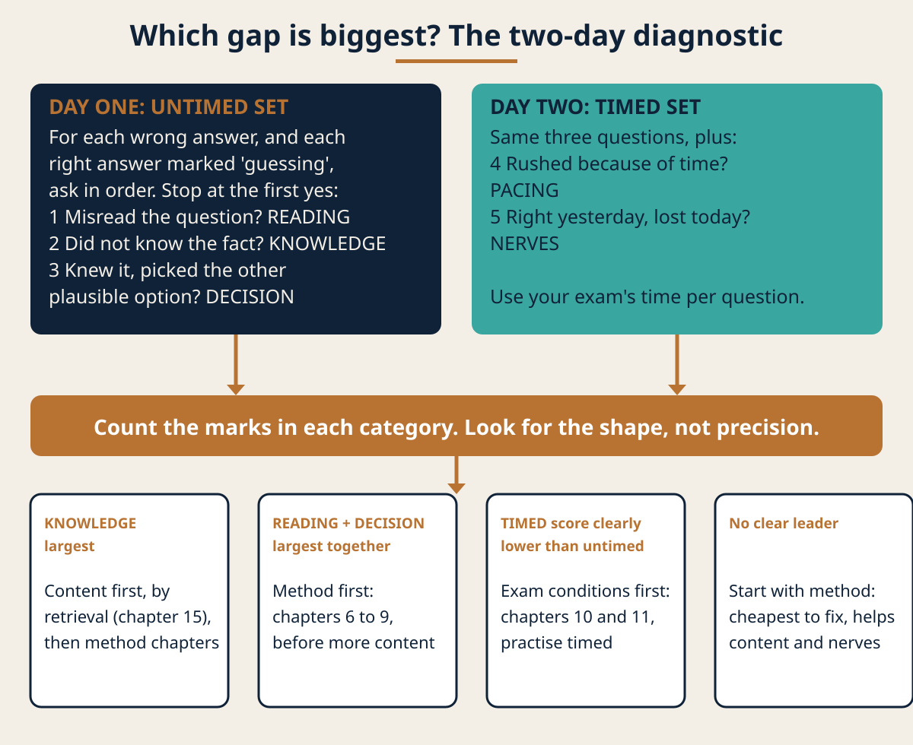
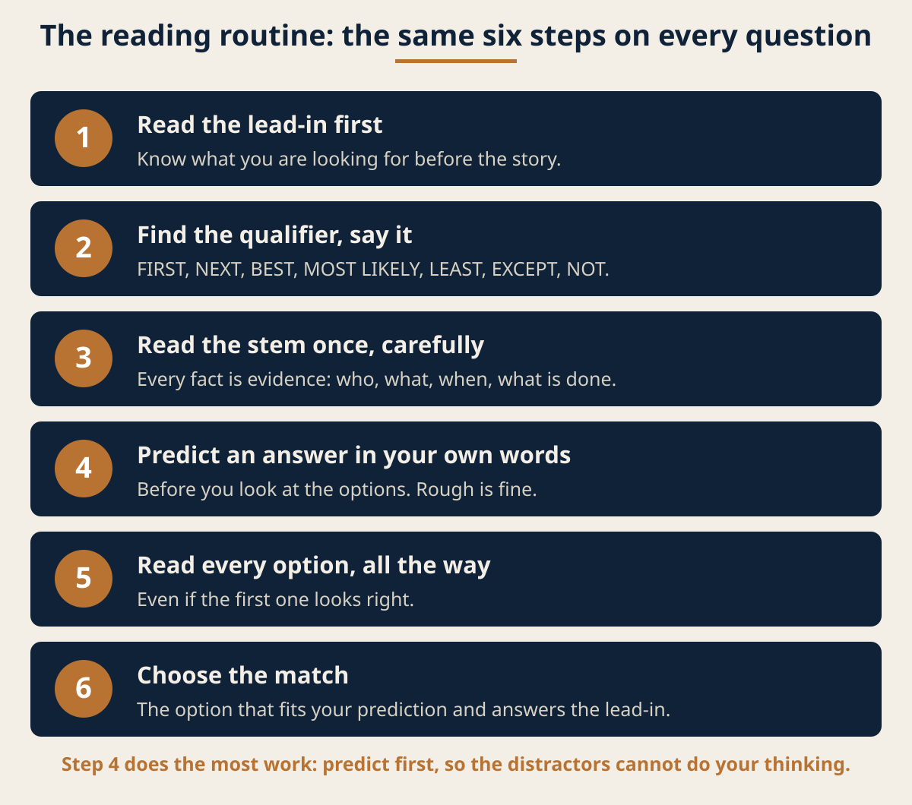
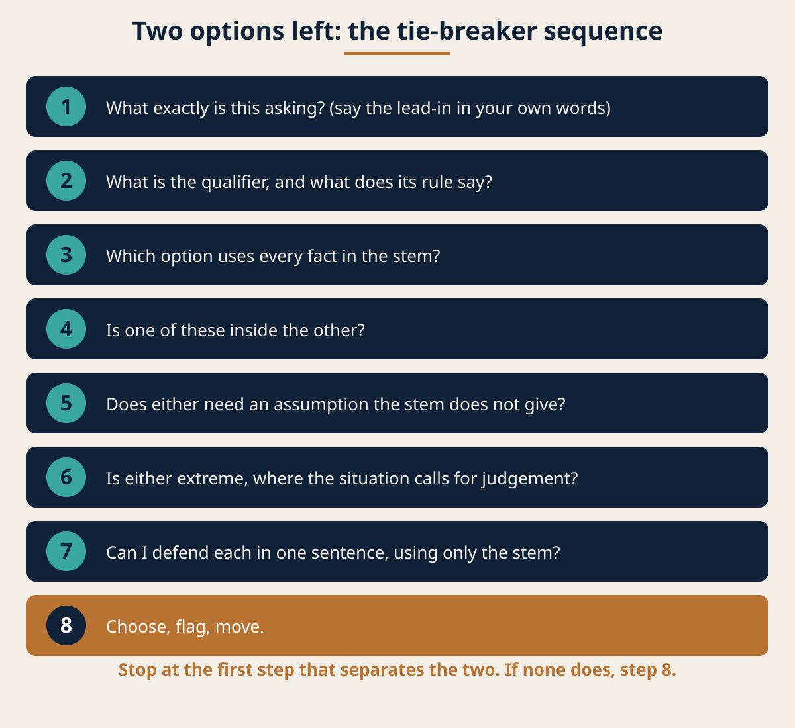
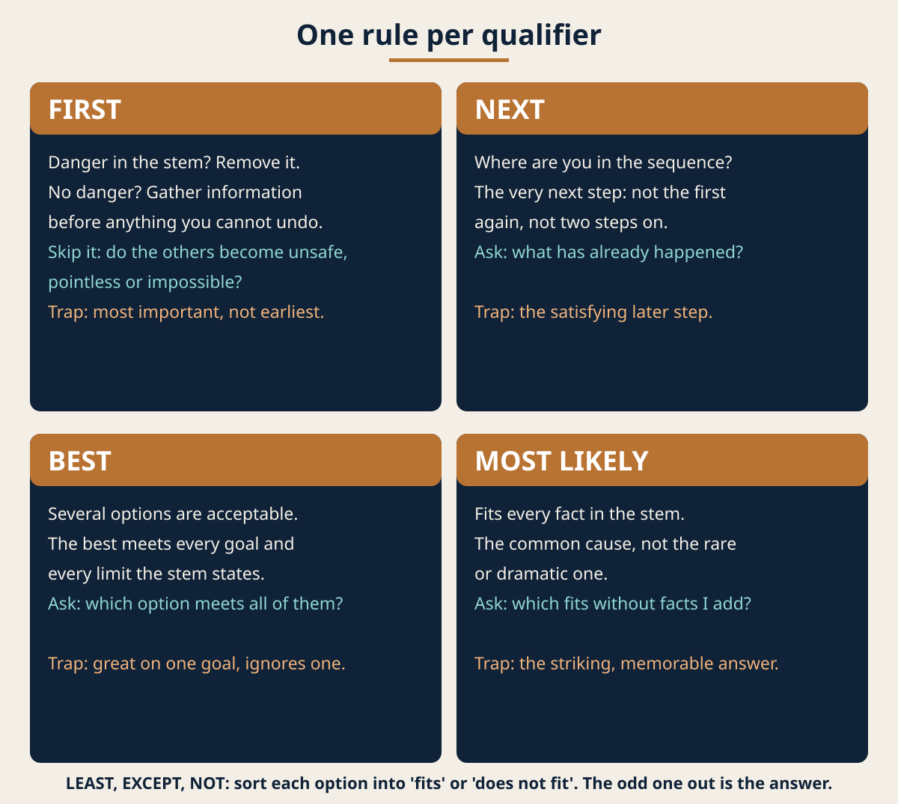
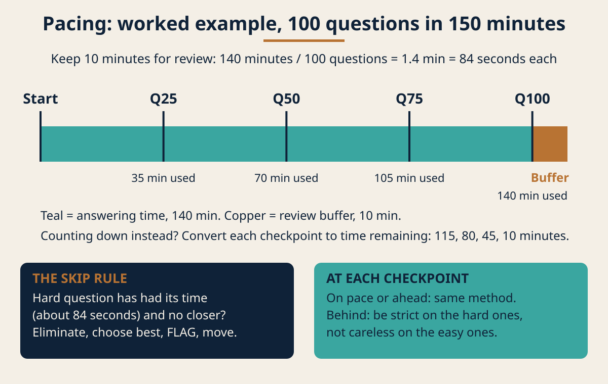

# Introduction: how to use this book

You sat a professional licensing exam, and the result was not the one you wanted. Maybe it was close. Maybe it was not close at all. Maybe this is the second or third time. Either way, a retake is booked or about to be, and you have probably already done the obvious thing, which is to open the same books again and start rereading.

This book is about the other half of the problem. It does not teach your subject. It teaches you how to sit the exam: how to read what your failed score report actually says, how to decide between two answers that both look right, how to hold a steady pace, what to say to yourself when your mind goes blank, and how to have the conversations at work and at home that make a second attempt possible at all.

## Who this book is for

It is written for one reader: an adult who has failed a professional licensing exam once or more, in any field, and who has a multiple-choice retake booked or planned. You might work in health, finance, engineering, design, a trade, or anything else that ends with a licence. The method does not depend on the field, because it is about questions, time and nerves, and those work the same way in every exam room.

If your exam is oral, practical or essay-only, this is not the right book. If you want subject content, practice questions or a promise of a result, this is not the right book either, and it says so now rather than after you have read it.

## The promise

By the end you will be able to do six things. Turn a failed score report into a diagnosis you can act on. Apply a fixed rule to questions that ask for the FIRST, NEXT, BEST or MOST LIKELY answer. Break a tie between two plausible options without guessing. Hold a pace per question that you worked out from your own exam's rules. Hold the retake conversation with your employer and your family. And run an exam-day routine, including a routine for the last ten minutes.

None of that replaces knowing your material. It makes sure that what you know reaches the answer sheet.

## Read it in this order

Chapters 2 to 5 are about understanding what happened. Do not skip them. The rest of the book only helps if you know which kind of problem you are fixing, and chapter 5 is where you find out.

Chapters 6 to 10 are the method in the exam room: how questions are built, how to decide, how to eliminate, and how to pace.

Chapters 11 to 13 are about people, starting with yourself. They are mostly scripts: the actual words, ready to use.

Chapters 14 to 18 are the practical tools: an error log, a study week, the exam-day routine, the last ten minutes, and what to do after the result arrives.

Read it once straight through. Then work through it again with your own score report and a practice set beside you. Reading about method feels like learning it. Using it on practice material is what actually changes how you sit the exam.

## What this book will not do

It will not give you exam content of any kind. It will not tell you how many times you may sit your exam, how long you must wait between attempts, or what a retake costs, because those rules belong to your exam body and they change. When a rule matters, this book tells you to check it in your exam body's published information, and that is where you should take it from.

It is exam-agnostic. Your exam has its own length, its own time limit, its own rules on flagging and reviewing answers, and its own score report. You will adapt every technique here to those rules, and the book shows you how.

## A word about the examples

Every worked example in this book is invented. The questions are set in kitchens, on bicycles and on journeys, on purpose, so that no example can be mistaken for the subject matter of any profession. None of them is an examination question, and none is drawn from any examination. The same goes for Dana, the hypothetical candidate who appears in several chapters, and for the hypothetical exam she sits: both are made up to show the method working.

# What a failed attempt tells you, and what it does not

The first thing a failed result does is shout. It says you are not good enough, you wasted months, everyone will know, and the next attempt will go the same way. None of that is in the result. It is in your reaction to the result, which is understandable and also not information.

This chapter separates the two.

## What the result actually is

A licensing exam result is a measurement of one sitting. On one day, in one room, with one set of questions, under one set of conditions, your performance landed below the line your exam body set. That is the whole of what it records.

It is a real measurement, and you should take it seriously. But it measures a performance, not a person. It does not measure how much you know in total, how good you are at your job, or what you are capable of with a better method on a different day. A measurement of one sitting is data about that sitting.

That distinction is not a comfort line. It is practical. If the result is a verdict on you, there is nothing to do except feel bad. If it is data about a sitting, you can ask what went wrong in that sitting and change it.

## What it can tell you

Depending on what your exam body reports, a failed result can tell you some or all of these things.

How far you were from the line. Some reports give a scaled score next to the passing score. Some only say pass or fail. If you have a distance, it tells you roughly how much has to change, not what.

Where you were weaker and stronger. Many reports break performance down by content area or domain, often in broad bands rather than exact numbers. This is the most useful part of the report, and chapter 4 shows you how to read it carefully.

That the format is now known to you. You have sat this exam. You know what the room feels like, how the check-in works, how the screen looks, how long the time really feels, and where your attention went at the hour mark. A first-time candidate has none of that.

## What it cannot tell you

It cannot tell you why. A low band in one area might mean you did not know the material. It might mean you knew it and misread the questions. It might mean those questions came at the point in the exam when you were running out of time or starting to panic. The report shows where the points were lost. It does not show the cause.

It cannot tell you about your next sitting. The next sitting will have different questions and different conditions, and you will bring a different method to it.

It cannot tell you that more studying of the same kind will fix it. This is the trap. The instinct after a fail is to reread everything, harder and longer. If your problem was knowledge, that might help. If your problem was method or nerves, more rereading leaves the real problem untouched and adds exhaustion on top.

## Your position as a retake candidate

You are not starting from zero. You are starting from a known position with more information than you had last time. You have a score report. You have your own memory of the sitting: where you rushed, where you froze, which kinds of questions made you hesitate. You have whatever study you already did, which has not vanished.

What you probably do not have yet is a diagnosis. That comes next.

## Meet Dana

Dana is a hypothetical candidate, invented for this book. She sat a hypothetical professional licensing exam: a computer-based, four-option multiple-choice exam with a fixed time limit. She missed the passing line. Her first reaction was to buy a second set of textbooks and plan to read them all, cover to cover, before her retake.

Over the next few chapters, Dana does something different. She reads her report as data, finds out which kind of problem she actually has, and changes the part that was broken. Her story is there to show the method working on one person, step by step. Yours will look different, and it should.

## Before you go on

Write one sentence, in your own words, that describes your last result as a measurement and not as a verdict. Something like: "On my last sitting, my performance was below the passing line, and I do not yet know why." Keep it. You will need it in chapter 4.

# Why people fail a retake: three causes

A second attempt can fail for the same reasons as the first, or for new ones. In practice the causes fall into three groups, and many candidates have some of each. The question is which one is doing the most damage for you.

## The knowledge gap

A knowledge gap means you did not know the material well enough to pick the right answer, however carefully you read the question.

You recognise it like this. When you review a missed practice question and read the explanation, the content is new to you, or you half-remember it but could not have produced it on your own. You find yourself saying "I have never seen that" or "I would not have known that". Your misses cluster in particular areas rather than being spread evenly.

A knowledge gap is the cause candidates expect, and it is real for many of them. It is fixed with study, but with a particular kind of study: practising retrieval, not rereading. Chapter 15 shows what that looks like in a week.

## The method gap

A method gap means you knew the material but did not turn it into the right answer. The knowledge was there; the decision was wrong.

You recognise it like this. When you review a missed question, the explanation makes immediate sense, and you think "I knew that". You chose an option that was true but did not answer the question asked. You answered what to do instead of what to do FIRST. You were torn between two options and picked the wrong one again and again. You missed a word like NOT, EXCEPT or LEAST. You changed answers from right to wrong. You ran out of time with questions unanswered.

A method gap is the cause candidates underestimate, because it does not feel like a lack of knowledge, and it is not one. More content study does not fix it. A method does, and chapters 6 to 10 set one out.

## The nerves gap

A nerves gap means your knowledge and your method were adequate in calm conditions but fell apart under exam pressure.

You recognise it like this. Your scores on untimed practice at home are comfortably above where they need to be, and your result on the day was not. You remember a stretch of the exam as a blur. Your mind went blank on things you knew well. You read the same question three times without taking it in. You spent the second half of the exam thinking about failing rather than about the questions. Your body was loud: heart pounding, hands shaking, stomach turning.

Test anxiety is generally described as a mix of two things: physical over-arousal, such as tension and a racing heart, and mental worry, such as dread, fear of failure and imagining the worst. Both can get in the way of thinking. A nerves gap is fixed partly with rehearsal under realistic conditions and partly with specific coping technique, covered in chapter 11.

## They overlap

These three are not separate boxes. A small knowledge gap makes you unsure, which slows you down, which makes you anxious about time, which makes you rush and misread. A method gap means you hesitate on questions you could answer, which eats time and raises the pressure. Nerves damage method first, because careful reading is the first thing to go when you are frightened.

So the aim is not to find the one cause. It is to find the biggest one, fix it first, and then move to the next.

## Dana's three causes

Dana's first guess was a knowledge gap, because that is what failing feels like. When she thought back over the sitting, she remembered two other things. She remembered running short of time in the last quarter and guessing on a block of questions. And she remembered a run of questions that asked what to do first, where every option looked like something she would do, and she had no way to choose. That is a method gap and a pacing problem, sitting alongside whatever knowledge gap there was. She did not know yet which was biggest. Neither do you, until you test it.

## A quick self-check

Read these and notice which ones you nod at. This is not a diagnosis yet; it is a starting guess.

- "When I read the explanations, the content was new to me." That points to knowledge.
- "When I read the explanations, I knew it already." That points to method.
- "I was torn between two answers, over and over." That points to method.
- "I ran out of time or had to rush the end." That points to pacing, which is part of method, and sometimes to nerves.
- "I do much better at home than I did on the day." That points to nerves, or to practising in conditions that are too easy.
- "I froze, went blank, or could not stop thinking about failing." That points to nerves.

Chapter 5 turns this guess into a proper diagnosis. Before that, you need to read the one hard piece of evidence you have: your score report.

# Reading your score report, word for word

Your score report is the only hard evidence you have about your last sitting. It is also easy to misread, because you read it while upset, looking for either reassurance or confirmation that you are hopeless. This chapter gives you the exact sentences to say and write down, so that you take from the report only what it actually shows.

## Before you start

Do not do this on the day the result arrives. Give it at least a day. Then sit down with the report, a notebook or a blank document, and twenty minutes without interruption.

Find the part of your exam body's published information that explains the score report. Many exam bodies publish a guide to reading their reports: what each number or band means, whether scores are scaled, and how the content areas are defined. Read that first. If you cannot find one, the email at the end of this chapter asks for it.

Say this to yourself before you look at the report:

> "I am reading this to find information, not to judge myself. I will write down only what the report actually says."

## Step one: read it once without a pen

Read the whole report once, slowly, without writing anything. Notice your reaction and let it pass. If you feel the urge to conclude something sweeping, such as "I am terrible at this whole area", say:

> "That is a feeling, not a finding. I will check it against the words on the page."

## Step two: write down the overall result in the report's own words

Copy the overall result exactly as the report states it. If it gives a scaled score and a passing score, write both. If it gives only a pass or fail, write that. Do not convert it into a percentage unless the report itself does, because scaled scores are often not percentages and the conversion will mislead you.

Then write this sentence, completing it with what the report shows:

> "On my last sitting, the report shows my overall result as (the result in the report's own words), against a passing standard of (the standard, if the report gives one)."

If the report gives no distance from the line, write:

> "The report does not tell me how close I was. I will not guess."

## Step three: write down each content area result

Not every report has a breakdown. Some give only pass or fail. If yours does, skip steps three, four and five and go to the section "If your report says only pass or fail" further down. If your report does break performance down, carry on here.

Reports that break down performance usually do it by content area, in bands such as weaker, borderline and stronger, or with a mark on a scale. For each content area, write one sentence in this shape:

> "In (content area name), the report places my performance at (the band or mark, in the report's own words)."

Write them all, including the stronger ones. It is tempting to skip your stronger areas, and that throws away useful information: an area where you did well is evidence that your method works on at least some material.

## Step four: check the weight of each area

Your exam body's published content outline usually says how much of the exam each area makes up, often as a share of the questions. Next to each content area sentence, write the area's weight from that outline:

> "(Content area name) makes up (the share stated in the published outline) of the exam."

This matters more than it looks. A weak band in a small area costs fewer points than a borderline band in a large one. Your priority is not your worst area. It is the area where improvement gains the most.

## Step five: write the diagnosis sentences

If your report had area results, write three sentences, and only three:

> "My largest opportunity is (the area with the weakest band relative to its weight), because it is (weaker or borderline) and makes up (its weight) of the exam."

> "My strongest area was (the area with the best band). That tells me my preparation and method worked on at least that material."

> "The report does not tell me why I lost points in (the weak area). I will find out with the diagnostic in chapter 5."

## What you must not write

These are the conclusions the report cannot support. If you catch yourself writing one, cross it out.

- "I am bad at this subject." The report measured one sitting, not you.
- "I need to restudy everything." The report shows where points were lost, which is almost never everywhere.
- "I nearly made it, so I just need to do the same again." If you did the same again, you would expect a similar result. Something has to change.
- "I was miles off, so there is no point." Distance from the line tells you how much has to change, not whether change is possible.

## If your report says only pass or fail

A bare result is less informative, and that is fine. It does not change the method; it moves the work to chapter 5, which finds out what the report cannot. Write these sentences instead of steps three to five:

> "The report gives me a result of (the result in the report's own words) and nothing else. It does not show where I lost points, so I will treat every area as unknown until the diagnostic in chapter 5 says otherwise."

Then use your own memory of the sitting, and write down only what you actually remember, without guessing at causes:

> "The part of the exam I remember as hardest was (the part, in your own words). The point where I felt time pressure was (the point, or none). The kind of question that made me hesitate most was (the kind, for example: questions asking what to do first, or questions with two answers that both looked right)."

Finally, choose where the diagnostic starts. Look at your exam body's published content outline and note the areas with the biggest shares:

> "With no breakdown, I will start the diagnostic with a mixed set across the areas the published outline weights most heavily: (the largest areas). I will let the results of that diagnostic, not a guess, tell me where to go next."

Your memory is evidence, but weaker evidence than a report, so hold it loosely. Treat it as a reason to look in a place, not a conclusion.

## If the report is unclear

If you cannot understand your report after reading the exam body's own guidance, ask them. Keep the message short and factual. Here it is, ready to send:

> "Dear Candidate Services,
>
> I sat the (exam name) on (date) and have received my score report. I would like to make sure I am reading it correctly before I plan my next attempt. Could you point me to your published guidance on how to interpret the score report, in particular what the result shown means, whether any content area breakdown is available to me, and whether the scores shown are scaled?
>
> My candidate number is (your candidate number).
>
> Thank you for your help.
>
> (Your full name)"

Do not ask them which questions you got wrong or what was on the exam. They will not tell you, and it is not information you need. What you need is to understand the report you already have.

## Dana's report

Dana's hypothetical report happened to include a breakdown, so she could use every step. It gave a scaled score below the passing score and a band for each of five content areas. Two were stronger, two borderline, one weaker. She was about to start on the weaker area when she checked the published outline and found it was the smallest area of the five. One of the borderline areas was the largest. Her diagnosis sentences pointed her there, while her first instinct would have sent her somewhere else.

# Method gap or knowledge gap: the diagnostic

Your score report tells you where you lost points. This chapter tells you why. It is a short decision path, run in two sessions on two days. At the end, you will know which problem to fix first and whether you need a subject tutor.

## What you need

A set of practice questions in your largest-opportunity area from chapter 4, from a reputable provider of practice material for your exam. If your report had no breakdown by area, use a mixed set that draws on the areas with the biggest shares in the published outline. Somewhere between thirty and fifty questions is enough. More is not better at this stage, because you are going to review every one carefully.

A second, similar set for the timed run on day two.

Your notebook, and the error log format from chapter 14. You can read that chapter now or simply follow the steps below.

## Day one: the untimed run

Answer the first set with no time limit, in a quiet room, with no notes. Take as long as you need on each question. Write a quick mark next to each answer: sure, fairly sure, or guessing.

Then mark the set. For every question you got wrong, and every one you got right but marked as guessing, ask these questions in order. Stop at the first one that answers yes.

1. "Did I misread the question?" Did you miss a word such as NOT, EXCEPT, FIRST or LEAST, or answer a different question from the one asked? If yes, mark it as reading.
2. "Did I know the fact or principle the right answer depends on?" Read the explanation. If the content is new to you, or you could not have produced it unprompted, mark it as knowledge.
3. "Did I know it, but choose a different option that was also plausible?" If you were torn between two and picked the wrong one, mark it as a decision.

Nothing in day one is timed, so nothing in it is pacing or nerves. That is deliberate. It separates what you know and how you decide from the pressure of the clock.

## Day two: the timed run

Answer the second set under realistic conditions. Use your exam's own time per question, which chapter 10 shows you how to work out. Sit at a desk, phone out of the room, no breaks except those your exam allows.

Mark it the same way, and add two more questions for every miss:

4. "Did I rush this because of time?" If yes, mark it as pacing.
5. "Would I have got this right yesterday, in calm conditions, and lost it today?" If yes, mark it as nerves.

## Reading the result

Count the marks in each category across both days. Do not worry about precision; you are looking for the shape.

If knowledge marks are the largest group, your first job is content, studied by retrieval. Go to chapter 15 first, then come back to the method chapters.

If reading and decision marks together are the largest group, your first job is method. Work through chapters 6 to 9 before you do any more content study.

If your timed score is clearly lower than your untimed score, and the extra misses are pacing or nerves, your first job is the exam conditions. Chapters 10 and 11 come first, and every practice session from now on should be timed.

If no category clearly leads, start with method. It is the cheapest to fix, it makes your content study count for more, and it helps with nerves, because a candidate with a method has something to do when they are unsure.

## When to find a subject tutor

This book does not teach your subject, and sometimes you need someone who does. Consider a qualified tutor or a course in your field if any of these is true:

- Knowledge marks are your largest group, they cluster in one area, and two weeks of retrieval practice on that area has not moved your practice scores.
- When you read the explanation for a missed question, you still cannot see why the right answer is right.
- You cannot explain the main ideas of an area out loud, in your own words, even after studying it.

A tutor fixes content. A method fixes how you use it. The two do not compete, and plenty of candidates need both.

## Run it again later

This diagnostic is not a one-off. Run a shorter version every two weeks, with a fresh set. The shape should change. If method marks fall and knowledge marks become the largest group, your method is working and it is time to put more weight on content. If nothing changes after a month, change the approach.

## Dana's diagnostic

On Dana's untimed day, the largest group of her misses was decisions: she knew the content and picked the second-best option. On her timed day, she had the same decision misses plus a block of pacing misses at the end. Knowledge was the smallest group. She put the new textbooks on a shelf and started on chapter 6.

# The anatomy of a question

Before you can decide well, you have to read well. Multiple-choice questions are built from the same few parts, whatever the subject, and once you can see those parts, you stop being carried along by the story in the question and start seeing what it is actually asking.

## The four parts

**The stem.** This is the body of the question: the situation, the facts, the background. In a professional exam it is often a short scenario. Every fact in the stem is there for a reason, either because the answer depends on it or because it rules an option out. Treat the stem as evidence, not as scenery.

**The lead-in.** This is the actual question, usually the last sentence of the stem. "What should you do first?" "Which is the most likely cause?" "Which of the following is NOT appropriate?" The lead-in tells you what kind of answer is wanted. Two questions with identical stems and different lead-ins have different answers.

**The qualifier.** This is the word or phrase in the lead-in that controls the decision: FIRST, NEXT, BEST, MOST LIKELY, LEAST, EXCEPT, NOT, INITIAL, PRIORITY. It is the one word that changes the question. Miss it and you can know everything and still choose wrong.

**The options.** One is the keyed answer. The rest are distractors, and they are not random. A well-written distractor is plausible to someone who has not read carefully, which is exactly why it exists.

## What distractors look like

Learning the common shapes of distractors helps you recognise them under pressure. Here are the ones you will meet in almost any multiple-choice exam.

**True but not responsive.** The option is a correct statement, but it does not answer the question asked. It is the most tempting kind, because your knowledge says "yes, that is right".

**Right action, wrong time.** The option is something you would do, but not at the point the question asks about. It belongs in a FIRST or NEXT question as the step after the answer, or the step before.

**Partly right.** The option covers some of what is needed but leaves out a key part that another option includes.

**Beyond the facts.** The option would be right if something were true that the stem does not say. It asks you to assume.

**Absolute or extreme.** The option uses words such as "all", "none", "every case" or "under no circumstances", when the situation in the stem calls for judgement. Extreme options are not automatically wrong, but they deserve a second look.

## The reading routine

Use the same routine on every question. It costs a few seconds and saves far more.

1. Read the lead-in first. Know what you are looking for before you read the story.
2. Find the qualifier and say it to yourself. "This is a FIRST question." "This is a NOT question."
3. Read the stem once, carefully, noticing every fact that could matter: who, what, when, what has already happened, what is wanted.
4. Before you look at the options, try to answer in your own words. Even a rough prediction protects you from being led by the options.
5. Read every option, all the way through, even if the first one looks right.
6. Choose the option that matches your prediction and answers the lead-in, using the rules in chapter 7.

Step 4 is the one candidates skip, and it is the one that does the most work. If you read the options first, the distractors do your thinking for you. If you predict first, you are checking options against your own answer.

## A worked example

Here is an invented question, set on a bicycle.

> "You are cycling home and notice a ticking noise from the back wheel that gets faster as you pedal faster. You stop and see nothing caught in the spokes. Which is the MOST LIKELY cause?"

The lead-in is "Which is the MOST LIKELY cause?" The qualifier is MOST LIKELY, which means you are choosing the common explanation that fits all the facts, not every possible one. The facts are: a ticking, from the back wheel, linked to pedalling speed, and nothing in the spokes.

Prediction, before reading options: something on the wheel or drivetrain that touches once per turn, such as a part rubbing or a loose fitting.

Now the options:

> "A. The front brake is rubbing.
> B. Something on the rear wheel is touching once each turn, such as a brake pad or a loose reflector.
> C. The frame is cracked.
> D. The tyre pressure is too high."

A is ruled out by a fact: the noise is from the back wheel. C is possible but dramatic, and nothing in the stem points to it. D would not produce a ticking that keeps time with the wheel. B fits every fact and matches the prediction.

Notice that you did not need to be a mechanic. You needed to read the lead-in, find the qualifier, collect the facts, predict, and check.

## The one-word trap

The single most expensive reading error is missing a reversing word: NOT, EXCEPT, LEAST, FALSE. When you see one, change your task out loud:

> "This is a NOT question. Three of these are true. I am looking for the one that is false."

Then read each option and mark it in your head as true or false. The odd one out is the answer. Turning a reversed question into a sorting task is slower by a few seconds and much harder to get wrong.

# FIRST, NEXT, BEST and MOST LIKELY: the decision rules

Some questions ask what is true. Many questions in professional exams ask something harder: what you should do, in what order, or what is most probable. Several options will be things you could defend. The qualifier decides which one is keyed.

This chapter gives you one rule per qualifier. Each is a general rule of good judgement, not a rule of any profession, and your exam's own conventions take precedence where they differ. Learn the rule, practise it on your own practice material, and use it the same way every time.

## FIRST

**The rule:** If there is immediate danger in the stem, the first action is the one that removes or reduces that danger. If there is no immediate danger, the first action is the one that gathers the information you need before committing to anything you cannot undo.

The test question to ask yourself is:

> "If I skipped this option, would any of the others become unsafe, pointless or impossible?"

The option that makes the others safe or possible is first.

Here is an invented kitchen example.

> "A pan of oil on the hob has started to smoke heavily but has not caught fire. What should you do FIRST?
> A. Open the window to clear the smoke.
> B. Turn off the heat under the pan.
> C. Look up the oil's smoke point.
> D. Ask a friend by message what they would do."

Every option is something a person might do. But there is immediate danger in the stem: the oil is heating further every second. So the first action is the one that stops the danger growing. Opening a window treats the effect, the smoke, and leaves the cause running. Looking something up or asking a friend gathers information while the danger grows, and the rule says information comes first only when there is no immediate danger. Turning off the heat is the only option that stops the cause, and it makes the others safer to do afterwards. B is first.

The common mistake on FIRST questions is choosing the most important action instead of the earliest. The most important action might be the third step. FIRST asks about order, not importance.

## NEXT

**The rule:** Find out exactly where you are in the sequence. The stem tells you what has already been done. The answer is the very next step, not the first step again, and not a step two places further on.

The test question:

> "What has already happened? What is the one step that has to happen before anything after it?"

An invented bicycle example.

> "Your tyre is flat. You have taken the wheel off the bike and pulled the inner tube out of the tyre. What should you do NEXT?
> A. Patch the tube.
> B. Find where the tube is leaking.
> C. Pump the tube up to full pressure and refit the wheel.
> D. Take the wheel off the bike."

D has already been done. C and A are later steps. You cannot patch a hole you have not found. B is next.

The trap in NEXT questions is the strong, satisfying action, such as patching, that skips a step the stem has not yet covered. Before choosing, run through the sequence in your head from what has been done: removed wheel, removed tube, then what? The answer is whatever fills that gap.

## BEST

**The rule:** Several options will be acceptable. The best one meets every goal and constraint stated in the stem. The others meet some of them.

The test question:

> "What does the stem say the person wants, and what limits does it set? Which option meets all of them?"

An invented travel example.

> "Your train is cancelled. You need to reach a city two hours away tonight, because you have a meeting there first thing tomorrow. You have a ticket you cannot afford to replace. The station help desk is open, and another service to that city leaves in twenty minutes. What is the BEST action?
> A. Buy a new ticket for the other service.
> B. Ask the help desk whether your existing ticket can be used on the other service.
> C. Book a hotel near the station and travel in the morning.
> D. Post a complaint about the cancellation."

The goal is to arrive tonight. The constraint is that you cannot afford a new ticket. A meets the goal and breaks the constraint. C breaks the goal. D does nothing for either. B is the only option that works towards the goal while respecting the constraint, and it uses the two facts the stem plants: the help desk is open and another service is leaving. It is the best.

The trap in BEST questions is the option that is very good on one goal and quietly ignores another. Before choosing, say the goals and constraints out loud, and check each option against all of them.

When two options both seem to meet everything, the best one is usually the more complete or the more direct of the two. Chapter 8 covers that tie in detail.

## MOST LIKELY

**The rule:** Choose the explanation that accounts for every fact in the stem and is the common one, not the rare or dramatic one.

The test question:

> "Which explanation fits all of the facts, without my adding any facts of my own?"

An invented kitchen example.

> "You made bread with a packet of yeast that had been open in the cupboard for several months. The kitchen was at a comfortable room temperature, and you followed the recipe exactly. The dough did not rise at all before baking. What is the MOST LIKELY cause?
> A. The oven was not hot enough.
> B. The yeast was no longer active.
> C. The flour was contaminated.
> D. The kitchen was too warm."

A cannot explain a failure that happened before baking. D contradicts the stem, which says the room was at a comfortable temperature. C is possible, but nothing in the stem points to it. B uses the one unusual fact the stem gives you, the long-open packet, and explains everything. It is most likely.

Notice how the stem plants a fact for you. When a stem mentions something unusual, it is rarely decoration. Ask what it is doing there.

The trap in MOST LIKELY questions is the striking, memorable answer. Rare causes stick in your memory because they are interesting, and that makes them feel more likely than they are. Prefer the plain explanation that fits.

## LEAST, EXCEPT and NOT

These reverse the task. Use the sorting method from chapter 6:

> "Three of these fit. I am looking for the one that does not."

Mark each option as fits or does not fit. Choose the one that does not. If you find two that do not fit, you have misread one of them; go back and reread both against the stem.

## Putting the rules into practice

Knowing these rules is not the same as using them under time pressure. Here is how to make them automatic.

For two weeks, on every practice question, before you choose, say the qualifier and the rule in a short line:

> "FIRST: danger, then information."
> "NEXT: where am I in the sequence?"
> "BEST: all goals, all limits."
> "MOST LIKELY: fits every fact, plainest cause."

Say it even on easy questions. The point is to make the rule fire by itself on the hard ones. When you review your misses in your error log, check whether you applied the rule. If you did not, the miss is a method miss, and the fix is to keep saying the line.

## Dana and the rules

Dana's decision misses were mostly FIRST questions in which she had chosen the most important action rather than the earliest. Once she started saying "FIRST: danger, then information" before each one, she found she could see the order. Her practice scores on those questions rose within a fortnight. Her knowledge had not changed. Her method had.

# Tie-breakers between two plausible options

You have read the question, applied the rule, and eliminated two options. Two remain, and both look right. This is the moment many retake candidates lose the most points, because they fall back on gut feeling, and gut feeling under pressure is mostly noise.

What follows is a fixed sequence of questions. Ask them in order, as lines you say to yourself, and stop as soon as one of them separates the two options. If none does, the last step tells you what to do.

## Step one: restate the question

> "What exactly is this question asking? Let me say the lead-in in my own words."

Many ties are not real ties. They are two options that answer two slightly different questions, and only one of those is the question on the screen. Saying the lead-in in your own words, out loud in your head, often makes one option fall away immediately.

## Step two: check the qualifier again

> "What is the qualifier, and what does its rule say?"

Apply the rule from chapter 7 again, deliberately, to just these two options. If it is a FIRST question, ask which one has to happen before the other. If it is a BEST question, ask which one meets every goal and limit. Ties often break here, because the first time through you applied the rule to four options at once.

## Step three: use every fact

> "Which option uses every fact in the stem? Is there a fact that one of these options ignores?"

Go back to the stem and list the facts. Then check each option against each fact. Often one option fits all the facts except one, and that one fact was put there precisely to rule it out.

## Step four: check whether one contains the other

> "Is one of these options part of the other?"

Sometimes one option is a specific action and the other is a broader action that includes it. On a BEST question, the broader and more complete option is usually stronger, as long as it stays within the stem. On a FIRST or NEXT question, the narrower, earlier step is usually the answer, because the broader option describes a whole process rather than its first move.

## Step five: check for assumptions

> "Does either option need something to be true that the stem does not say?"

If an option only works on an assumption, such as that the person has a tool the stem never mentions, or that a fact is different from how the stem gives it, prefer the other option. Exam questions are built so that the keyed answer works on the facts given.

## Step six: check for extremes

> "Is either option absolute where the situation calls for judgement?"

Words such as "all", "none", "immediately stop everything" or "under no circumstances" make an option fragile. If the other option is measured and fits the facts, prefer it. If both are measured, this step does not help; go on.

## Step seven: defend each in one sentence

> "Can I defend each option in one sentence, using only the stem?"

Try it. Say: "Option B is right because..." and finish the sentence using only facts from the stem. Then do the same for the other. The option whose sentence comes easily and uses the stem's facts is the stronger one. If one sentence needs "probably" or "unless" or an outside assumption, that option is weaker.

## Step eight: choose, flag, move

> "I have done the steps. I choose this one, I flag it, and I move on."

If all seven steps leave you with a genuine tie, stop spending time. Choose the option that won more of the steps, flag the question if your exam allows it, and go to the next question. A tie that has survived seven checks will rarely break by staring at it, and the time is worth more on the next question.

## The full sequence, as a list you can learn

Learn these eight lines until you can say them without looking:

- "What exactly is this asking?"
- "What is the qualifier, and what does its rule say?"
- "Which option uses every fact?"
- "Is one inside the other?"
- "Does either need an assumption?"
- "Is either extreme?"
- "Can I defend each in one sentence?"
- "Choose, flag, move."

## A worked example

An invented travel question.

> "You are planning a day trip by car to a coastal town. The forecast for the afternoon is heavy rain, and you want to see the cliffs. What is the BEST plan?
> A. Leave early and visit the cliffs in the morning, before the rain.
> B. Check the forecast again the night before and keep the plan flexible."

Say both look right. Run the steps.

What is it asking? The best plan to see the cliffs given that rain is forecast for the afternoon.

The qualifier is BEST: all goals, all limits. The goal is to see the cliffs. The limit is afternoon rain.

Which uses every fact? A uses the timing of the rain directly. B uses the forecast but does not, by itself, get you to the cliffs.

Is one inside the other? No. B is a way of checking, and it leaves open what you would then do. A is a complete plan.

Assumptions: A assumes only what the stem says, that the rain comes in the afternoon. B is sensible but leaves the goal open.

One-sentence defence: "A is best because it sees the cliffs before the forecast rain." That uses only the stem. "B is best because..." needs you to add what you would then do.

A wins. Notice that B is not wrong as advice. It simply does not answer the question as completely.

## Practising the tie-breakers

On your next three practice sets, every time you are torn between two options, write which step broke the tie. After a few sets, you will notice that the same two or three steps do most of the work for you. Those are the ones to say first in the exam.

# Elimination, and when not to change an answer

Elimination is the most reliable tool you have on a question you are unsure of. Changing answers is the most dangerous. This chapter covers both, because they are two halves of one skill: deciding on evidence rather than on feeling.

## How to eliminate

The aim of elimination is not to find the right answer straight away. It is to remove options for named reasons, so that what remains is a smaller, clearer choice.

Every time you strike out an option, you should be able to name the reason in a few words. These are the reasons that count:

- "Does not answer the question asked." It may be true, but it responds to a different lead-in.
- "Contradicts the stem." A fact in the stem rules it out.
- "Wrong point in the sequence." It is a step before or after the one the qualifier asks for.
- "Needs a fact the stem does not give." It only works on an assumption.
- "Covered by a better option." Another option includes it and goes further.

These are the reasons that do not count:

- "It sounds odd."
- "It is too long" or "too short".
- "I have not seen that term before." An unfamiliar term in an option is not evidence that it is wrong.
- "I have picked that letter too many times already."

If you cannot name a reason from the first list, do not eliminate the option. Leave it in.

## Doing it on screen

Many computer-based exams let you strike out options on screen, or give you a whiteboard or scratch paper. Check your exam's published rules and tutorial so you know which tools you will have. If you can strike out, use it, because it keeps your eliminated options out of sight and out of mind. If you cannot, write the option letters on your scratch material and cross them through as you go.

Practise with the same method you will use on the day. If you will have only a whiteboard, practise with a whiteboard.

## Elimination when you do not know the answer

On a question where your knowledge runs out, elimination still works. You may not know which option is right, but you can often see that one contradicts the stem, or that one answers a different question. Removing even one option out of four improves a guess. Removing two turns a guess into a choice between two, which the tie-breakers in chapter 8 can handle.

Say this when you hit a question you do not know:

> "I do not need to know the answer to remove the wrong ones. Which of these can I rule out, and why?"

## When to change an answer

You will review questions, and you will be tempted to change some answers. Here is a fixed rule.

**Change an answer only when you can complete this sentence with a specific fact:**

> "I am changing this answer because..."

Good completions are concrete:

- "...I misread the lead-in. It says NOT, and I answered it as if it did not."
- "...I missed a fact in the stem. It says the step has already been done."
- "...a later question reminded me of something that applies here."
- "...my reason for the original answer depended on an assumption the stem does not support."

If your completion is a feeling, leave the answer alone:

- "...it just feels wrong now."
- "...I have too many Cs."
- "...the other one sounds more professional."
- "...I am nervous about this one."

The feeling of doubt on review is common, and it is not new information. The first time you answered, you read the question fresh and applied your method. On review, you are tired and anxious, and the question has become familiar enough to seem strange. A specific reason is evidence. Unease is not.

## The flag-and-note habit

When you flag a question to revisit, also make a short note on your scratch material of why: "torn A and C", "not sure of order", "check stem fact about timing". When you come back, you will know what to look at, and you will not reread the whole question from scratch with fresh doubt.

If your exam does not let you write question numbers on scratch material, or does not allow review, check that in your published rules, and adjust: in that case, your best decision is the one you make the first time.

## A short practice drill

Take ten practice questions you have already answered and reviewed. Cover your previous answers. Answer them again, and for every option you eliminate, write the reason in four words or fewer. If you find yourself eliminating without a reason, you have found a habit to fix.

Then take ten fresh questions, answer them, and before you check the answers, go back and consider changing any of them. Change only the ones where you can finish the sentence with a fact. Mark the set. Note whether your changes went from wrong to right, or right to wrong. Over a few weeks, this shows you whether your changes are based on evidence or on nerves.

# Pacing: setting the clock per question

Running out of time is one of the most common ways to lose points you could have earned. It is also one of the easiest to fix, because it is arithmetic plus a habit. This chapter shows you how to work out your own pace from your own exam's rules, set checkpoints, and use a skip rule.

## Find your exam's rules first

Every number in this chapter comes from your exam body's published information, not from this book. Before you calculate anything, find and write down:

- The total number of questions.
- The total time allowed.
- Whether there are scheduled breaks, and whether break time comes out of your exam time.
- Whether the exam is divided into sections, and whether you can go back to a section once you leave it.
- Whether you can flag questions and return to them.
- Whether wrong answers cost you anything, or whether a blank and a wrong answer score the same.
- Whether some questions are unscored. Some exams include questions that do not count towards your result. If yours does, you will not be able to tell which they are, so treat every question as if it counts.

If anything on that list is not clear from what you can find, check the exam body's published candidate information again or ask their candidate services. Do not rely on what someone in a forum remembers.

## The calculation

Take the total time, and subtract a buffer for review at the end. Ten minutes is a sensible starting buffer for a long exam; use less for a short one. Divide what is left by the number of questions. The result is your time per question.

Here is an invented example. A hypothetical exam has 100 questions in 150 minutes, with no scheduled breaks. Keep a ten-minute buffer, which leaves 140 minutes. 140 minutes divided by 100 questions is 1.4 minutes per question, which is 84 seconds.

If your exam is divided into sections with separate time limits, do this calculation for each section. If breaks come out of your exam time, subtract the break time you plan to take before you divide.

## Checkpoints

You cannot watch a stopwatch on every question. You can check the clock at a few fixed points.

Set four checkpoints, at a quarter, half, three-quarters and the end of the questions. For each, write down the question number and the time that should have been used by then.

In the invented example, with 84 seconds per question, the checkpoints are: by question 25, no more than 35 minutes used. By question 50, no more than 70 minutes. By question 75, no more than 105 minutes. By question 100, no more than 140 minutes, leaving your ten-minute buffer.

If your exam's clock counts down rather than up, convert each checkpoint into time remaining. In the example, at question 25 you should have at least 115 minutes left; at question 50, at least 80; at question 75, at least 45; at question 100, at least 10.

Memorise your checkpoints. On exam day, write them on your scratch material in the first minute, if your exam's rules allow it.

## What to do at a checkpoint

If you are on time or ahead, say:

> "On pace. Same method, next question."

Do not speed up because you are ahead, and do not slow down to use the spare time. Bank it for review.

If you are behind, say:

> "Behind by (the number of minutes). I will apply the skip rule strictly until the next checkpoint."

Do not panic and rush every question. Make up the time by being strict with the hard ones, not by being careless with the easy ones.

## The skip rule

This is the habit that protects your pace.

> **The skip rule:** When a question has taken your time per question and you are not closer to an answer, eliminate what you can, choose your best option, flag it, and move on.

In the invented example, that means at around 84 seconds, if you are still circling, you stop. You do not leave it blank, unless your exam penalises wrong answers and you have no basis for a guess at all. You choose, you flag, you go.

The skip rule is hard because it feels like giving up. It is the opposite. A difficult question is worth the same as an easy one. Spending four minutes on a hard question costs you the time for two or three easier ones at the end, which you would have got right. Skipping is a trade in your favour.

Say this when you apply it:

> "This one has had its time. Best option, flag, next."

## Practise the pace

Pace is a habit, and habits come from practice. From now on, every practice set you do should be timed at your exam's pace, with the checkpoints. At the end of each set, write down where you were at each checkpoint. If you are consistently behind at the halfway mark, the skip rule is not firing early enough. If you are consistently ahead with time to spare and still making careless errors, you are going too fast, and you can afford to read more slowly.

## Dana's pace

Dana worked out her hypothetical exam's time per question, set four checkpoints, and practised with them. On her first timed set, she was six minutes behind at the halfway mark. She had been spending three or four minutes on the hard FIRST questions. She started applying the skip rule at her time per question, flagged those, and came back to them in her buffer. By her fourth practice set she was finishing with eight minutes to spare and had no block of rushed guesses at the end.

# What to say to yourself when you are stuck or panicking

At some point in the exam, something will go wrong inside your head. You will hit a question you cannot answer, or a run of them. Your mind will go blank on something you know. You will notice the clock and feel your chest tighten. You will start thinking about the last result.

This is normal, and it is not the problem. The problem is what happens next, because an unmanaged moment of panic can take the next ten questions with it. This chapter gives you the exact words to say to yourself in those moments, so you are not making them up under pressure.

## What is happening in your body and mind

Test anxiety is generally described as two things working together. One is physical: over-arousal, tension, a racing heart, shallow breathing, a churning stomach. The other is mental: worry, dread, fear of failure, and catastrophising, which means jumping from "I do not know this question" to "I am going to fail, again, and everyone will know".

Both get in the way of the careful reading your method depends on. When your body is in alarm and your head is full of worry, there is less room for the question. That is how you come to read a stem three times and take in nothing.

The scripts below deal with both. Each one starts with a physical reset, because it is hard to think your way out of a body that is in alarm, and then gives you a line to say and an action to take.

## The physical reset

Use this before any of the scripts, and any time you notice your body running ahead of you. It takes about twenty seconds, and nobody watching will notice.

- Put both feet flat on the floor and feel them there.
- Unclench your hands and let your shoulders drop.
- Breathe in through your nose for a slow count of four, and out through your mouth for a slow count of six. Keep the breath out longer than the breath in, and keep the count slow. Do it three times.
- Look away from the screen for a moment at something neutral, such as the edge of the desk.

Then go to the script that fits.

## When you are stuck on a question

> "I do not know this one yet. That is allowed. Eliminate what I can, best option, flag, next."

Then do exactly that. You have a method for this, from chapters 9 and 10. Being stuck on one question is not a sign of anything except that this question is hard for you, which is true of some questions for every candidate.

## When you have flagged several in a row

> "Flagged is a plan, not a failure. I will come back with fresh eyes. This question in front of me is a new one."

A run of hard questions feels like evidence that the whole exam is going badly. It is not. Questions do not come in order of difficulty for your benefit, and a hard patch says nothing about the next one.

## When your mind goes blank

> "My memory is still there. I am going to read the lead-in only, slowly, and say in four words what it is about."

Then read the lead-in alone. Name the qualifier. Say the topic in four words. Then read the stem. Blankness is usually your attention narrowing under stress, and giving it a very small, specific task brings it back. If it does not come back within your time per question, use the stuck script.

## When you notice the clock and panic

First check it against your checkpoint. Then say whichever line is true:

> "I am on pace. The clock is fine. Back to the question."

> "I am behind by (the number of minutes). I have a skip rule for this. Strict until the next checkpoint."

Panic about time makes you rush, and rushing makes you misread, which costs more than the time you save. A known plan for being behind is what stops the rush.

## When you start thinking about the last result

> "That was a different sitting. This is a new one, with a new method. Back to the question in front of me."

Or, shorter:

> "Not now. This question."

You will not stop the thought from arriving. You can decline to follow it. Each time it comes back, say the line again and return to the lead-in of the question on screen.

## When you start predicting failure

> "I do not know my result, and nobody in this room does. My only job is this question."

Catastrophising feels like reasoning, but it is not. You cannot know your result from inside the exam, so any prediction is noise. Bring your attention back to the only thing you control.

## When you feel a wave of physical anxiety

Do the physical reset, then:

> "This is my body getting ready. It is uncomfortable, and it is not dangerous. It will pass in a minute. I can read while it passes."

Then read the next lead-in, slowly.

## Rehearse the scripts

Scripts only work under pressure if they are already familiar. Say each one aloud several times at home, so the words are ready when you need them. During timed practice sets, use them when you notice the moment, even if it is mild. If you can, do at least one full-length timed practice in a place that is not your usual study spot, so that the strangeness of the exam room is not new.

## When it is more than exam nerves

These are coping techniques for exam nerves. They are not treatment. If anxiety about your exam, or anything else, is affecting your sleep, your work or your daily life, or feels like more than exam nerves, speak to a doctor or a qualified mental health professional. That is a sensible step, not a sign of weakness, and it can sit alongside everything in this book.

# The retake conversation with your employer or supervisor

If your job depends on your licence, or your employer paid for or scheduled your exam, you will need to talk to them about the result and the retake. This is a conversation people dread, and dread makes them either avoid it or say too much. The scripts in this chapter keep it short, factual and forward-looking.

A note before you start: this chapter is about what to say, and only that. It does not cover your employer's rules or your arrangements with them. For questions of that kind, ask your human resources department.

## The principles

Tell them yourself, early, before they hear from anywhere else. A short, calm message from you lands better than a question from them.

Lead with the fact, then the plan. They need to know what happened and what you are doing about it. They do not need your feelings, your score, or a long explanation of what went wrong.

Ask for what you need, specifically. Study time, a changed rota around the exam date, or the day off for the sitting. A specific request is easier to agree to than a vague one.

Put anything important in writing. If you agree arrangements in conversation, follow up with a short email that confirms them.

## The written message: formal

Use this where your workplace is formal, or where the exam is a condition of your role.

> "Dear (manager's name),
>
> I am writing to let you know that I did not pass the (exam name) on (date). I have reviewed my score report and have a clear plan for the retake, which I intend to sit on or around (planned date), subject to the exam body's published rules on scheduling.
>
> To prepare properly, I would like to request (the specific support, for example: two half-days of study leave per week for the next six weeks, or a change to my rota in the week before the exam). I am also requesting leave on (exam date) to sit the exam.
>
> I am happy to discuss this at a time that suits you, and I will keep you updated on my progress.
>
> Kind regards,
>
> (Your name)"

## The written message: casual

Use this where your workplace is informal and you have an easy relationship with your manager.

> "Hi (manager's name),
>
> Quick update: I did not get through the (exam name) this time. I have looked at the results, I know what I need to work on, and I am planning to resit around (planned date).
>
> Would it be possible to (the specific request, for example: block out Thursday afternoons for study until then)? And I will need (exam date) off for the exam itself.
>
> Happy to chat if that is easier.
>
> Thanks,
>
> (Your name)"

## Spoken lines

If you tell them face to face or on a call, use the same structure: fact, plan, request.

Formal:

> "I wanted to let you know directly that I did not pass the exam on (date). I have gone through my results and I have a plan for the retake. I would like to ask for some support with study time, and I will put the details in an email so you have them in writing."

Casual:

> "Just so you hear it from me, I did not pass the exam. I know what went wrong and I have a plan. Could we sort out some study time before the resit?"

## When they ask "What happened?"

Give one sentence, about method, not about you, and move to the plan.

> "Mostly exam technique: I knew more than my result shows, and I was not managing the time and the harder questions well. I have changed how I am preparing."

If knowledge was the main issue, say so plainly:

> "There was one area I was not strong enough in. I am focusing my study there and practising under timed conditions."

You do not need to share your score. If asked directly and you would rather not, say:

> "I would prefer to keep the detail to myself, but I am confident in the plan."

## When they ask "Will you get it this time?"

You cannot promise a result, and you should not try.

> "I cannot promise a result, but I have identified what went wrong and I am working on exactly that. I will let you know how my practice is going."

## When they say no to study time

> "I understand. Could we look at a smaller arrangement, such as (a smaller version of the request, for example: one afternoon a week, or swapping a shift in the week before the exam)?"

If they still say no, thank them and plan around it. Chapter 15 shows how to fit a method-based study week into limited hours.

## When the licence affects your role

If they tell you that something about your work will change because of the result, keep your reply neutral and ask for the details in writing:

> "Thank you for letting me know. Could you send me the details in writing, including any timescale, so I can make sure I understand them?"

Then take any questions about it to human resources.

# The retake conversation with family and partner

At home, the conversation is less formal and often harder. The people closest to you care about the result, and that care can come out as worry, pressure, unsolicited advice or questions you do not want to answer. This chapter gives you scripts for asking for support, setting boundaries, and answering the question that stings most: "Again?"

## Asking for support

Be specific. "I need support" is hard to act on. "I need two evenings a week where I am not disturbed" is easy.

To a partner:

> "I have booked the retake for (date). I want to do it properly this time, and I need your help. Could you take over (a specific task, for example: dinner on Tuesdays and Thursdays) until then, so I can study those evenings? It would make a real difference."

To family you live with:

> "I am sitting the exam again on (date). Between now and then, I am going to study at (the times). During those times, could you treat me as if I am at work? Knock if it is urgent, otherwise it can wait."

To parents or relatives who ask how they can help:

> "Thank you. The best thing you could do is not ask me about the exam until it is over. I will tell you the result when I have it."

## Setting boundaries

Boundaries are kindest when they are said early and calmly.

On talking about the exam:

> "I am happy to tell you how it is going if I bring it up, but I would rather it was not the topic at every meal. It helps me keep it in proportion."

On advice:

> "I know you mean well, and I have a plan I trust. If I want ideas, I will ask."

On your study time:

> "From seven to nine is my study time. I will be free after that."

On your score:

> "I would rather not share the number. What matters is what I do next."

## Answering "Again?"

This question can land hard. Here are answers in three registers, so you can pick the one that fits the person and the moment.

Light:

> "Yes, again. Third time's the charm is not a strategy, so I have changed the strategy."

Honest:

> "Yes. It is frustrating, and I have been through what went wrong. This time I am changing how I prepare, not just doing more of the same."

Firm:

> "Yes. I am not going to go over it in detail, but I have a plan and I would appreciate your support."

None of these apologise. You do not owe anyone an apology for a result. And none of them get defensive; they state a fact and move on.

## When someone says something unhelpful

"Maybe it is not for you." "Have you thought about doing something else?" "Your cousin passed first time."

> "I have thought about it carefully, and I want to keep going. I would rather talk about something else now."

Then talk about something else. You do not need to win the argument.

## Talking with children

If you have children, keep it simple and honest:

> "I have a big test for my work. I did not do well enough last time, so I am practising and doing it again. That is what grown-ups do when something is hard."

It is also a useful lesson for them, which is worth saying once and leaving there.

## When support starts to feel like pressure

Sometimes the people who help most also add the most pressure, without meaning to. A partner who has taken on extra chores may start asking how much you studied tonight. A parent who paid towards the exam may ask how the practice scores look. Say what you need without sounding ungrateful:

> "I really appreciate what you are doing for me. It helps most if you trust me to manage the studying. If I am struggling, I will tell you, I promise."

If you have agreed a study arrangement and it is slipping, raise it once, early, and plainly:

> "Our plan was that Tuesdays and Thursdays are my study evenings. The last two weeks that has not happened. Can we look at it together and work out what would make it hold?"

Keep the conversation on the arrangement, not on who is to blame. You need the arrangement more than you need to be right.

## After the exam, before the result

The wait is its own kind of pressure. A line for the people around you:

> "I have done it, and now I am waiting. I would rather not guess how it went. I will tell you when I know."

# Your practice error log

An error log is the single most useful habit for a retake candidate. It turns each missed practice question into information about why you miss questions, and over a few weeks it shows you a pattern you cannot see from scores alone.

Because this book is designed to be read on any screen, the log is not a grid. It is a short paragraph, written in sentences, one per missed question. Keep it in a notebook or a single document that you add to after each practice session.

## What goes in the log

Log every question you got wrong, and every question you got right but marked as a guess. A lucky guess is a miss you have not been charged for yet.

For each one, write a short paragraph using this prose template, filling in the parts in parentheses with your own words:

> "Question (the set name and question number). I chose (your answer) because (your reason, in one line). The keyed answer was (the right answer) because (the reason, in your own words, from the explanation). The question type was (FIRST, NEXT, BEST, MOST LIKELY, NOT or EXCEPT, or a straight fact question). The cause of my miss was (one of: knowledge, reading, decision, pacing or nerves). The rule I take from this is (one sentence I can apply to the next question like it)."

Write it in your own words, not copied from the practice material. That matters for two reasons. Rewriting the explanation is itself retrieval practice, and it keeps your log free of other people's copyrighted questions, so it is your own working document.

## The causes, defined

Use the same five causes from chapter 5 every time, so you can compare across weeks.

- **Knowledge:** I did not know the fact or principle the answer depends on.
- **Reading:** I missed a word, a fact or the lead-in.
- **Decision:** I knew the content and chose a different plausible option.
- **Pacing:** I rushed it because of time.
- **Nerves:** I knew it in calm conditions and lost it under pressure.

If two causes apply, choose the one that happened first. A misread that led to a wrong decision is a reading miss.

## Two invented example entries

These use the invented examples from earlier chapters.

> "Question: kitchen set, number 4. I chose opening the window because the smoke was the obvious problem. The keyed answer was turning off the heat, because that removes the cause and makes every other action safer. The question type was FIRST. The cause of my miss was decision. The rule I take from this is: on a FIRST question with danger in the stem, remove the cause before treating the effect."

> "Question: bicycle set, number 11. I chose patching the tube because I wanted to fix the problem. The keyed answer was finding the leak, because the stem said the tube had only just come out. The question type was NEXT. The cause of my miss was reading. The rule I take from this is: on NEXT questions, list what the stem says is already done before choosing."

## The weekly review

Once a week, read through the whole week's entries. It takes about fifteen minutes. As you read, count how many entries fall under each cause, and write one paragraph summarising the week:

> "This week I logged (number) misses. (Number) were knowledge, (number) reading, (number) decision, (number) pacing and (number) nerves. The largest cause was (the cause). The question type I missed most was (the type). The rule I most need to practise next week is (the rule)."

Then copy the rules from that week's entries into a short running list at the front of your log. That list becomes your personal rulebook. Read it before each practice session and, in the last few days, before the exam.

## What the pattern tells you

If knowledge stays the largest cause week after week, put more of your study time into retrieval practice on those areas, and consider a tutor, as chapter 5 describes.

If reading or decision is the largest cause, the method chapters are where your points are. Reread chapters 6 to 9 and keep saying the qualifier lines on every question.

If pacing or nerves grows as you do more timed sets, that is useful too: it tells you the exam conditions are now the main thing between you and your result, and chapters 10 and 11 deserve more rehearsal.

If the causes shift over time, from reading to knowledge, for example, that is a sign the method is working and you are now meeting the real limits of your content. That is progress, even if it does not feel like it.

## Keep it short

An entry should take two minutes. If you find yourself writing pages, you are rewriting the textbook. The log is about why you missed, not about the whole topic. One clear sentence of rule is worth more than a page of notes.

# A retake study week built on method

The usual retake plan is to reread everything, more slowly. This chapter offers a different week: one built on retrieval practice, spaced review, method drills and timed sets, which you adapt to your own material, hours and exam date.

## Why this shape

Two ideas from learning research shape the week.

The first is the testing effect, also called retrieval practice. The general idea behind retrieval practice is that long-term memory tends to improve when part of your study time is spent pulling information out of memory, rather than reading it in again. Closing the book and writing down what you remember, then checking, tends to do more for later recall than rereading the same pages. Practice questions are one form of retrieval; so is explaining a topic aloud from memory.

The second is spaced repetition. Spaced repetition is the general idea that material reviewed at spread-out intervals, with harder material reviewed more often and easier material less often, tends to be held better than material crammed in one block. That is why the week returns to earlier material on purpose, and why your error log rules come back again and again.

Neither idea is a promise. They are general findings about how memory works, and they are a better bet than rereading.

## The sample week

This sample assumes about two hours on most weekdays and a little more at the weekend. If you have less time, shorten each session but keep the order and the rest day. If you have more, add timed sets, not more reading.

**Day 1: timed set and log.** Do one timed practice set at your exam's pace, with your checkpoints, in exam-like conditions. Then mark it and write error log entries for every miss and every lucky guess. This day tells you where the week's work should go.

**Day 2: retrieval on your weakest area.** Pick the content area your log and score report point to. Spend twenty minutes reading one section of your study material. Then close it and write down, from memory, everything you can about that section: the main ideas, the steps, the distinctions. Check against the material and mark what you missed or got wrong. Do the same for a second section. End by answering a short set of practice questions on that area.

**Day 3: method drill.** Take twenty to thirty practice questions you have not seen. For each one, before answering, write only the qualifier and the rule line from chapter 7. Then predict an answer in your own words before reading the options. Then answer. The aim is not the score; it is making the reading routine and the rules automatic. Log the misses.

**Day 4: spaced review.** Go back to the material from Day 2 and test yourself again from memory, without rereading first. Then do the same for something you studied the week before. Read through your error log rulebook. Make or review flashcards for anything you keep forgetting, giving the harder cards more turns and the easy ones fewer.

**Day 5: timed set with checkpoints.** A second timed set at full exam pace. Pay particular attention to the skip rule and your checkpoints. Afterwards, note where you were at each checkpoint, then log your misses.

**Day 6: light review and rehearsal.** Read your error log for the week and write the weekly summary paragraph from chapter 14. Say the self-talk scripts from chapter 11 aloud. Do a short retrieval session on whatever came up most in the log. Stop early.

**Day 7: rest.** No study. Rest is part of the plan, not a break from it. Tired practice produces bad habits, and you need the week after to be as sharp as this one.

## Adapting it to your situation

If your diagnosis was mainly knowledge, put more weight on Days 2 and 4, and keep at least one timed set a week so pacing does not slip.

If your diagnosis was mainly method, put more weight on Days 3 and 5, and use Day 2 for the area with the most decision misses rather than the weakest content.

If your diagnosis was mainly nerves or pacing, make every set timed and as exam-like as you can: same time of day as your exam, a desk, no phone, no music, the same scratch materials you will have. Rehearse the scripts during the sets.

If you work full time, a version of this week can run on evenings plus one weekend morning: Day 1 and Day 5 become the weekend morning and a weekday evening, and the others shrink to forty-five minutes each.

## The weeks before the exam

Repeat the week, adjusting it after each weekly review. In the final week before your exam, keep the shape but lighten it: one timed set early in the week, short retrieval sessions, a read of your rulebook each day, and no new material in the last two days. Chapter 16 covers the night before.

## A plan template, in prose

Write your own week as a short plan at the start of each week, in sentences, like this:

> "This week my main focus is (the cause or area from my weekly review). I will do timed sets on (two days), retrieval on (the area) on (day), a method drill on (day), and spaced review on (day). My rest day is (day). The one rule I will practise on every question this week is (the rule from my rulebook)."

Keep it to that one paragraph. A plan you can read in thirty seconds is a plan you will follow.

# The exam-day routine

On exam day, you want as few decisions as possible. Every choice you make in the morning, about what to eat, when to leave, what to bring, uses attention you would rather spend on questions. This chapter sets out a routine you decide in advance, with the lines to say at each stage.

Check your exam body's published rules for everything practical: what identification you need, what you may bring into the room, when you must arrive, and what happens if you are late. Those rules override anything general here.

## The night before

Stop studying at a fixed time, in the early evening. Last-minute cramming adds anxiety more than knowledge.

Pack everything you need, using your exam body's published list, and put it by the door. Typically that means the required identification, your confirmation or appointment details, and anything the rules allow, such as water or a snack for breaks. Check the identification matches the name you registered with.

Confirm your route and how long it takes, and add a generous margin. If you can, you will already have travelled the route once before, at the same time of day.

Read your error log rulebook once. Then put it away.

Say this as you finish:

> "The work is done. Tomorrow I am not learning anything new. I am using what I already have, with a method I have practised."

Then do something ordinary and pleasant, and go to bed at your usual time. If you do not sleep well, that is common before an exam and one night of poor sleep is something you can work through.

## The morning

Eat a breakfast you are used to. Exam day is not the day for something new.

Do not study. If you want something to look at, read your list of rule lines from chapter 7 and the self-talk scripts once, then stop.

Leave with the margin you planned. Say:

> "I have everything I need. I am leaving early so that nothing about getting there can rattle me."

## Arrival

Arrive early, as your exam's rules require, and go through check-in calmly. There may be identity checks, photographs, or checks of your pockets. These are routine and are the same for everyone.

While you wait, do the physical reset from chapter 11: feet on the floor, hands unclenched, three slow breaths with a longer breath out. Then say:

> "I have sat this exam before. I know what the room is like. This time I have a method."

If you notice other candidates looking calm or anxious, ignore it. You cannot tell anything about their preparation from their faces, and it has no bearing on your result.

## The first five minutes

The first few minutes set the tone, so use them deliberately.

If there is a tutorial or instruction screen, read it fully, even if you remember it. Confirm how flagging, striking out and reviewing work on this system.

If the rules allow you to write on scratch material before or at the start, write your checkpoints from chapter 10: the question numbers and the times. Write the four qualifier lines as well, if allowed:

> "FIRST: danger, then information. NEXT: where am I? BEST: all goals, all limits. MOST LIKELY: fits every fact."

Then, before the first question, say:

> "One question at a time. Lead-in, qualifier, stem, predict, options."

Take the first question slowly and carefully, even if it seems easy. Getting your reading routine running on the first few questions makes it far more likely to keep running when the hard ones come.

## During the exam

Use your method: the reading routine, the rules, the tie-breakers, elimination, the skip rule and your checkpoints. When something goes wrong in your head, use the scripts from chapter 11.

If your exam has a scheduled break, take it, even if you feel you do not need it. Stand up, drink water, eat something small if allowed, and do the physical reset. Do not think about the questions you have done. Say:

> "The first part is finished. I cannot change it. The next part is a new start."

## A note about the room

Your exam room may be noisy, cold, warm or uncomfortable. If something is genuinely wrong, such as equipment not working, raise your hand and tell the staff at the time, calmly, and ask them to note it. Your exam body's published information will explain what to do if a problem affects your sitting; read it in advance so you know.

For ordinary discomfort, prepare rather than react. Wear layers you can add or remove, if the rules allow. If the rules allow earplugs or provide ear defenders, practise with them at home first, so they feel normal. If noise from another candidate distracts you, say:

> "Other people's noise is not my business. Lead-in, qualifier, stem."

## Your routine, written as one paragraph

Write your own exam-day routine in a single paragraph, a few days before, and read it the night before:

> "The night before, I stop studying at (time), pack (the items on my exam's list) by the door, and go to bed at (time). In the morning I eat (my usual breakfast) and leave at (time), which gives me (the margin) to spare. At the centre I do the physical reset while I wait. In the first minute I write my checkpoints and the four rule lines, if allowed. On the first question I go slowly and use the full reading routine."

Deciding it in advance is the point. On the day, you only follow it.

# The last ten minutes

The last ten minutes are where many retake candidates either save points or throw them away. With a plan, you use them to fill gaps and to fix real errors. Without one, you spend them in a panic, changing right answers to wrong ones.

This chapter gives you the order to work in. Practise it at the end of every timed set, so it is automatic by exam day.

## Before you start: check the clock

When your clock shows ten minutes left, stop whatever you are doing, even mid-question. Say:

> "Ten minutes. Switching to the end routine."

If you are still working through questions you have not seen yet, the routine changes slightly; see the section on running short below.

## Step one: answer every blank

Your first priority is any question you have not answered. Check your exam's rules on wrong answers. If there is no penalty for a wrong answer, a blank is worth nothing and a guess is worth something, so every question needs an answer.

For each blank, spend no more than thirty seconds. Eliminate what you can, using only the reasons from chapter 9. Choose the best remaining option. Do not flag it for further review; you will not have time.

> "Blanks first. Eliminate, choose, next."

If your exam does penalise wrong answers, check the published rules for how, and decide in advance, while you are calm, when you will guess and when you will leave a blank.

## Step two: flagged questions, in order of closeness

Next, go to your flagged questions. Do not work through them from first to last. Start with the ones where your note says you were torn between two options. Those are the questions where a few minutes are most likely to change a wrong answer to a right one.

For each one, run the tie-breaker sequence from chapter 8 once, quickly. If a step breaks the tie in favour of the other option, and you can complete the change sentence with a fact, change it. If not, leave it.

> "Torn ones first. Tie-breakers once. Change only with a reason."

Leave the flagged questions where you were completely lost until last. Those are the least likely to improve.

## Step three: the do-not-change list

As you review, these are the answers you do not change. Learn the list:

- Any answer where your only reason to change is a feeling of doubt.
- Any answer you are changing because you have chosen one letter too often or too seldom.
- Any answer you are changing because the other option sounds more technical or more professional.
- Any answer you chose using a rule from chapter 7, unless you now see you applied the wrong rule because you misread the qualifier.
- Any answer you want to change in the final minute without a specific, new reason.

If you are tempted, say:

> "Can I finish the sentence 'I am changing this because...' with a fact? No. Leave it."

## Step four: the final minute

With about one minute left, stop reviewing. Go to the review screen, if your exam has one, or check through your answer record. Confirm that every question has an answer. If there is a blank you missed, fill it with your best guess.

Then stop. Do not open another flagged question you cannot finish. Say:

> "Every question answered. I have done what I can with what I know."

## If you are running short

If your ten-minute warning arrives while you still have unseen questions, your priorities change. Do not review flagged questions at all. Work through the remaining questions using the skip rule at half your normal time, so that each one gets a reasoned answer, then use any seconds left to fill blanks.

This is the situation your pacing and checkpoints are designed to prevent. If it happens in practice, look at your checkpoint notes afterwards to see where the time went.

## Practising the routine

At the end of every timed practice set, stop at ten minutes before the end and run the routine. Afterwards, when you mark the set, check what your changes did. Count how many went from wrong to right and how many from right to wrong. If your changes tend to go the wrong way, tighten the do-not-change list for yourself. If they tend to go the right way, your review is working, and you can trust it.

# After the result: the next 24 hours, week and month

Whatever the result, the next month matters. This chapter gives you a plan for both outcomes, because you should go into the exam knowing what you will do either way. That knowledge alone takes some of the weight off the result.

## If you pass

**The next 24 hours.** Tell the people who supported you, and thank them. Let your employer know, using a short version of the message from chapter 12. Do something you enjoy. You do not need to do anything else today.

**The next week.** Check your exam body's published information for what happens next: confirmation of results, application for the licence, any fees, any deadlines. Follow those steps exactly and keep copies of everything you send. If your employer needs confirmation, send it when you have the official version.

**The next month.** Keep your error log and your rulebook. The habits in this book, reading the lead-in first, finding the qualifier, retrieving rather than rereading, apply to any assessment you meet later in your career, including continuing professional education. Write down, while it is fresh, the three things that made the difference this time. If you know someone who is about to sit the same exam, you have useful experience to share, as long as you share method and not anything from the exam itself.

## If you do not pass

**The next 24 hours.** Make no decisions. Do not book, cancel, quit or announce anything. Let yourself be disappointed. Tell the people who need to know, briefly. To yourself, say:

> "This is a result about one sitting. I will look at it properly in a day or two, and I do not have to decide anything today."

To your partner or family:

> "It did not go my way this time. I am disappointed, and I do not want to talk about what is next yet. I will, in a few days."

**The next week.** Read the new score report using chapter 4, exactly as before, and compare it with the last one. Write down what changed. Then check the rules, all of them, in your exam body's published information:

- Whether there is a limit on the number of attempts, and how many you have used.
- How long you must wait before your next attempt.
- What a retake costs and how it is booked.
- Whether anything else is required before another attempt, such as additional study or approval.

Do not rely on memory or forums for any of these. Rules differ between exams and change over time. Write down what you find and where you found it.

**The next month.** Make the decision to continue, deliberately. Sit down with your two score reports, your error log and your weekly summaries, and ask yourself these questions, one at a time, writing an honest answer to each:

- "Did my result move? In which areas?"
- "Did the causes in my error log shift, for example from method to knowledge?"
- "What did I change this time, and what did I not change?"
- "What would I need to change for a different result next time?"
- "Can I do that, with the time, money and energy I actually have?"
- "Do I still want this licence, for my own reasons?"

Then write a decision paragraph:

> "I have decided to (retake on or around a date, take a planned break until a date, or step back from this route). I have made this decision because (your reasons). The main thing I will change is (the change). I will review this decision on (a date)."

Every one of those three decisions is a legitimate decision. Taking a break is not giving up. Stepping back from a route to a different one is not a failure. Retaking with the same method and hoping is the only option this book advises against.

If you decide to continue, go back to chapter 5 and run the diagnostic again with your new report. The cause may have changed.

## Dana's month

Dana's hypothetical story does not need a happy ending to be useful, so here is the version where it did not go her way. Her second report showed her largest area had moved from borderline to stronger, and a smaller area had slipped. Her error log showed decision misses had fallen sharply, and knowledge misses in that smaller area were now the largest group. She waited a week, checked her exam body's published rules on the next attempt, and wrote her decision paragraph: retake, with a subject tutor for the one area, and the same method for everything else. The method had done its job. What remained was content, and she now knew exactly which content.

That is what progress looks like between attempts. It is not necessarily a pass. It is a clearer picture of what is left.

## If you are struggling

A second or third fail can hit hard. If you find that your mood, your sleep or your daily life are suffering, and it feels like more than disappointment, talk to someone: a doctor, a qualified counsellor, or a trusted person in your life. Your result is about one sitting. You matter more than any exam.

# Conclusion: the habits that carry over

This book has covered a lot of ground. Most of it comes down to a handful of habits, and those are worth more than any single technique.

**Treat a result as data about a sitting.** A score report is evidence. Read it in its own words, compare areas by their weight, and do not let it become a verdict on you.

**Diagnose before you study.** Knowledge, method and nerves are fixed in different ways. Finding out which is doing the most damage, and fixing that first, is what makes a retake different from a repeat.

**Read the lead-in first, and find the qualifier.** Every question tells you what kind of answer it wants. FIRST is about order. NEXT is about sequence. BEST is about meeting every goal and limit. MOST LIKELY is about fitting every fact with the plainest cause. Say the rule before you choose.

**Decide on evidence.** Eliminate for named reasons. Break ties with a fixed sequence. Change an answer only when you can finish the sentence with a fact.

**Hold your pace.** Know your time per question and your checkpoints. Use the skip rule. A hard question is worth the same as an easy one.

**Practise retrieval, not rereading.** Pull information out of memory, spread your review over time, and keep an error log that turns every miss into a rule.

**Have the words ready.** For yourself, when you are stuck or frightened. For your employer and your family, when you need their support. Words you have rehearsed are there when you need them.

None of these habits is specific to one exam. They work in any multiple-choice assessment you face, and most of them work beyond exams entirely.

## If you keep only one thing

Keep the qualifier. Before every question, find the one word that tells you what kind of answer is wanted, and say its rule. It costs two seconds. It turns a question that looks like four reasonable options into a question with one job, and it is the habit that holds up best when you are tired, anxious or short of time.

## What this book left to you

Three things were deliberately not answered here, because they belong to you and to your exam body: the rules of your exam, which you take from its published information; the content of your subject, which you take from your study material and, if needed, a tutor; and the decision whether and when to sit again, which only you can make. This book gives you a method for each of them. It does not make them for you.

You have already done the hardest part, which is deciding to try again. The rest is method, and method can be learned.

# Recommended next steps and further resources

## The next thing to do

Today: read your score report using chapter 4 and write your three diagnosis sentences.

This week: run the two-day diagnostic in chapter 5, and start your error log.

This month: work through the method chapters on your own practice material, follow the study week in chapter 15, and have the conversations in chapters 12 and 13.

## A planning companion

If you want a day-by-day structure for the weeks between now and your retake, "The 90-Day Clinical Licensing Exam Study Plan", also from The Velvet Foundry, is a structured, independent preparation schedule written for one particular clinical licensing exam. It lays out ninety days in four phases, schedules spaced review on named days, rehearses pacing, and explains how to read a failed score report. It is built around that one exam, so it fits you only if that is your exam; this book's method applies whatever your field. It teaches no subject content and is not affiliated with any exam body. Where the two books differ, follow your own exam's published rules.

## Where to get the rules that apply to you

**Your exam body's published candidate information.** It is the primary source for the exam's format, timing, scoring, score reports, retake rules, fees and exam-day requirements. Read it in full, and check it again before you book.

**Your exam body's candidate services.** For anything the published information does not answer. Ask in writing and keep the reply.

**Reputable practice material for your exam.** Practice questions under timed conditions are the raw material for every technique in this book. Choose providers carefully, and be wary of anything sold as real or leaked exam content, which is not something a legitimate provider offers.

**A qualified tutor or course in your field,** if chapter 5 shows a knowledge gap that your own study is not closing.

**A doctor or qualified mental health professional,** if anxiety is affecting your daily life.

## A note on sources

The learning techniques in this book draw on general research on the testing effect, spaced repetition and test anxiety, and on ordinary multiple-choice exam practice. They are described in plain terms and without figures, because no figure would apply to your exam, and none is needed to use the method.

# About the publisher

Poppy Ebooks is an imprint of The Velvet Foundry, publishing practical guides for people facing a specific, difficult situation without anyone to walk them through it. Each book is written for one named reader and states plainly what it does not cover. Our books contain no fabricated sources, no invented statistics and no claims about outcomes we cannot support. Where an example is made up, we say so, and we send you to the primary source for any rule that matters. If you find an error, we would like to hear about it, and corrections go into the next edition.

# Copyright

Copyright 2026 The Velvet Foundry. All rights reserved.

First edition, 2026. Published by Poppy Ebooks, an imprint of The Velvet Foundry. Written by The Velvet Foundry Editorial Team.

No part of this publication may be reproduced, distributed or transmitted in any form or by any means without the prior written permission of the publisher, except for brief quotations in a review.

This book is general educational material about exam technique. It is not professional advice, and it is not clinical, legal, tax, financial or medical advice. It contains no examination questions, and every example in it is invented. The publisher cannot and does not guarantee any examination result, and the publisher and author accept no liability for any loss arising from reliance on this book.

Exam formats, timings, scoring and retake rules differ between exams and change over time. Verify the rules yourself in your exam body's published information, which is the primary source.

This book is not affiliated with, endorsed by or approved by any examination body, licensing authority or professional body.
