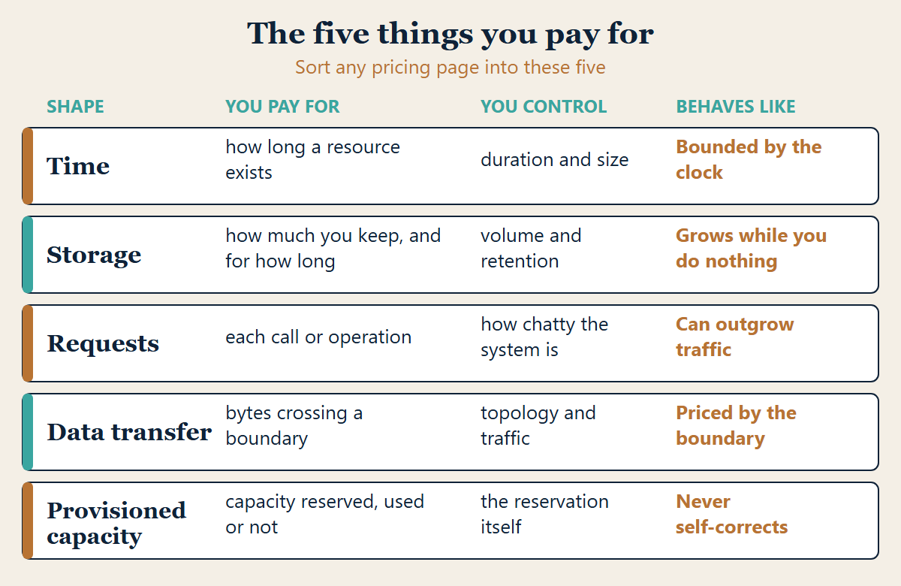
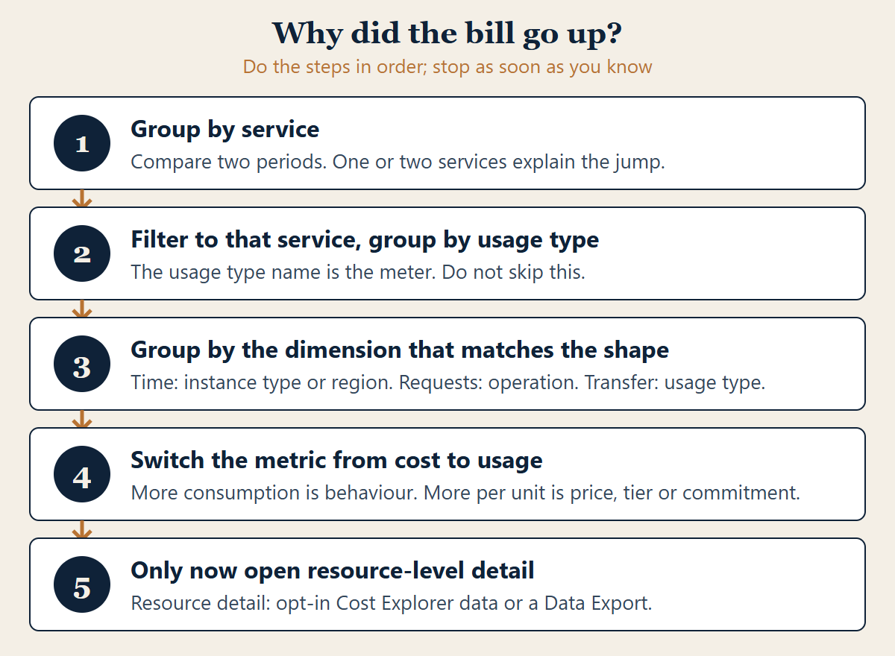
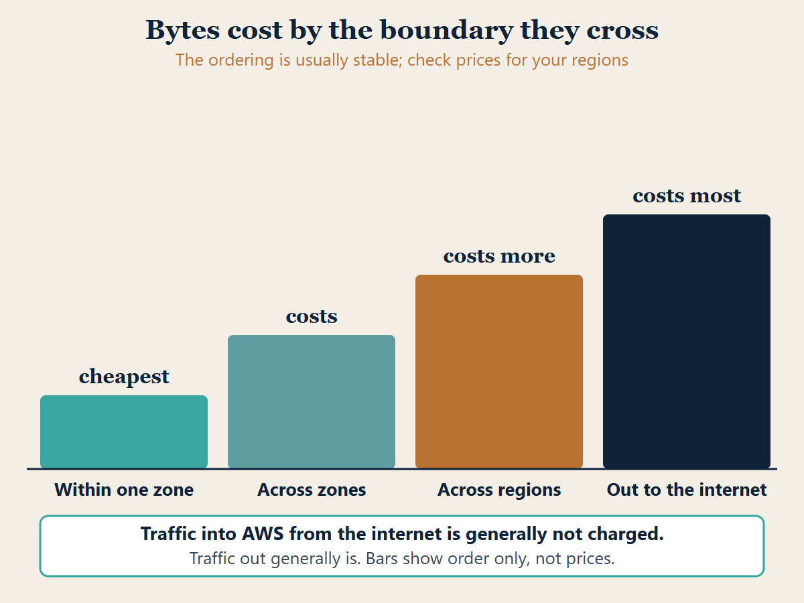
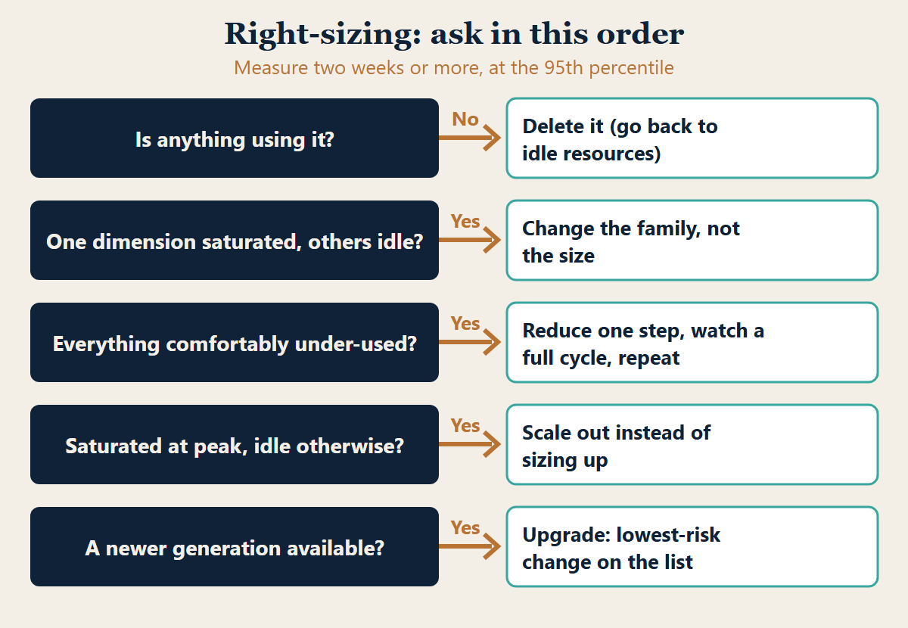
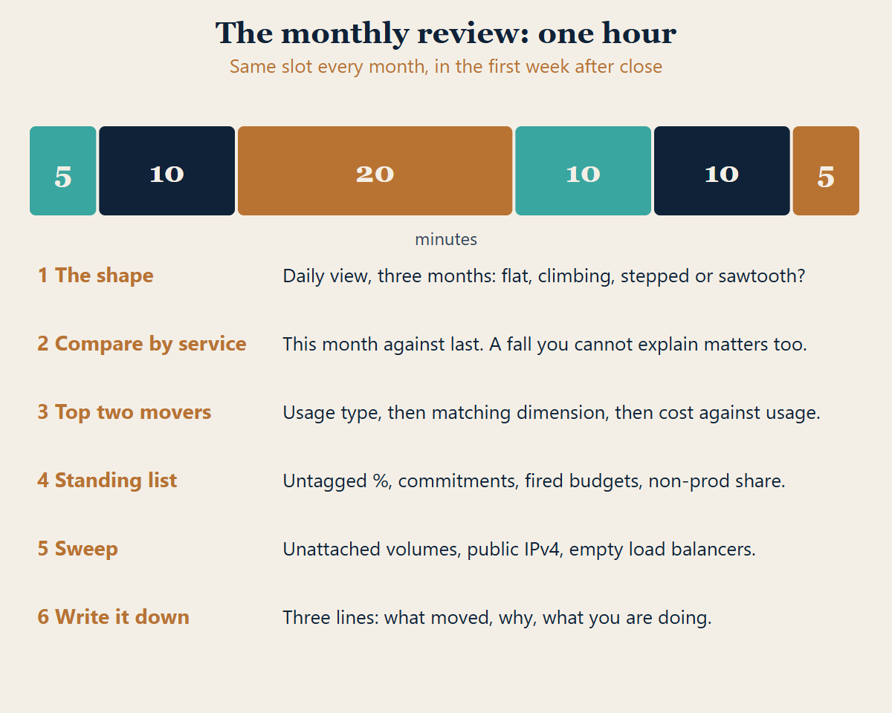

# How to use this book

Somebody forwarded you the AWS invoice and asked what happened. You opened the console, found a
number, and could not explain it. Not because you are careless — because almost nothing about a
cloud bill is arranged to answer that question.

This book is about the arrangement. It explains what AWS actually charges for, which architectural
decisions quietly set those charges, where the cost hides when you go looking for it, and the
monthly routine that turns a surprising bill into a boring one.

By the end you will have a method for tracing a line on your bill back to the decision that most
likely caused it, a routine for finding the few things driving most of your spend that is designed
to fit in about an hour, and a way to tell the difference between a cost that is a problem and a
cost that is simply the price of running the thing.

## Read it in this order

Chapters 1 to 4 are the foundation: what this book does and does not cover, why bills surprise
people, the five things you are actually paying for, and how to read the bill as a structure rather
than a total. Skipping them makes
everything after look like a list of tricks.

Chapters 5 and 6 are about attribution: tags, and accounts. Chapters 7 to 15 are where the money
usually is, roughly in order of how often each one is the answer. Data transfer first, because it
is the cost almost nobody models.

Chapters 16 to 20 are the practice: budgets and alarms, the monthly review, a worked month, costing
a design before you build it, and the judgement call about when to stop.

Work through it with your own Cost Explorer open. Reading it without doing it will feel like it
worked and will not stick.

## What you need

An AWS account you can see billing data for, and the IAM permission to read Cost Explorer and the
billing console — which is itself often the first obstacle, and chapter 4 deals with it. A
spreadsheet. Nothing else, and nothing to buy.

## If you have just inherited the account

A special case, because it is common and disorienting. You have been handed an AWS account somebody
else built, with resources you did not create and no documentation.

Do three things before anything else. Switch on Cost Explorer, if it is not already on. AWS then
prepares your cost data for the current month and the previous 13 months: the current month is
visible in about 24 hours and the rest takes a few days longer [S1]. Check which Cost Anomaly
Detection monitors and alert subscriptions already exist, and make sure an alert on the whole
account reaches a person. Detection can take up to a day, so treat it as a safety net rather than
a live alarm [S1, S9]. Then read chapter 4 and group a single month by service, which will tell you in about ten minutes what kind of
estate you have inherited.

Do not optimise anything in the first week. An account you do not understand is one where the idle
resource and the load-bearing one look identical.

## Who this is not for

If you are a cloud financial management specialist with a dedicated team and a commitment
portfolio to manage, this book is below you and you should read the vendor's own framework instead.

If you want somebody to tell you which instance to buy, this book will frustrate you. It teaches
you to answer that yourself, because the answer depends on measurements only you have.

And if you are looking for a list of tricks to apply without understanding them, the ordering here
will seem perverse: the most interesting chapters are deliberately last, because the boring ones
save more money.

This is for the engineer or the small team who owns an AWS bill they did not entirely design, and
who would like to be able to explain it.

## One promise and one warning

The promise: cloud cost is not mysterious. It is a small number of pricing shapes applied to a large
number of services. Once you can recognise the shapes, a service you have never used before becomes
readable.

The warning: this book contains no prices. Not one. The next chapter explains why that is
deliberate, and why a book full of prices would be actively worse for you. It does name the AWS
services involved, so you can find them on your own bill, and it quotes a few documented limits and
time windows. Those are facts about how AWS behaves, not prices.

## How the facts in this book were checked

Statements about AWS behaviour were checked against the official AWS documentation on 2026-11-07.
Where a statement rests on a documented behaviour, the text carries a source tag such as [S1]. The
matching address for each tag is in the last section of the book. AWS changes its services without
notice, so open the linked page before you rely on anything here.

# Chapter 1. What this book does not do

Read this chapter. It is short and it sets the boundaries honestly.

**This book contains no prices, no rates and no cost figures.** You will not find a per-gigabyte
charge, an hourly rate, a free-tier limit or a worked example with real currency in it. That is a
deliberate design decision, not an omission. The book does name services (S3, EC2 and EBS, Lambda,
CloudWatch and others) so that you can recognise them on your bill, and it states a few documented
behaviours such as how many months of history Cost Explorer prepares. Those are behaviours, dated
and sourced, not prices.

AWS prices differ by region, change without a book being reprinted, vary by commitment and
agreement, and in several services depend on usage tiers that reset monthly. A book that stated them
would be wrong for most readers the day it shipped, and wrong in a way that looked authoritative —
which is worse than saying nothing, because you would plan against it.

So this book teaches the part that does not expire: **what you are charged for, and which decisions
change how much of it you consume.** The current number for your region and account is always one
click away in the AWS pricing pages and the AWS Pricing Calculator, both published by AWS and both
authoritative in a way this book could never be.

Put plainly: this book tells you *where* the money goes and *why*. AWS tells you *how much*.

**What else is out of scope.** Negotiated enterprise agreements, private pricing and marketplace
contracts are between you and AWS. Tax treatment of cloud spend is a question for your accountant. Other cloud
providers are not covered; the shapes in chapter 3 transfer well, the specifics do not.

**This is not financial advice, and it is not a recommendation to buy any commitment.** Chapter 11
explains how reserved and committed pricing works structurally, and deliberately stops short of
telling you to buy one, because that decision depends on forecasts only you have.

**One honest limitation.** Because this book avoids specifics, it cannot tell you whether a
particular line on your bill is high. It can tell you what that line is, what drives it, and how to
compare it against your own previous months — which is the comparison that actually matters, and the
only one that survives a price change.

# Chapter 2. Why cloud bills surprise people

A surprising bill is almost never caused by a price you did not know. It is caused by a *quantity*
you did not know, generated by a decision that looked unrelated to cost at the time.

Four structural reasons, and recognising them is most of the work.

## The unit is not the thing you think you bought

You believe you bought a server. You are charged for seconds of a server, plus the storage attached
to it, plus the storage snapshots you forgot, plus the bytes it sent, plus the public address it kept while it was switched off. One mental object, five meters.

This is the single most common source of surprise. Nothing on the bill is named after the thing you
think you provisioned, and one decision usually lights up several meters at once.

## Cost is a consequence of architecture, and architecture is decided early

The decision that sets your data transfer cost is where you put two components relative to each
other. The decision that sets your request cost is how chatty the protocol between them is. Both are
made in a design discussion, months before anyone looks at a bill, by people who are not thinking
about billing and should not have to be.

By the time the cost appears, the decision is load-bearing. This is why cost work that starts at the
invoice is so much harder than cost work that starts at the diagram.

## Nothing switches itself off

A physical server you stop using sits in a rack and stops costing money the moment you stop buying
electricity for it, and eventually someone notices it is idle because it is a physical object in a
room. A cloud resource you stop using keeps billing with no outward sign at all. There is no room to
walk into.

Idle cost is the purest form of cloud waste: you are paying for something nobody wants, and nothing
in the system is incentivised to tell you.

## The feedback loop is a month long and badly addressed

You take a decision on the third. The bill arrives after the month closes. It arrives to whoever
owns the account, who is frequently not the person who took the decision. By then there have been
thirty more decisions.

Almost every practice in this book exists to shorten that loop — tagging so the cost reaches the
right person, alarms so it arrives within a day or so instead of weeks, a monthly review so it arrives at all.

## What follows from this

Three things, which the rest of the book keeps returning to.

**Quantity is the lever, not price.** You will save far more by not transferring the data than by
finding a cheaper way to transfer it.

**The cheapest resource is the one that does not exist.** Every optimisation chapter here is ordered
with deletion first, resizing second, and clever pricing last, because that is the order of
magnitude of the savings.

**Attribution is worth more than optimisation.** An organisation that cannot say which team caused a
cost will optimise the wrong thing confidently. Chapter 5 is the dullest in the book and probably
the most valuable.

## When it goes wrong

**"The bill doubled and nothing changed."** Something changed. Compare the two months by *service*
first, then by *usage type* within the service that moved — chapter 4 is the procedure. A change in
usage with no deploy is usually traffic, retries, or a scheduled job that started failing and
retrying.

**"Nobody knows who owns this resource."** Expected, and chapter 5 is the fix going forward. For the
one in front of you, look at the creation event in CloudTrail if it is recent enough, and the
resource's own naming and network placement if it is not.

**"The number is big but I cannot tell if it is bad."** Compare against your own history and against
what the thing earns or enables, never against an absolute. A bill that doubled while traffic
tripled is a good month.

## Checklist

- You can name the several meters that one provisioned thing lights up.
- You treat cost as a property of the architecture, not of the invoice.
- You assume nothing switches itself off, and you check.
- You know who receives the consequence of a cost decision, and how long it takes to reach them.
- You reach for deletion before resizing, and resizing before pricing cleverness.

# Chapter 3. The five things you actually pay for

Almost every AWS charge is one of five shapes. Learn the shapes and an unfamiliar service becomes
readable from its pricing page in a couple of minutes.

## The five shapes

**Time.** You pay for how long a resource exists, usually per second or per hour, whether or not it
is doing anything. Compute instances, databases, load balancers, public IPv4 addresses. The quantity
you control is *duration* and *size*.

**Storage.** You pay for how much data you keep and for how long, usually per gigabyte-month.
Object storage, disks, snapshots, backups, log retention. The quantity you control is *volume* and
*retention*.

**Requests and operations.** You pay per call, usually per million. Object reads and writes, queue
messages, function invocations, API calls, database operations. The quantity you control is *how
chatty your system is* — and this is the shape most often multiplied by a loop nobody costed.

**Data transfer.** You pay for bytes moving, and crucially the price depends entirely on *which
boundary they cross*. Chapter 7 is devoted to it because it is the shape that behaves least like
intuition.

**Provisioned capacity.** You pay for capacity you reserved whether or not you used it: provisioned
throughput, pre-warmed concurrency, allocated IOPS, committed capacity. The quantity you control is
*the reservation*, and the risk is that it silently decouples from reality.

*Figure 1. The five pricing shapes, and how each behaves as you grow.*

## Reading an unfamiliar service

Take any AWS service you have not used. Open its pricing page and sort what you see into the five
shapes. You will usually find two or three, and one of them will dominate for your workload.

A managed queue: requests dominate. A data lake: storage dominates, with requests second and a
transfer surprise if consumers sit elsewhere. A managed database: time dominates, with storage
second and provisioned IOPS a third if someone set it. A serverless function: requests and
time-multiplied-by-memory, with transfer appearing the moment it talks to anything outside.

That exercise is the whole skill. Everything else is detail.

Try it on services you will meet first. An EC2 instance is billed for time (by the second [S23]),
plus the EBS volumes attached to it, which are charged by the gigabytes you provision [S31], plus
any data it sends out. An S3 bucket is storage, requests and retrievals, plus transfer if the data
leaves [S16]. A Lambda function is requests plus duration scaled by memory [S22]. CloudWatch Logs is
charged for collecting and ingesting logs, storing them and analysing them [S21]. Each has its own
pricing page, and the sorting exercise is the same every time.

## Why the shape matters more than the rate

Because the shapes behave differently as you grow.

Time scales with how long things run, so it is bounded by the clock and is the easiest to predict.
Storage **accumulates** — it is the only shape that grows while you do nothing, which is why
retention is a cost decision and not a housekeeping one. Requests scale with traffic *and* with
architectural chattiness, so they can grow superlinearly when a change adds calls per unit of work.
Transfer scales with traffic and with topology. Provisioned capacity does not scale with anything —
it sits where you left it, which is its entire danger.

A workload whose cost is dominated by storage and one dominated by requests need completely
different attention, and knowing which you are is worth more than any individual saving.

## The one that catches everyone

**Requests multiplied by a loop.** Per-call pricing is so small per call that it reads as free, so
nobody models it. Then a retry policy, a polling interval, a per-row call inside a per-row loop, or
a health check that runs on every instance every second turns a rounding error into a line item.

The database world has a name for this pattern — the N+1 query — and the billing version is
identical in shape and much more expensive to discover, because the feedback is a month away rather
than a slow page.

## When it goes wrong

**"A service appears on the bill that we never provisioned."** Many services are consumed
implicitly: logging, metrics, key management, DNS queries, data processed by a load balancer. You
provisioned the thing that calls them.

**"Our cost went up but usage is flat."** Check retention and accumulation. Storage grows at the
rate you write, and bills on what has accumulated, so a flat write rate still produces a rising
bill until something expires it.

**"We cannot find where the requests come from."** Look for the shortest interval in the system:
health checks, polling loops, retries with no backoff, and any per-item call inside an iteration.

**"The pricing page lists units we do not recognise."** Normalise to the five shapes before trying
to estimate anything. If a unit does not fit, it is usually provisioned capacity wearing a service
specific name.

## Checklist

- You can sort any pricing page into the five shapes.
- You know which shape dominates each of your significant workloads.
- You treat storage as accumulating and therefore retention as a cost control.
- You have looked for per-call charges sitting inside a loop.
- You recognise provisioned capacity as the shape that does not self-correct.

# Chapter 4. Reading the bill as a structure

The invoice total is the least useful number AWS gives you. This chapter is about the three views
underneath it and what each one is for.

## The three things you can look at

**The bills page** shows the invoice: what you owe, by service, for a closed month. It is an
accounting artefact. Use it to reconcile, never to investigate.

**Cost Explorer** shows cost and usage over time, grouped and filtered. It is the investigation
tool, and almost everything in this book is done here.

**The detailed export** is the raw data, delivered to S3. AWS now provides it through Data
Exports, where the Cost and Usage Report 2.0 table is the recommended way to receive detailed cost
and usage data and the older Cost and Usage Report is available as a legacy export type [S12]. It
carries the most granular data AWS offers, and it is the view to use when the question is "which
specific resource" rather than "which service". Cost Explorer can also show resource-level data if
you opt in (see "When it goes wrong").

Most teams need Cost Explorer daily and the detailed report occasionally. Knowing which question
needs which tool saves a lot of fruitless clicking.

## The procedure that answers "why did it go up"

Do this in order. It converges fast and it is the single most useful routine in the book.

**1. Group by service, compare two periods.** Last month against this month. One or two services
will account for nearly all of the change. Ignore everything else for now — a long tail of small
services almost never explains a jump.

**2. Filter to the service that moved and group by usage type.** This is the step people skip, and
it is where the answer usually is. "Compute" tells you nothing; the usage type tells you whether you
are paying for instance-hours, for storage attached to those instances, for transfer out of them, or
for something provisioned. The name of the usage type is the meter.

**3. Group by the dimension that matches the shape.** If it is time-shaped, group by instance type
or region. If it is request-shaped, group by operation. If it is transfer-shaped, group by usage
type again, because transfer encodes its boundary in the usage type name, which chapter 7 covers.

**4. Switch the metric from cost to usage.** Decide whether you are consuming more or paying more
per unit. These have completely different causes: more consumption is a behaviour or traffic change,
more per unit is a pricing, region, tier or commitment change. Confusing the two sends you looking
in the wrong place for a week.

**5. Only now go to resource-level detail**, the opt-in resource data in Cost Explorer or a Data
Export, for the specific resource, if you still need it.

*Figure 2. The five-step procedure for finding why the bill went up.*

## Daily granularity, and why monthly lies

Look at daily rather than monthly when investigating. A monthly view hides the single most
valuable piece of evidence: *the shape of the change*.

A step change on a particular day points at a deploy, a configuration change or a new resource —
and gives you a date to search your change history against. A gradual ramp points at accumulation,
most often storage or log retention. A daily sawtooth points at a scheduled job. A change that
coincides exactly with a weekend points at traffic.

That shape usually identifies the cause before you have grouped anything.

## Amortised against unblended

You will meet two ways of counting the same spend. **Unblended** shows the charge when it was
incurred, so a one-off upfront payment appears as a spike on the day you paid it. **Amortised**
spreads that payment across the period it covers, so the spike becomes a flat line.

Use amortised for understanding the shape of your spend and for comparing months fairly. Use
unblended when reconciling against an invoice, because that is what the invoice says. Comparing one
month of amortised against another of unblended produces a mystery that does not exist.

## Permission, which is often the real blocker

Billing data is controlled separately from everything else in AWS, and a developer with wide
infrastructure access routinely has no billing visibility at all. Two steps are needed. The account
root user must switch on the Activate IAM Access setting once, and you must then attach IAM
policies that grant the billing actions: activating access alone grants nothing [S11]. For member
accounts created through AWS Organizations the setting is on by default [S11]. A few things sit
outside the setting, including the Cost Anomaly Detection console pages and the billing APIs, so
they need their own policy permissions [S11]. Cost Explorer itself is enabled once from the
console, cannot be enabled through the API, and a management account can deny it to a member
account [S1].

This is worth sorting out before you need it, though not for the reason people assume. Cost
Explorer does not start empty. Once it is enabled, AWS prepares the current month and the previous
13 months; the current month appears in about 24 hours and the rest takes a few days longer [S1].
So switching it on during an incident is not hopeless, but you will wait a day to see this month
and longer for the rest, and waiting is the one thing an incident does not allow. Enable it, and
sort out access, before you need it.

## When it goes wrong

**"Cost Explorer shows nothing."** Either it has not been enabled, or it was enabled in the last
day or two and the data is still being prepared [S1]; or your identity cannot read billing; or the
period you chose is older than the history AWS prepared (the previous 13 months); or the account
has joined or left an organisation, because an account cannot see cost and usage data from before
its organisation status changed [S1].

**"The total does not match the invoice."** Check credits, refunds, tax, and whether you are looking
at amortised against the invoice's unblended. Also check you have not filtered to one linked account
inside an organisation.

**"The jump is spread evenly across everything."** That is the signature of a change in how cost is
allocated rather than what was consumed — a new shared charge, a changed organisation structure, or
a commitment that expired and stopped discounting everything at once.

**"I can see the service but not the resource."** By default Cost Explorer stops at the service and
usage type. Per-resource detail needs an opt-in. Resource-level data at daily granularity can be
enabled for chosen services; it is available within 48 hours, covers the past 14 days, and shows
the 5,000 most costly resources per service [S8]. EC2 instances can also be enabled at hourly
resource-level granularity [S8]. For every resource, use a Data Export [S12].

## Checklist

- Cost Explorer is enabled, and billing access has been granted deliberately rather than discovered.
- You investigate by service first, then usage type, then the dimension matching the shape.
- You look at daily granularity and read the shape before grouping.
- You check cost against usage before concluding anything.
- You know whether you are reading amortised or unblended, and you do not mix them.

# Chapter 5. Tagging, and why attribution beats optimisation

This is the dullest chapter in the book. It is also the one that decides whether any of the others
can be acted on.

## The problem it solves

Without tags, your bill answers one question: how much did AWS cost? With tags, it answers the
questions people actually ask. How much does this product cost to run? Which customer segment is
expensive? Is the staging environment really a third of our spend? What does this feature cost per
user?

An organisation that cannot answer those optimises whatever is most visible, which is rarely what is
most expensive.

## A tag set that works

Four or five tags, applied to everything, consistently. More than that and compliance collapses.

**Owner** — the team or person who can decide to switch this off. Not who created it. The question
every cost investigation ends on is "can this go?", and only an owner answers it.

**Environment** — production, staging, development, sandbox. The single highest-value tag, because
non-production spend is where the easy savings are and it is invisible without this.

**Service or product** — the thing this resource belongs to, named the way your organisation names
it rather than the way AWS does.

**Cost centre** — only if someone genuinely does chargeback. Do not add it speculatively.

Optionally **expires**, a date, on anything created for an experiment. A resource with an expiry
date in the past is the easiest deletion decision you will ever make.

## The two things that make tagging fail

**Tags applied by hand.** They decay immediately. Tags must be set where the resource is defined —
in your infrastructure code, at the stack or module level so everything inherited gets them — and
never typed into a console.

**Tags that are not activated.** This one catches everybody. A tag existing on a resource does not
make it available in Cost Explorer. Each tag key must be explicitly *activated as a cost allocation
tag* in the billing console, and it can take up to 24 hours to appear after that [S3]. Only the
management account of an organisation, or a standalone account, can do the activating [S3].
Activation is not automatically retrospective, but it can be backfilled. The management account can
request a backfill for up to twelve months, one request at a time and no more than once every 24
hours, from the Cost allocation tags page [S2]. The backfill only helps where the resource already
carried the tag in those months [S2]; months before the tag was on the resource stay untagged.
Activate the keys the day you introduce them, and if you are late, request the backfill before you
assume the history is lost.

## What to do about resources that cannot be tagged

Some charges never carry a tag: certain shared services, some data transfer, support, and anything
consumed implicitly. You will have an untagged remainder.

Do not pretend otherwise. Measure it. Track untagged spend as a percentage and drive it down to a
level you can live with, then allocate what remains by a rule you have written down — evenly across
teams, or in proportion to their tagged spend. An explicit, slightly unfair rule beats an argument
every month.

## Accounts as the stronger boundary

Tags are a label; a separate AWS account is a wall. For anything where the separation genuinely
matters — production against everything else, one customer's data from another's, a team that must
not be able to reach another team's resources — a separate account in an organisation gives you
attribution that cannot be forgotten, plus isolation you want for other reasons entirely.

The cost of many accounts is organisational, not financial. For a small team, environment tags are
enough. For a growing one, the account boundary is usually worth the overhead sooner than expected.

## When it goes wrong

**"Our tags exist but Cost Explorer cannot group by them."** They have probably not been activated as
cost allocation tags, or were activated less than 24 hours ago [S3]. Request a backfill to cover
earlier months; it recovers history only for months in which the resource already had the tag [S2].

**"Half our spend is untagged."** Usually either resources created before tagging was introduced, or
resource types your infrastructure code does not propagate tags to. Attack the largest untagged
service first; the tail is rarely worth it.

**"Everyone tags differently."** `env`, `Env`, `environment`, `Environment` are four tags. Fix the
keys centrally, enforce them where resources are defined, and treat a missing tag as a failing check
rather than a reminder.

**"Tagging feels like overhead with no payoff."** It has no payoff until the first month somebody
asks a question it answers. That is exactly when you will wish you had started, because the months before a resource carried a
tag cannot be attributed, even with a backfill [S2].

## Checklist

- Four or five tags, no more, defined centrally.
- Every tag is set in infrastructure code, never by hand.
- Every tag key is activated as a cost allocation tag, the day it is introduced (and backfilled if you were late).
- Untagged spend is measured as a percentage and has an owner.
- You have decided, in writing, how unallocatable cost is shared.

# Chapter 6. Accounts, organisations and consolidated billing

Tags are a label somebody can forget. An account boundary is a wall. For attribution, and for
several things that matter more than attribution, the account is the stronger tool — and it is
usually adopted later than it should be.

## What an organisation gives you

Multiple AWS accounts under one organisation, with a single payer. Four consequences, in order of
how much they matter to cost.

**Attribution that cannot be forgotten.** Every charge in an account belongs to that account. There
is no equivalent of an untagged resource. If the production account and the development account are
separate, the question "how much does non-production cost us?" has an exact answer, permanently,
with no discipline required from anybody.

**Blast radius.** A runaway process, a compromised credential or a misconfigured loop is contained
to one account's resources and one account's budget. This is a security property with a cost
benefit attached.

**Volume pricing and commitments are shared.** Consolidated billing aggregates usage across the
organisation, so tiered services reach cheaper tiers sooner, and commitments bought in one account
can apply across others. Splitting into accounts does not split your discounts, which is the fear
that stops people doing it.

**Limits are per account.** Service quotas, concurrency ceilings and API rate limits apply per
account, so a noisy development workload cannot exhaust the capacity production needs.

## A structure that works for a small team

Resist the elaborate version. Three or four accounts covers most organisations for a long time:

**A management account** that pays, and runs almost nothing else. Keep workloads out of it; its job
is billing, organisation policy and identity. Resources here are the hardest to attribute and the
most dangerous to lose.

**Production.** The account with customers in it, the strictest access, and the real alarms.

**Non-production**, or one per environment once there are enough of them to be confusing.

**A sandbox** per engineer or per team, with its own budget alarm, where experiments live and die.

Growth beyond this should be driven by a real requirement — a regulatory boundary, a separate
customer's data, a team that must be isolated — rather than by a diagram in a best-practice guide.

## What this does to your bill

The payer account receives one consolidated invoice; each member account's spend remains visible
individually. In Cost Explorer, **linked account becomes a grouping dimension**, which is the single
most useful one most organisations ever add. Your chapter 4 investigation gains a first step that
narrows the problem before you look at a service.

Two things to know so they do not surprise you. **Credits and discounts are applied across the
organisation** by rules you should read once rather than assume. And **shared charges land
somewhere** — support, certain organisation-level services, and anything the management account
runs are not naturally attributable to a team, which is the untagged-remainder problem from the
tagging chapter in a different coat. Decide the allocation rule in advance and write it down.

## Controls the structure makes possible

**Per-account budgets** that reach the team that owns the account, which is the version of budgeting
people actually act on.

**Policies that prevent spend**, rather than reporting it afterwards: restricting which regions may
be used at all is a straightforwardly effective control, because a surprising amount of accidental
cost appears in a region nobody meant to use and nobody is watching. Restricting expensive resource
types in sandbox accounts is the same idea applied at the other end.

Prevention beats detection here, and the organisation is where prevention lives.

## The cost of doing this

Honest accounting: more accounts mean more identity plumbing, more places to configure logging and
guardrails, and a real risk of resources becoming orphaned in an account nobody opens any more.

The overhead is organisational rather than financial, and it scales with the number of accounts,
which is the argument for the small structure above rather than the elaborate one.

## When it goes wrong

**"Splitting accounts will lose our discounts."** It does not. Consolidated billing aggregates usage
for tiering, and commitments can apply across the organisation. This is the most common reason teams
stay in one account, and it is based on a misunderstanding.

**"A chunk of spend sits in the management account."** Something is running where nothing should.
Move it, or accept it as a shared charge and allocate it by your written rule.

**"We cannot tell what a sandbox is doing."** It needs its own budget alarm and an expiry
convention, and the engineer who owns it should receive both.

**"Cost appeared in a region we do not use."** Either a global service reports there, or something
was created there by accident or by someone else. A region restriction prevents the second
permanently.

## Checklist

- Workloads are separated from the account that pays.
- Production is its own account, with its own alarms.
- Linked account is used as the first grouping dimension when investigating.
- Each account has a budget reaching the team that owns it.
- Unused regions are restricted rather than merely watched.
- Shared, unallocatable charges have a written allocation rule.

# Chapter 7. Data transfer, the cost nobody models

If one chapter in this book saves you money, it is likely to be this one. Data transfer is the shape
that behaves least like intuition, and it is priced by a dimension most architecture diagrams do not
show: the boundary the bytes cross.

## The rule

**Bytes cost according to the boundary they cross, not the distance they travel.**

The same megabyte can be free, cheap or expensive depending entirely on whether it stayed inside one
availability zone, crossed to another zone, crossed to another region, went out to the internet, or
came back in. Traffic *into* AWS from the internet is generally not charged; traffic *out* generally
is, and that asymmetry alone explains a lot of surprised faces. AWS states that there is no charge
for inbound data transfer across all services in all Regions, that data transfer within the same
Availability Zone is free, and that traffic crossing a zone or Regional boundary typically incurs a
charge [S13].

You do not need the numbers to use this. You need the ordering, which is usually stable: within a
zone is cheapest, and the charged boundaries (across zones, across regions, out to the internet)
tend to rise in that order. Treat the ordering as a rule of thumb, not a guarantee. AWS says
internet egress is charged per service at rates specific to the originating Region [S13], so check
the pricing page for your regions.

*Figure 3. Data transfer boundaries in their usual order of cost. Order only, not prices.*

## The boundaries that cost money and are easy to cross by accident

**Across availability zones.** You put a service in three zones for resilience, correctly. Now every
call between two components that land in different zones crosses a charged boundary. The traffic is
internal, the diagram shows one box, and the bill shows a meter. Multiply by a chatty protocol and
it is a real line item.

**Across regions.** Replication, cross-region backups, a database in one region and its consumers in
another. These are usually deliberate decisions whose cost consequence was not part of the decision.

**Out to the internet.** The obvious one, and the one people do model. Serving large files or video
directly from object storage to users is the classic shape.

**Through a managed network appliance.** Several managed services charge per gigabyte *processed* in
addition to running. The next chapter covers the most common example because it deserves its own.

## Where it hides

Three places, in order of how often they are the answer.

**Chatty internal services across zones.** The fix is awareness, not avoidance: you want multiple
zones. You just want to know that the chattiest paths crossing them are a cost you chose.

**Logs and telemetry.** Shipping every log line and metric to a collector somewhere else is a
continuous transfer of a surprisingly large volume. Sampling and local aggregation are a cost
control as well as a sanity control.

**Backups and snapshots leaving the region.** Correct for disaster recovery, and a steady recurring
transfer charge that nobody attributes to the backup policy that created it.

## The levers, in order

1. **Do not move the bytes.** Co-locate chatty components. Cache. Aggregate before shipping. This is
   usually the largest saving and the only one that compounds.
2. **Move fewer bytes.** Compress. Sample telemetry. Strip payloads to what the consumer needs. Stop
   transferring data nobody reads.
3. **Move them across a cheaper boundary.** A content delivery network for internet egress, a
   private endpoint instead of a public path. This can be worth doing, and it is third because
   it usually saves a fraction of what the first two do.

## When it goes wrong

**"Transfer is high and we serve almost nothing to the internet."** It is internal. Group by usage
type: the usage type name encodes the boundary, which is how you tell cross-zone from cross-region
from egress.

**"It went up when we added a zone."** Expected, and usually the right trade. Now check that your
chattiest path is not the one crossing.

**"We cannot tell which service is transferring."** Transfer is often charged against the service
rather than a resource, so the detailed report plus network flow logs is the combination that
resolves it. Flow logs themselves cost storage, so switch them on to answer a question and off again.

**"Our content delivery network made it worse."** Check the origin fetch pattern. A low cache hit
rate means you now pay to move the bytes twice.

## Checklist

- You know which boundaries your significant traffic paths cross.
- Cross-zone chatter is a known quantity rather than a discovery.
- Telemetry is sampled or aggregated rather than shipped whole.
- Backup and replication transfer is attributed to the policy that causes it.
- You reach for not moving the bytes before moving them more cheaply.

# Chapter 8. The appliance that charges per gigabyte

A category of managed service bills you twice: once for existing, and again for every gigabyte it
processes. The second charge is the one that surprises people, and the network address translation
gateway is the example everyone meets first.

## The shape

A NAT gateway lets resources in a private subnet reach the internet without being reachable from it.
It is the standard, correct component for that job. It charges an hourly rate for existing *and* a
per-gigabyte rate for data processed — and "processed" means every gigabyte that passes through it, regardless of where the traffic ends up [S6].

That last clause is the trap. Traffic from a private subnet to an AWS service in the same region
still goes through the gateway if that is the route, and still bills per gigabyte, even though it
never touches the internet.

## The three mistakes, in order of cost

**One gateway per availability zone, multiplied by environments.** Resilient designs commonly put one in each
zone. Three zones across four environments is twelve gateways running continuously, most of them
serving a development environment that is idle overnight and at weekends. The hourly charge alone,
before a single byte, can be the largest surprise on a small team's bill.

**Routing AWS-service traffic through it.** Your application pulls objects from storage, writes logs
and calls a queue. If those calls route through the gateway, every gigabyte is billed as processed
data for traffic that never left AWS. A VPC endpoint gives that traffic a private path that bypasses
the gateway. Interface endpoints are charged for each hour they are provisioned in each zone and for each
gigabyte processed [S14], so the saving is real but not total. Gateway endpoints, which exist for S3
and DynamoDB, carry no additional charge [S30, S6] and are the straightforward win.

**Leaving one running for a workload that is gone.** The gateway outlives the thing it was created
for, because nothing links the two.

## The same shape elsewhere

Once you recognise it, you see it across managed networking and traffic services: an hourly charge
for the resource plus a per-unit charge for what flows through it. Load balancers, managed transit
and private connectivity all have a version of this.

The question to ask of any managed network component is therefore the same: **what does it
cost to exist, and what does it cost per unit of traffic?** If the pricing page answers only the
first, read again.

## What to actually do

Count your gateways. For each one, ask what is behind it, whether that thing needs internet access
at all, and whether its AWS-service traffic has a private path. In non-production, ask whether a
single shared gateway or a scheduled teardown is acceptable — resilience requirements are a
production concern and copying the production topology into four environments is a decision worth
making deliberately rather than by template.

## When it goes wrong

**"Processed gigabytes are huge and we barely use the internet."** AWS-service traffic is routing
through the gateway. Endpoints are the fix.

**"We added endpoints and saved less than expected."** Interface endpoints charge hourly per
endpoint per zone plus per gigabyte processed [S14]. For low-traffic services the endpoint can cost more than the
gateway traffic it saves. Check the volume before adding one per service.

**"Can we just remove it?"** Only if nothing behind it needs outbound access — and outbound access is
often needed for package installs, updates and external APIs. Removing it in development where
instances are rebuilt from images is more often viable than in production.

## Checklist

- You know how many of these you run, across every environment.
- Non-production topology is a deliberate decision, not a copy of production.
- Traffic to AWS services has a private path where the volume justifies it.
- You ask every managed network component what it costs to exist and what it costs per unit.
- Decommissioning a workload includes decommissioning its networking.

# Chapter 9. Idle, forgotten and orphaned

The cheapest resource is the one that does not exist. This chapter is a hunting guide, and it is the
fastest money in the book because deleting something saves its entire cost rather than a fraction.

## The usual inventory

**Unattached storage volumes.** An instance is terminated, but a volume that was not set to be deleted with it can remain. EBS
volumes are charged by the gigabytes you provision until you release them [S31], so an unattached
volume (shown as "available" in the EC2 console [S26]) bills every month and does nothing.

**Snapshots with no lifecycle.** The most reliable slow-growing cost there is. Someone sets up daily
snapshots, nobody sets an expiry, and years later you are paying to keep every day of a disk that
was deleted long ago.

**Public IPv4 addresses, attached or not.** An Elastic IP address that is allocated but not in use
is the classic orphan, and it is charged. But idle is no longer the whole story: since 1 February
2024 AWS also charges for public IPv4 addresses that are in use, such as those on running
instances [S4, S5]. See the section on public IPv4 addresses below.

**Old machine images and their backing snapshots.** By default, deregistering an image does not delete the
snapshot underneath it, which is where the cost actually lives; the console and CLI offer an option
to delete the associated snapshots at the same time [S25].

**Stopped instances that still carry things.** A stopped EC2 instance has no instance charge, but
its EBS volumes are still charged, and so is an Elastic IP address associated with it [S23].

**Load balancers with no healthy targets.** Hourly charge, no purpose.

**Databases nobody queries.** Hard to find and expensive. Look at connection counts over a long
window rather than at CPU, which can look busy while doing nothing useful.

**Logs with infinite retention.** CloudWatch Logs keeps log data indefinitely unless you set a
retention period on the log group [S20]. This is the one most likely to be quietly the largest item
on the list.

**Whole environments for a project that ended.** The largest single saving available to most
organisations, and the one nobody is authorised to action.

## How to find them

Group cost by service, then look for spend with no corresponding activity. The pattern you are
looking for is **cost without usage**: storage billed with no reads, an instance running with no
network traffic, a load balancer with no requests.

AWS Compute Optimizer analyses configuration and utilisation metrics, produces rightsizing
recommendations and identifies idle resources, for EC2 instances, EBS volumes, Lambda functions,
RDS databases and NAT gateways among others; you have to opt in to it [S27]. The Billing console
also has a Rightsizing recommendations page [S11]. Both are worth reading, with one caution: they
see utilisation, not purpose, and a resource can look busy while serving nothing. Ask "could this be
deleted?" before "could this be smaller?".

## Public IPv4 addresses, in use or not

Until 1 February 2024 the usual advice was to hunt for unattached Elastic IP addresses. AWS now
charges for every public IPv4 address, whether it is attached to a service or not, and the change
applies across AWS services including EC2, RDS and EKS [S4]. The charge covers the public addresses
on running instances and Elastic IP addresses, in use or idle [S5, S6]. The rate is on the Public
IPv4 Address tab of the VPC pricing page [S6], not in this book.

What to do about it, using only documented features:

- **List them.** Public IP Insights, a feature of Amazon VPC IP Address Manager, helps you monitor,
  analyse and audit public IPv4 usage, and AWS says it is available at no cost [S4].
- **Release the idle ones.** An Elastic IP address stays allocated to your account, and charged,
  until you explicitly release it [S5].
- **Question the attached ones.** For each address in use, ask whether the resource needs to be
  reachable from the internet at all. A public IP address can be unassigned from an instance after
  launch [S7].
- **Add them to the monthly sweep** in chapter 17.

## The organisational problem, which is the real one

Finding idle resources is easy. Deleting them is not, because nobody will authorise removing
something they cannot prove is unused, and the cost of being wrong is an outage while the cost of
being slow is invisible.

The practice that breaks this deadlock is the **owner tag** plus a **stop-before-delete** step: stop
the resource, or detach it, or snapshot and delete with the snapshot retained for a defined period.
If nothing breaks in two weeks, finish the job. The reversible step is what gets the decision made.

## When it goes wrong

**"We deleted something and broke production."** Hence stop-before-delete. Anything deleted should
be recoverable for a window you decide in advance.

**"Nobody will say whether we can remove it."** Escalate to the environment tag: if it is not
production, the bar is much lower. If no owner exists, the resource is by definition unowned, and
unowned production infrastructure is a bigger problem than its cost.

**"Snapshots keep coming back."** Something automated is creating them. Find the policy rather than
deleting the output, or you will do this again next month.

**"It is small, it is not worth the effort."** Individually true, collectively usually false, and a
single sweep with a lifecycle rule afterwards is a one-off cost that keeps paying.

## Checklist

- You have swept for unattached volumes, orphaned snapshots, public IPv4 addresses (attached or not) and empty load balancers.
- Every log group has a retention period set deliberately.
- Snapshot and backup policies have expiry, not just creation.
- Deletion is reversible for a defined window, so the decision can actually be made.
- Terminated projects have a decommissioning step that includes their environment.

# Chapter 10. Storage, retention and the cost of keeping things

Storage is the only shape that grows while you do nothing. That single property makes retention a
cost control rather than a housekeeping chore.

## What you are actually charged for

Not just volume. Most object storage charges for **how much** you keep, **how long**, in **which
class**, plus **requests** against it, plus **retrieval** in the colder classes, plus **transfer**
if it leaves. A cost that looks like storage is often requests, and the fix for the two is opposite.

## Classes, structurally

In S3 the colder classes are cheaper to store, usually carry per-gigabyte retrieval fees, and the
archive classes are slower to retrieve. Several also have a minimum billable storage duration and a
minimum billable object size [S16]. For example, S3 Standard-IA and One Zone-IA suit objects larger
than 128 KB kept for at least 30 days: a smaller object is billed as 128 KB, and an object deleted
or moved early is charged for the remainder of the 30 days [S16].

Those minimums are what make naive tiering lose money: moving a very large number of very small
objects into a colder class can cost more than leaving them, because each object is billed as if it
were larger and kept for longer than it is. Lifecycle transitions also cost a request per object,
which is why S3 by default does not transition objects smaller than 128 KB [S15]. Tier by **size
and access pattern**, not by age alone.

The intelligent tiering option (S3 Intelligent-Tiering) exists precisely because most teams do not
know their access patterns. It charges a small monthly monitoring and automation fee per object,
has no retrieval charges, and moves objects between access tiers for you [S17]. That is a good
trade for large objects with unknown patterns. Objects under 128 KB are not monitored and stay in
the frequent access tier, so they gain nothing from it [S16].

## Lifecycle rules are the whole discipline

Every bucket should have a lifecycle policy, and writing it is a *product* decision, not an
infrastructure one. In S3 this is a lifecycle configuration on the bucket, with rules to transition
objects, expire them, expire non-current versions and abort incomplete multipart uploads
[S15, S18, S19]. Three questions, answered by the person who owns the data:

- How long is this useful?
- How long must it be kept for legal or contractual reasons?
- What happens if it disappears?

Most data has an honest answer measured in weeks. Almost none has an honest answer of "for ever",
yet "for ever" is what the default gives you.

Remember the invisible accumulations: incomplete multipart uploads leave their parts stored in the bucket until they are aborted, and
AWS recommends a lifecycle rule with the AbortIncompleteMultipartUpload action to avoid paying for
them [S18]; and old versions in a versioned bucket accumulate until a rule expires them [S19], so a versioned bucket without a non-current expiry rule grows without
limit no matter how disciplined the writers are.

## Logs

Log retention deserves naming separately because it is the most common runaway. CloudWatch
Logs, for example, keeps log data indefinitely by default [S20]. The volume scales with traffic and
with verbosity, and
nobody reads anything older than a fortnight except during an investigation.

Set retention explicitly everywhere. If an investigation genuinely needs a year of logs, export the
subset that matters to cheap storage rather than keeping everything hot.

In CloudWatch you can set retention per log group, or for a whole account with an account-level
retention policy. The minimum for a policy is 30 days, a policy can be applied retroactively to
existing log groups, and a policy overrides a log group's own setting even when that setting is
longer, so run the dry run first to see which log groups would be shortened. A new policy takes
effect 24 hours after you create it [S20]. Logs are charged for collection and ingestion, storage
and analysis [S21].

## When it goes wrong

**"Storage cost rose but we deleted things."** Versioning, or incomplete uploads, or snapshots of
the deleted thing. Deleting an object in a versioned bucket does not reclaim the space.

**"We moved to a colder class and saved nothing."** Minimum object size and minimum duration, or
retrievals bringing the data back often enough to cancel the saving.

**"Most of the cost is requests, not storage."** A chatty access pattern. Batch, cache, or stop
listing a huge bucket on every run.

**"Nobody will agree a retention period."** Default to a short one with an explicit exception list.
An exception somebody had to ask for is cheaper than a policy nobody set.

## Checklist

- Every bucket has a lifecycle policy, written by whoever owns the data.
- Versioned buckets expire non-current versions; incomplete uploads are expired.
- Tiering decisions account for minimum object size and minimum duration.
- Every log group has an explicit, finite retention.
- You have checked whether your storage cost is really request cost.

# Chapter 11. Provisioned capacity and commitments

Two different things that behave the same way: you pay for what you reserved, not what you used.
Both are useful. Both decouple from reality if nobody watches them.

## Provisioned capacity

Throughput you allocate on a database table, IOPS on a volume, concurrency kept warm on a function,
nodes in a cluster sized for a peak. You chose a number once, usually during a launch when the
traffic estimate was a guess, and that number has been billing ever since.

The failure is not choosing wrong. It is that **nothing ever revisits it.** Traffic patterns change,
a feature is retired, a caching layer removes most of the load — and the provisioned number stays
where it was, now paying for headroom nobody needs.

Two practices fix nearly all of it. **Review provisioned numbers on a schedule**, because they will
not surface themselves. And **prefer on-demand or auto-scaling modes while demand is unknown**,
accepting a higher per-unit price in exchange for not paying for a guess. Moving to provisioned
later, once you have real measurements, is the cheap direction to travel.

## Commitments

Reserved instances, Savings Plans and their equivalents: you commit to a level of usage for a term
and receive a discount. A Savings Plan commits you to an amount of compute usage, measured per
hour, for one or three years [S29]. The discount is genuine and often large.

Structurally, you are selling flexibility for a lower rate. That is a good trade when the usage is
genuinely stable and a poor one when it is not, and the risk is specific: **if your usage falls
below the commitment you pay for it anyway**, so a commitment made just before an architecture
change can cost more than it saves.

This book deliberately does not tell you whether to buy one. What it will say is what to check
first, because these are the checks people skip:

- Is this workload going to exist, in this shape, for the whole term? An architecture migration or a
  move to a different instance family during the term is the common way a commitment goes wrong.
- Are you committing to your *baseline* rather than your peak? The usual mistake is sizing the
  commitment to current total usage, which guarantees paying for troughs.
- Does the commitment's flexibility match your likely changes? The more specific the commitment, the
  deeper the discount and the more expensive a change of mind.
- Who will notice when it expires? An expiring commitment produces a sudden unexplained rise, and it
  is one of the few bill jumps with no corresponding change in usage at all. AWS Budgets has
  utilisation and coverage budgets for Reserved Instances and Savings Plans, which alert you when
  utilisation or coverage falls below a threshold you set [S10].

## The order to do things in

Optimise the architecture first, then commit. Committing first locks in paying for the waste you
have not removed yet, at a discount. Delete, right-size, then buy the discount on what remains.

## When it goes wrong

**"Our bill rose and nothing changed."** Check for an expired commitment. This is its signature.

**"Our utilisation is below a hundred per cent."** You are paying for unused commitment. Find out
what changed, and size future commitments to the trough rather than the average.

**"Provisioned throughput is throttling despite costing a lot."** Provisioning is usually per
partition or per shard, so an uneven access pattern can throttle while the total looks ample. That
is a data modelling problem, not a budget one.

**"We want the discount but cannot predict usage."** Then the flexible options exist for exactly
that, at a smaller discount (Compute Savings Plans, for example, apply across instance family, size
and Region, and to Fargate and Lambda usage as well as EC2 [S29]), and a smaller commitment you are certain of beats a larger one you hope
for.

## Checklist

- Every provisioned number has an owner and a review date.
- Unknown demand starts on-demand and moves to provisioned once measured.
- Architecture is optimised before any commitment is bought.
- Commitments are sized to the baseline, not the peak.
- Somebody is told, in advance, when a commitment expires.

# Chapter 12. Right-sizing without guessing

Deletion is usually the largest saving and this is often the second largest. It is also the one most often done
badly, because "right-sizing" is usually performed as "make it smaller and see who complains".

## Why instances are oversized in the first place

Rarely incompetence. Four structural reasons, and each suggests a different fix.

**The size was chosen before the workload existed.** Somebody picked a size at launch, when there
was no traffic to measure, and sensibly erred upward. Nothing has revisited it since, because
nothing ever does.

**It was sized for a peak that happens rarely.** A size that comfortably handles the busiest hour of
the year is paying for that hour all year. This is an availability decision disguised as a capacity
one, and the honest fix is usually scaling rather than resizing.

**It was copied.** From production, from another service, from a tutorial, from the previous system.

**It was sized by the wrong dimension.** Somebody needed more memory, so they chose a larger
general-purpose instance and bought a proportional amount of CPU they did not need. Instance
families exist precisely so that you can buy one dimension without the other.

## What to measure, and for how long

Measure **at least two weeks**, and make sure it contains whatever your busiest period is — month
end, a weekly batch, a marketing event. A right-sizing decision made from three days of data will
be reversed during the first busy week, and the reversal costs more than the saving.

Look at the **95th percentile, not the average and not the maximum**. The average hides peaks that
matter. The maximum is usually a single anomalous spike that should not size a whole fleet. The
95th percentile is the number that reflects the load the instance actually has to serve.

And measure every dimension, not just CPU: CPU, memory, network throughput, disk throughput and
disk operations. The binding constraint is frequently not CPU, and an instance that looks idle on
CPU can be saturated on network or disk.

## The decision tree

**Is anything using it?** If not, go back to the chapter on idle resources. Deletion beats resizing.

**Is one dimension saturated while others idle?** Change *family*, not size. This is the largest and
most often missed win: moving to a memory-optimised or compute-optimised family can cut the cost
materially while improving the thing that was actually constrained.

**Is everything comfortably under-used?** Reduce size. Move down one step, watch for a full cycle,
repeat. One step at a time, because the failure mode of a large jump is an incident.

**Is it saturated at peak and idle otherwise?** Scale rather than resize. A smaller instance that
scales out during the peak is cheaper than a large one that is idle for twenty-three hours, and it
also removes the single point of failure.

**Is it a newer generation away?** Newer instance generations are often better value for the
same nominal size (check the pricing page; this book gives no rates), and a generation upgrade is usually the lowest-risk change on this list because
nothing about your architecture changes.

*Figure 4. The right-sizing questions, in the order to ask them.*

## Automated recommendations, and their one blind spot

AWS Compute Optimizer will do most of this analysis for you and is worth reading. After you opt
in, it analyses configuration and utilisation metrics from CloudWatch, by default for the last 14
days (a paid option extends the window to 93 days), and it covers EC2 instances, Auto Scaling
groups, EBS volumes, Lambda functions and RDS databases among other resources. It also identifies
idle resources [S27]. Make sure its window contains your real peak. It has one blind spot worth
knowing: **it sees utilisation, not purpose.** It cannot know that the service is deprecated, that the environment is for a project that ended, or
that the whole component could be removed. It will cheerfully recommend a smaller instance for
something that should not exist.

So read its output with the deletion question asked first, every time.

## The risk nobody prices

Right-sizing trades headroom for money, and headroom is what absorbs the unexpected — a traffic
spike, a slow dependency, a memory leak that used to have room to run before anyone noticed.

That is often a good trade. It is a trade, though, and it should be stated. Leaving explicit
headroom on the component that would take down the product is a reasonable, deliberate decision, and
so is removing it on a background worker where a restart costs nothing.

## When it goes wrong

**"We resized and performance collapsed."** The binding dimension was not the one you reduced, or
two weeks did not contain the real peak, or burst credits were doing more work than anyone realised
on a burstable instance type.

**"The recommendation says downsize but we know it is wrong."** The tool sees utilisation, not
requirements. Latency commitments, licence terms tied to core counts, and peaks outside the window
are all invisible to it.

**"We right-sized everything and saved very little."** Then your cost is not in compute. Check the
chapter on shapes again: it is probably storage, transfer or requests, and compute was simply the
most visible thing.

**"It drifts back up."** Something scales automatically, or a deployment template still specifies
the old size. Fix the template, not the instance, or you will do this again next quarter.

## Checklist

- Deletion was considered before resizing, every time.
- At least two weeks of data, including the real peak, informed the decision.
- You looked at CPU, memory, network and disk, not CPU alone.
- A saturated single dimension changed the family rather than the size.
- Changes went one step at a time, and the templates were updated too.
- You said out loud what headroom you traded away.

# Chapter 13. Managed databases, where the cost actually sits

Databases can be among the largest lines on a small team's bill, and the reason is that one
database is five meters wearing a single name.

## The five meters

**Instance time.** The hourly charge for the database being there, which continues whether it serves
one query an hour or thousands a second.

**Storage.** Per gigabyte of allocated or consumed storage, which in many managed engines **can be
increased but not reduced in place**. Storage that auto-expands under load can stay expanded after
the load passes, and reclaiming it can mean a migration rather than a setting. Check what your
engine allows.

**Provisioned input and output.** Allocated operations per second, if somebody set them. The
classic forgotten number from the chapter on provisioned capacity.

**Backups and snapshots.** Retained copies, billed by volume and retention, accumulating quietly.
Backup storage can add charges beyond any included allowance, and retained automated backups and manual snapshots keep billing until they are deleted [S28].

**Replicas and standbys.** A read replica or a standby in another zone is approximately another
database, billed approximately like one. High availability roughly means paying for a second instance, and that is the
correct price of the thing; it is simply worth knowing it was a cost decision.

Plus transfer if consumers sit across a zone or region boundary, which the chapter on transfer
covers and which is a common quiet addition.

## The three decisions that dominate

**Availability configuration.** Single instance, multi-zone standby, or a cluster. This sets the
multiplier on everything above. It should be chosen per environment: production needs it, and the
four non-production copies almost certainly do not.

**Engine and licensing.** Depending on the licensing option, commercial engines can carry licence cost in the hourly rate. For a workload
that does not depend on engine-specific features, this is one of the few places where a single
decision changes the cost materially rather than marginally — and it is a migration, so it is a
decision for a design discussion rather than a cost review.

**Instance family.** Databases are usually memory-bound. Choosing a general-purpose family when a
memory-optimised one fits the workload buys CPU nobody is using, which is the family mistake from
the previous chapter in its most expensive form.

## Where the hidden growth is

**Backup retention that nobody set.** The default is rarely what you would have chosen.

**Snapshots of databases that no longer exist.** Deleting a database does not delete its manual
snapshots, and automated backups you chose to retain also bill until deleted [S28]. This is the database version of the orphaned volume, and it is more expensive.

**Storage that auto-grew during an incident.** A runaway table or a logging mistake expanded storage
permanently. The data was deleted; the allocation remained.

**Replicas created for a migration and never removed.** Temporary by intention, permanent in
practice.

**Non-production running continuously.** A development database serving nobody overnight and at
weekends is the same scheduling saving as everywhere else, and databases are usually among the
largest resources it applies to.

## The question to ask first

Not "can this be smaller?" but **"does this need to be a database at all, and does it need to be
this one?"**

A great many managed databases are serving a workload that is small, read-mostly and cacheable. The
cheapest query is the one answered from a cache; the second cheapest is the one not made. A caching
layer in front of a modest database is routinely cheaper and faster than a larger database, and it
reduces the connection pressure that drives sizing decisions in the first place.

Equally: several small databases that each exist because a team needed somewhere to put something
are often one consolidated instance, if the isolation requirement is organisational rather than
regulatory.

## When it goes wrong

**"Storage cost keeps rising and our data is not."** Backups, snapshots, or storage that auto-grew and
may not shrink. Check retention first, snapshots second.

**"We downsized and connections started failing."** Connection limits can scale with instance
size, so a smaller instance can be fine on CPU and memory and still refuse connections. A connection
pooler is usually the right answer rather than a larger instance.

**"The replica costs as much as the primary."** It is approximately another database. That is
expected, and the question is whether you need it in that environment.

**"Provisioned operations are high but we are still throttled."** Allocation is often per volume or
per partition rather than pooled, so an uneven access pattern throttles while the total looks
generous. A data modelling problem, not a budget one.

## Checklist

- You can name all five meters for each of your databases.
- Availability configuration is chosen per environment, not inherited from production.
- Backup retention is set deliberately, and orphaned snapshots have been swept.
- Family choice reflects that databases are usually memory-bound.
- You asked whether a cache would remove the need before making the instance larger.
- Non-production databases are scheduled off when nobody is using them.

# Chapter 14. Serverless and always-on have different cost shapes

Not better and worse. Different, in a way that is predictable once you see it, and the choice
between them is a cost decision as much as an architectural one.

## The two shapes

**Always-on** costs a roughly flat amount per unit of time regardless of traffic. The cost line is
horizontal. Utilisation is the lever: a server at ten per cent costs the same as one at eighty.

**Per-request** costs close to nothing at rest and rises with use. The cost line goes through the
origin and climbs with traffic. Efficiency per request is the lever, and idle costs you nothing.

Both lines are honest. They simply cross somewhere.

## Where the crossing point is, and why you cannot be told

Below the crossing point, per-request is cheaper — often dramatically, because most workloads are
idle most of the time and always-on pays for the idleness. Above it, always-on wins, because at high
steady utilisation you stop paying a premium for elasticity you are not using.

Nobody can tell you where your crossing point is from a book, because it depends on your request
volume, your execution duration, your memory allocation and your traffic shape. What you *can* know
is which side you are on, and the test is simple: **look at your utilisation over a week.** Spiky
with long quiet periods means per-request. Flat and high means always-on. Flat and low means you are
paying for idle and should be on the other side.

## What actually drives per-request cost

Three things, and only one of them is obvious.

**Invocations** — how many times it runs. Obvious, and the one people model.

**Duration multiplied by memory.** You are billed for the duration your code runs, scaled by the memory you
allocated [S22], which has a counter-intuitive consequence: *more memory can be cheaper*. Lambda
gives you CPU in proportion to the memory you choose [S22], so larger memory settings come with
proportionally more CPU, so a function that is CPU-bound can finish several times
faster at double the memory and cost less in total. Tuning memory downwards to save money is one of
the most common and most backwards optimisations in this area, and it is worth measuring rather than
assuming in either direction.

**Waiting.** You are billed for wall-clock duration, including time spent waiting on a network call
to something else. A function that calls three services in sequence is billed for all three waits;
the same calls in parallel are billed for the longest one. Idle waiting is pure cost.

## The costs that come with serverless but are not the function

This is where serverless bills surprise people. The function is rarely the largest line. Around it
sit the API gateway, typically charged per request, the queue, typically charged per message, the
logs sent to CloudWatch Logs, charged for collection, storage and analysis [S21], data transfer at
standard AWS rates [S22], and any pre-warmed concurrency you provisioned to control latency.
Lambda provisioned concurrency is charged for the concurrency and the period you configure [S22],
which makes it always-on cost wearing serverless clothing.

Count the whole path when comparing, not the compute line alone. The comparison people make, which
is function cost against instance cost, is not the comparison that matters.

## When it goes wrong

**"Serverless was supposed to be cheaper and it is not."** Either you are above the crossing point,
or the cost is in the surrounding services rather than the function, or provisioned concurrency has
made it always-on. Check logs first; log ingestion is a frequent and unglamorous answer.

**"Costs rose with no traffic increase."** Duration rose. Something downstream is slower, and you
are paying for the wait.

**"We reduced memory and it cost more."** Expected if the work is CPU-bound. Measure duration at
several memory settings and compare the product, not the rate. Compute Optimizer also produces
recommendations for Lambda functions [S27].

**"The always-on version looks cheaper per request."** At current volume it may well be. Ask what
happens at a tenth of the traffic, and at ten times — the right answer often depends on which
direction you are actually heading.

## Checklist

- You know which side of the crossing point each significant workload is on.
- Per-request cost is modelled as invocations, duration multiplied by memory, and waiting.
- Memory settings were measured rather than minimised.
- Comparisons include the gateway, queue, logs and transfer, not just compute.
- Provisioned concurrency is recognised as always-on cost.

# Chapter 15. Environments, and how non-production escapes

For many organisations a large avoidable share of the bill is not production. It is the four
copies of production that nobody is watching.

## Why it escapes

Production has attention: alarms, owners, review, scrutiny on every change. Non-production has none
of that by design, which is the point of it — and the same absence of attention applies to its cost.

Worse, non-production is usually built by copying production's topology, so it inherits the
multi-zone resilience, the managed gateways, the provisioned capacity and the retention policy of a
system that serves customers. A development environment does not need to survive the loss of an
availability zone at three in the morning.

## The three practices, in order of saving

**Switch it off when nobody is using it.** A development environment needed during working hours in
one time zone is genuinely wanted for roughly a quarter of the week. Scheduled stop and start is
the single largest non-production saving available, it is low risk, and it is mostly a matter of
deciding to. On AWS the options include Instance Scheduler on AWS (which has additional charges of
its own), a Lambda function triggered by an EventBridge rule, or Auto Scaling, which terminates
unneeded instances rather than stopping them [S24].

It does not apply to everything equally. Stopping an instance stops its compute charge but not its
attached EBS storage, and an Elastic IP address associated with it keeps being charged [S23]. Some managed services cannot be stopped, only deleted. The gain is still usually
large, and it is largest exactly where the resource is biggest.

**Make it smaller than production.** The instinct to mirror production comes from wanting realistic
testing, and it is right for a performance test and wrong for everything else. Separate the
environment that must be production-shaped — one, used occasionally, switched off between runs —
from the environments that merely need to work.

**Make it disposable.** An environment created from code on demand and destroyed afterwards cannot
accumulate idle resources, cannot drift, and costs nothing between uses. This is the end state worth
working towards, and it pays back in reliability as much as in money.

## Shorter retention, smaller everything

Non-production does not need production's log retention, backup schedule, snapshot history or
multi-zone redundancy. Each of those is a separate, easy decision that nobody makes because the
environment was cloned rather than designed.

## The sandbox problem

Accounts where engineers are free to experiment are valuable and should exist. They are also where
the forgotten expensive thing lives, because experiments are abandoned rather than finished.

Two controls make them safe: a **budget alarm per sandbox** so the owner hears about their own
spend, and an **expiry convention** — resources tagged with a date, swept after it. Both treat the
engineer as the owner rather than as a suspect, which is what makes them work.

## When it goes wrong

**"We turned things off and saved less than expected."** Storage keeps billing while compute is
stopped. Check what remains behind a stopped resource.

**"Developers complain the environment is never there."** Start and stop must be reliable and fast,
and anyone must be able to start it on demand. A schedule people cannot override gets disabled.

**"Nobody knows which environments exist."** The environment tag, and an account boundary for
anything that matters. An untagged environment is an unowned one.

**"We cannot switch production-shaped testing off."** You can switch it off between test runs, which
is most of the time, and that is where the saving is.

## Checklist

- Non-production is designed, not cloned from production.
- Anything not needed overnight or at weekends is scheduled off.
- Retention, backups and redundancy are set separately for non-production.
- Sandboxes have a budget alarm and an expiry convention.
- Every environment has an owner tag and somebody who could decide to delete it.

# Chapter 16. Budgets, alarms and anomalies

Everything so far shortens the feedback loop after the fact. This chapter is about hearing it within a
day or so rather than at month end.

## The three mechanisms

**Budgets** are thresholds you set and are notified against, on cost or usage, filtered to an
account, service, tag or environment. They answer "are we on track against what we expected?". AWS Budgets offers cost and usage
budgets, plus utilisation and coverage budgets for Reserved Instances and Savings Plans. Alerts can
be actual or forecast, and go to an email address, an SNS topic or both. A budget action can also
apply a custom IAM policy automatically, for example one that denies provisioning more resources
[S10]. Budget data is updated up to three times a day, and there can be a delay between a charge
and its notification, so costs can pass a threshold before you hear about it [S10].

**Anomaly detection** learns your normal pattern and tells you when spend departs from it, without
you setting a number. It answers "has something changed?", which is the better question, because it
catches the thing you did not think to budget for. AWS Cost Anomaly Detection uses machine
learning models on your spend and runs about three times a day. It uses Cost Explorer data, which
can be up to 24 hours behind, so an anomaly can take up to 24 hours to be detected; a new monitor
can take 24 hours to start, and a newly used service needs 10 days of history first [S9]. Enabling
Cost Explorer already sets up an AWS services monitor and a daily summary alert subscription [S1],
so check what exists before you add anything. Alerts can go by email or to an SNS topic, which can
reach a chat application [S9].

**Alarms on usage metrics** — request counts, data processed, concurrency — catch the cause rather
than the consequence, and catch it faster, because usage moves before the cost is computed. In AWS
these are CloudWatch alarms on metrics; metrics and alarms are themselves charged, per the
CloudWatch pricing page [S21].

Use all three. They fail in different ways: budgets miss what you did not anticipate, anomaly
detection has nothing to compare against for a brand new workload, and usage alarms only watch what
you pointed them at.

## Setting a budget that gets acted on

A budget that fires every month trains people to ignore it, and a budget nobody owns reaches nobody.

**Set it per team or per environment, not for the whole account.** A single account-wide budget tells
you something is wrong and nothing about where. A budget on the development environment, going to
the team that owns it, is actionable the moment it arrives.

**Use forecast alerts, not only actual.** A notification that you have spent the whole month's
budget is history. A notification that you are *forecast* to exceed it arrives while there is still
something to do.

**Alert at a threshold that means something.** Several alerts on the way up — one that is a hint,
one that is a problem — beat a single alarm at the end.

## The one alarm everyone should have

An anomaly alert on the whole account, going to somebody who will read it, set loose enough that it
fires rarely. It may partly exist already, as described above; make sure it reaches a person.

Almost every runaway cost story has the same shape: a change was made, nobody noticed, and three
weeks later the bill arrived. That alert is the cheapest insurance in this book, and configuring it
takes a few minutes.

## What the alert should say

Enough to act on without opening the console: what changed, by how much, which service and account,
and compared with what. An alert that says only "budget exceeded" guarantees a context-switch into
an investigation, which is why they get ignored.

## When it goes wrong

**"We get alerts constantly and ignore them."** Thresholds are too tight or the budget is
unrealistic. Reset against actual history rather than against a hope.

**"The alert went to an inbox nobody reads."** Send it where the team already works. Cost alerts
treated differently from operational alerts get treated worse.

**"Anomaly detection missed a big rise."** It needs history, so a new workload or a gradual ramp can
look normal. That is what budgets are for.

**"We were alerted but could not tell what caused it."** Run the chapter 4 procedure: service, then
usage type, then shape, then cost against usage.

## Checklist

- An account-wide anomaly alert exists and reaches a person.
- Budgets are per team or environment, with a named owner each.
- Forecast alerts are enabled, not just actual-spend alerts.
- At least one usage metric alarm watches your largest cost driver.
- Alerts carry enough context to act on without opening the console.

# Chapter 17. The monthly cost review, in one hour

Technique is worthless without a habit. This is the habit.

## The routine

Book an hour, the same slot every month, in the first week after the month closes. Treat it as an
appointment with an owner.

**1. The shape (5 minutes).** Total spend, daily granularity, three months. You are looking at the
line, not the number. Flat, climbing, stepped, or sawtooth?

**2. Compare by service (10 minutes).** This month against last. Note everything that moved by an
amount you care about, in either direction. A fall you cannot explain matters as much as a rise: it
often means something stopped working.

**3. Investigate the top two movers (20 minutes).** The chapter 4 procedure: usage type, then the
dimension that matches the shape, then cost against usage. Two is usually enough; the tail rarely
repays the time.

**4. Check the standing list (10 minutes).** Untagged spend as a percentage. Commitment utilisation
and expiry dates. Any budget that fired. Non-production as a share of the total — the single most
revealing ratio most teams never compute.

**5. Sweep for the obvious (10 minutes).** Unattached volumes, public IPv4 addresses (attached or not),
empty load balancers, log groups with no retention. Mostly empty once you have done it twice, which is the point.

**6. Write it down (5 minutes).** Three lines: what moved, why, what you are doing. Keep them
somewhere a successor will find. Six months of these is an institutional memory nothing else gives
you.

*Figure 5. The one-hour monthly review, split into six timed steps.*

## What to do with what you find

Three questions, every month:

**Is anything growing faster than the thing it supports?** Cost rising with traffic is fine. Cost
rising faster than traffic is the signal — it means cost per unit is climbing, which compounds.

**Is anything here that nobody wants?** The idle sweep, and the harder organisational version:
whole environments and projects that quietly ended.

**Can we afford what we are about to build?** The review is the natural moment to cost a design that
has not shipped, while it is still cheap to change.

## Quarterly and annually

**Each quarter:** revisit provisioned numbers, review commitment coverage against the next quarter's
plans, and re-examine retention policies, which drift as data grows.

**Each year:** check whether the architecture still matches the cost shape it was designed for.
Workloads migrate across the crossing point in chapter 14 without anyone noticing.

## When it goes wrong

**"It takes three hours."** You are investigating everything. Two movers, then stop. The rest will
still be there next month, and if it matters it will have grown.

**"We do it and nothing changes."** Step 6 is missing, or the findings have no owner. A review that
produces no decision is a reporting exercise.

**"We skipped three months."** Do the most recent one only. Trying to reconstruct a quarter in one
sitting produces errors and discouragement.

**"The person who understands it left."** Which is exactly what step 6 defends against.

## Checklist

- A recurring appointment exists, with a named owner.
- You read the daily shape before grouping anything.
- You investigate the top two movers and deliberately ignore the tail.
- Untagged percentage, commitment expiry and the non-production ratio are checked every month.
- Three lines are written down, and kept.

# Chapter 18. A month, worked end to end

Everything applied once, to a fictional small product team. No currency, no rates — the arithmetic
here is in proportions, because proportions are what survive a price change.

## What they see

The bill is up by about a third on last month. Nobody deployed anything unusual. The team is asked
what happened.

## Step 1: the shape

Daily view, three months. The line is flat for two months, then **steps up on the 9th** and stays
flat at the new level. Not a ramp, not a sawtooth.

That single observation has already done most of the work. A step means a discrete change on a
specific date. They now have a date to search against, and they have ruled out accumulation and
scheduled jobs.

## Step 2: by service

This month against last, grouped by service. Two things moved: a managed network charge, up
substantially, and object storage, up slightly. Everything else is flat.

The storage rise is small and gradual — that is accumulation, normal, noted and left alone. The
network charge is the step.

## Step 3: usage type

Filtered to that service, grouped by usage type, the rise is entirely in **data processed**, not in
the hourly charge. So no new gateway was created. Something started pushing a lot more traffic
through an existing one.

## Step 4: cost against usage

Switching the metric from cost to usage confirms gigabytes processed rose in the same proportion as
cost. So this is consumption, not a pricing change. They are moving more data, not paying more per
gigabyte.

## Step 5: what changed on the 9th

The change log shows a new log shipping configuration deployed that morning: application logs now
forwarded to an external analysis tool. The traffic leaves private subnets, routes through the NAT
gateway, and is billed as processed data on the way out.

Nobody did anything wrong. The decision was "send logs to the tool", and its cost consequence lived
two layers down in the network topology.

## Step 6: the options, in the book's order

**Do not move the bytes.** Much of the volume is debug-level logging enabled during the rollout and
never turned down. Reducing verbosity to the level actually read removes most of it at no loss.

**Move fewer bytes.** Sample high-volume, low-value events rather than shipping every one.

**Move them across a cheaper boundary.** Only after the first two: the remaining traffic can leave
by a path that does not bill per processed gigabyte.

They do the first two, which takes an afternoon. The step disappears at the next billing day.

## Step 7: stop it recurring

Three lines in the review note: *log shipping added on the 9th, routed through the gateway, verbosity
was the cause; fixed by reducing level and sampling; added a usage alarm on gigabytes processed.*

The alarm is what matters. The same mistake in a different service would otherwise take another
month to surface.

## What the month teaches

**The shape identified the cause before any grouping.** A step on a known date is a deploy.

**The cost appeared nowhere near the decision.** Nobody who chose to ship logs was thinking about
network topology, and no reasonable process would have made them.

**The cheapest fix was not a cost fix.** Reducing log verbosity to what people read is better
practice regardless, and it happened to be the largest saving.

**One alarm converts a month of delay into a day or so.** That is the compounding return.

## Checklist

- You can read a step, a ramp and a sawtooth and say what each implies.
- You check cost against usage before concluding anything about price.
- You look for the change at the date the shape identifies.
- You apply the levers in order: do not move, move less, move cheaper.
- Every finding leaves behind an alarm or a note, so the next occurrence is faster.

# Chapter 19. Costing a design before you build it

Every chapter so far starts at the invoice. This one starts at the whiteboard, which is where the
cost was actually decided, and it is the only practice here that prevents rather than repairs.

## The five-minute version

You do not need a model. You need to walk the diagram and name the shapes.

For each component, ask **which of the five shapes it is**. For each arrow between components, ask
**which boundary it crosses**. That is the whole exercise, and it takes about five minutes on a
normal design.

What comes out is not a number. It is a list of the two or three things that will dominate, which
is far more useful at design time, because at design time the number is unknowable and the dominant
shapes are not.

## The four questions worth asking out loud

**What runs when nobody is using it?** Anything always-on in the diagram is a floor under your bill.
Sometimes that floor is correct. It should be a decision.

**Which arrow carries the most bytes, and what does it cross?** The chattiest path crossing a
charged boundary is the single most common expensive surprise, and it is visible on the diagram
before anything is built.

**What is priced per request, and what multiplies it?** Find the per-call components, then find the
loops, retries, polls and fan-outs around them. A per-item call inside a per-item loop is cheap to
move at design time and expensive to find later.

**What accumulates?** Anything storing or logging will grow while you do nothing. Decide retention
now, because a retention policy added at design time costs one line of configuration and added later
costs an argument about what can be deleted.

## When to reach for the calculator

Once the shapes are named, the Pricing Calculator turns the two or three dominant ones into an
actual figure. Model only those. A model that includes every component is slower to build, no more
accurate, and harder to revisit.

Model three cases, not one: expected, a tenth of expected, and ten times expected. The ratio between
them tells you what you need to know — whether this design **degrades gracefully** if it is more
successful than you think, or whether a tenfold traffic increase produces a hundredfold bill.
Designs with that property exist and are worth knowing about before launch rather than during it.

## Write the estimate down and check it

The habit that makes this compound: record the estimate, with its assumptions, next to the design.
Then, a month after launch, compare it to the actual bill.

You will usually be wrong, and the *way* you were wrong is the valuable part. Teams that do this for
a few projects develop genuinely good intuition about their own systems, which is a capability no
tooling provides. Teams that never compare keep making the same category of error for years.

## Two traps at design time

**Costing the happy path only.** Retries, dead-letter queues, failed job reprocessing and error
logging are all real consumption, and they are largest exactly when something is going wrong — which
is also when nobody is looking at the bill.

**Assuming the prototype's shape survives.** The cheapest shape at prototype volume is frequently
not the cheapest at production volume, because the crossing point sits between them. Ask which side
of it the design will be on in a year, not which side it is on today.

## When it goes wrong

**"We cannot estimate, we do not know the traffic."** Then estimate the *shape*, not the amount.
Knowing that your cost will be dominated by requests rather than compute is actionable without any
traffic figure at all.

**"The estimate was wildly wrong."** Compare which component was wrong. A wrong total with the right
dominant component is a successful estimate; a right total with the wrong component was luck.

**"Nobody has time to cost a design."** Five minutes of naming shapes, not an afternoon of
modelling. The expensive version of this is the one performed on an invoice three months later.

## Checklist

- Every component in the design has been named as one of the five shapes.
- Every arrow has been asked which boundary it crosses.
- Per-request components have been checked for the loops around them.
- Retention is decided at design time, not after the first big bill.
- Three cases are modelled, and the ratio between them is understood.
- The estimate is written down next to the design, and compared after launch.

# Chapter 20. When to stop optimising

A short chapter, because knowing when to stop is part of doing this well.

## The test

Compare the cost of the engineering time against the saving, over a sensible horizon, and include
the cost of the complexity you are about to add. A great deal of cloud optimisation fails this test
and is done anyway, because saving money feels virtuous and the engineering time is already paid for.

A recurring saving is worth much more than a one-off, so the horizon matters. But an optimisation
that makes the system harder to change has a cost that keeps being paid too, and that one never
appears on any bill.

## The four things worth doing almost always

They are cheap, they recur, and they rarely add complexity: **delete what nobody wants**, **set
retention on everything**, **switch non-production off when nobody is using it**, and **put one
anomaly alarm on the account**. If you only ever do these four, you will have captured most of the
available saving for a few hours of work.

## When to stop

**When the saving is smaller than the attention.** A small recurring saving that requires somebody
to remember something every month is a bad trade.

**When it makes the system harder to understand.** Cost-driven architecture that nobody can explain
in six months will be rewritten, and the rewrite will cost more than the saving.

**When it trades away reliability you actually need.** Removing redundancy to save on cross-zone
traffic is a real saving and sometimes a bad decision. Say out loud what you are buying with it.

**When the cost is simply the price of the thing.** Not every large line is waste. A service that
costs a lot and earns more is working. The goal is cost you can *explain and predict*, not cost that
is minimal.

## The thing worth remembering above all

**Unexplained cost is the problem. Large cost is not.**

A bill you can account for, line by line, that grows in proportion to the thing it supports, is a
healthy bill at any size. A small bill nobody understands is a future surprise that has not arrived
yet.

## Checklist

- You compare engineering time and added complexity against the saving.
- The four cheap recurring wins are done.
- You stop when a saving costs more attention than it returns.
- You state plainly what reliability you are trading, when you trade it.
- You aim for explainable and predictable, not minimal.

# Conclusion: the four habits that matter

Twenty chapters, and most of them you will consult rather than reread. Four habits carry nearly
all of the value.

**Know which shape each workload is.** Time, storage, requests, transfer, provisioned. Once you can
say which shape dominates a workload, you know where to look and what will happen as it grows. This
is the one skill that transfers to services you have never used and to providers this book does not
cover.

**Make cost reach the person who caused it.** Tags, owners, per-team budgets, an environment
boundary. The dullest chapter in the book, and the one that decides whether anything else can be
acted on. An organisation that cannot attribute cost optimises confidently in the wrong place.

**Delete before you resize, and resize before you get clever.** The ordering is the whole insight.
The largest savings are things that should not exist, the next largest are things that are too big,
and pricing cleverness is a distant third — but it is the most interesting, so it is where people
start.

**Review monthly, and write three lines down.** An hour, the same slot, two movers investigated, the
findings recorded. Six months of three-line notes is an institutional memory that survives people
leaving, and it is the only thing here that compounds.

## The idea underneath all four

Cost is a consequence of architecture, and architecture is decided long before the invoice.

The log shipping decision in chapter 18 was made by someone thinking about observability, not
networking, and its cost appeared two layers away and a month later. No amount of invoice analysis
would have prevented it. What prevents it is a team that can read the shapes, so that somebody in
the design discussion says "that will cross the gateway" — and that sentence costs nothing.

## What this book deliberately left to you

Every number. Your rates, your region, your tiers, your free allowances and whether any particular
line is high for a workload like yours. Those live in the AWS pricing pages and the Pricing
Calculator, they are published by AWS and they are current, which is more than any book could promise.

Go and look one up now, for the service that dominates your bill. It takes two minutes, and it is
the exercise that makes everything here concrete.

# Recommended next steps and further resources

## The next thing to do

Today: check which Cost Anomaly Detection monitors and alert subscriptions already exist (enabling
Cost Explorer sets up a default AWS services monitor and a daily summary [S1]), and make sure an
account-wide alert reaches somebody who will read it. It takes a few minutes. Detection can take up
to a day [S9], so it is a safety net, not a live alarm.

This week: run the chapter 17 review once, with your own account, and write the three lines.

This month: set retention on every log group, and sweep once for unattached volumes, public IPv4 addresses
(attached or not) and orphaned snapshots.

One completed review is worth more than finishing this book twice.

## Where to get the numbers

**The AWS pricing pages**, one per service, which state the current rate for every region. Primary
source, free, and the only correct answer to "how much".

**The AWS Pricing Calculator**, for modelling a design before you build it. The most useful habit it
creates is costing an architecture while it is still a diagram.

**Your own Data Exports** (the Cost and Usage Report 2.0 table), which carry the most granular cost
and usage data AWS offers for your account [S12].

**The AWS Well-Architected Framework**, whose cost optimisation pillar is the vendor's own structured
treatment of this subject [S32].

A deliberate note on sources: this book cites documents and tools rather than figures, because rates
change and a stale number is worse than none. Go to the primary source for anything you will rely on.

## Sources checked on 2026-11-07

Each source below was opened on 2026-11-07 (accessed 2026-11-07). The tag is the one used in the
text. If AWS has moved or changed a page since, trust the page.

- **[S1]** https://docs.aws.amazon.com/cost-management/latest/userguide/ce-enable.html (accessed 2026-11-07). Enabling Cost Explorer: current month and previous 13 months prepared, current month visible in about 24 hours, rest a few days longer; default Cost Anomaly Detection monitor and daily summary; cannot enable via API; management account can deny members; history does not follow an account across organisations.
- **[S2]** https://docs.aws.amazon.com/awsaccountbilling/latest/aboutv2/cost-allocation-backfill.html (accessed 2026-11-07). Cost allocation tag backfill: management account, up to twelve months, tag must have been on the resource, one request per 24 hours.
- **[S3]** https://docs.aws.amazon.com/awsaccountbilling/latest/aboutv2/cost-alloc-tags.html (accessed 2026-11-07). Tags must be activated before they appear in Cost Explorer; up to 24 hours to appear; only the management account or a standalone account manages cost allocation tags.
- **[S4]** https://aws.amazon.com/blogs/aws/new-aws-public-ipv4-address-charge-public-ip-insights/ (accessed 2026-11-07). Public IPv4 address charge from 1 February 2024, attached to a service or not, across AWS services including EC2, RDS and EKS; Public IP Insights in VPC IP Address Manager at no cost.
- **[S5]** https://docs.aws.amazon.com/AWSEC2/latest/UserGuide/elastic-ip-addresses-eip.html (accessed 2026-11-07). Elastic IP pricing: charged whether in use or idle; AWS charges for all public IPv4 addresses; remains allocated until released.
- **[S6]** https://aws.amazon.com/vpc/pricing/ (accessed 2026-11-07). NAT gateway hourly and per gigabyte processed charges; public IPv4 in-use and idle charges (rate on that page); gateway endpoints have no data processing or hourly charges.
- **[S7]** https://docs.aws.amazon.com/vpc/latest/userguide/vpc-ip-addressing.html (accessed 2026-11-07). AWS charges for all public IPv4 addresses; a public IP can be unassigned from an instance after launch.
- **[S8]** https://docs.aws.amazon.com/cost-management/latest/userguide/ce-granular-data.html and https://docs.aws.amazon.com/cost-management/latest/userguide/ce-resource-daily.html (accessed 2026-11-07). Cost Explorer granular data: opt-in resource-level data at daily granularity (past 14 days, available within 48 hours, top 5,000 resources per service) and EC2 resource-level hourly data.
- **[S9]** https://docs.aws.amazon.com/cost-management/latest/userguide/manage-ad.html (accessed 2026-11-07). Cost Anomaly Detection: runs about three times a day, uses Cost Explorer data with up to 24 hours delay, new monitor can take 24 hours, 10 days of history for a new service, email or SNS delivery.
- **[S10]** https://docs.aws.amazon.com/cost-management/latest/userguide/budgets-managing-costs.html (accessed 2026-11-07). AWS Budgets: budget types (cost, usage, RI and Savings Plans utilisation and coverage), actual and forecast alerts, email and SNS, budget actions, updates up to three times a day, notification delay.
- **[S11]** https://docs.aws.amazon.com/awsaccountbilling/latest/aboutv2/control-access-billing.html (accessed 2026-11-07). Activate IAM Access set by the root user once, policies still required, default for created member accounts, items outside the setting, Rightsizing recommendations page.
- **[S12]** https://docs.aws.amazon.com/cur/latest/userguide/what-is-data-exports.html (accessed 2026-11-07). AWS Data Exports: CUR 2.0 is the recommended way to receive detailed cost and usage data; legacy CUR export type; exports stored in S3.
- **[S13]** https://aws.amazon.com/blogs/architecture/overview-of-data-transfer-costs-for-common-architectures/ (accessed 2026-11-07). No charge for inbound data transfer; same-zone traffic free; cross-zone and cross-Region typically charged; internet egress charged per service at Region-specific rates.
- **[S14]** https://aws.amazon.com/privatelink/pricing/ (accessed 2026-11-07). Interface endpoints: hourly charge per Availability Zone provisioned plus data processing per gigabyte.
- **[S15]** https://docs.aws.amazon.com/AmazonS3/latest/userguide/lifecycle-transition-general-considerations.html (accessed 2026-11-07). S3 Lifecycle transitions: objects under 128 KB do not transition by default (since September 2024); transition request per object; early transition charged for minimum duration.
- **[S16]** https://docs.aws.amazon.com/AmazonS3/latest/userguide/storage-class-intro.html (accessed 2026-11-07). S3 storage classes: minimum duration and billable object size, 128 KB and 30 days for the IA classes, retrieval fees, Intelligent-Tiering monitoring fee and objects under 128 KB.
- **[S17]** https://docs.aws.amazon.com/AmazonS3/latest/userguide/intelligent-tiering.html (accessed 2026-11-07). S3 Intelligent-Tiering: small monthly monitoring and automation charge, no retrieval charges.
- **[S18]** https://docs.aws.amazon.com/AmazonS3/latest/userguide/mpu-abort-incomplete-mpu-lifecycle-config.html (accessed 2026-11-07). Lifecycle rule to abort incomplete multipart uploads, recommended to minimise storage costs.
- **[S19]** https://docs.aws.amazon.com/AmazonS3/latest/userguide/lifecycle-configuration-examples.html (accessed 2026-11-07). Lifecycle examples: noncurrent version expiration in versioned buckets; deleting without a version ID adds a delete marker.
- **[S20]** https://docs.aws.amazon.com/AmazonCloudWatch/latest/logs/Working-with-log-groups-and-streams.html (accessed 2026-11-07). CloudWatch Logs: stored indefinitely by default, per log group retention, account-level retention policies (30 day minimum, retroactive mode, dry run, 24 hours to take effect).
- **[S21]** https://aws.amazon.com/cloudwatch/pricing/ (accessed 2026-11-07). CloudWatch pricing: logs charged for collection and ingestion, storage and analysis; metrics, alarms and dashboards are charged (first part of the page read; rates not used).
- **[S22]** https://aws.amazon.com/lambda/pricing/ (accessed 2026-11-07). Lambda pricing basis: requests and duration, memory with proportional CPU, provisioned concurrency charged for the amount and period configured, data transfer at standard rates.
- **[S23]** https://docs.aws.amazon.com/AWSEC2/latest/UserGuide/how-ec2-instance-stop-start-works.html (accessed 2026-11-07). Stopped EC2 instances: no instance charges, EBS volumes still charged, associated Elastic IP addresses charged; per-second billing with one minute minimum.
- **[S24]** https://docs.aws.amazon.com/AWSEC2/latest/UserGuide/Stop_Start.html (accessed 2026-11-07). Scheduling stop and start: Instance Scheduler on AWS (additional charges), Lambda with EventBridge, Auto Scaling terminates.
- **[S25]** https://docs.aws.amazon.com/AWSEC2/latest/UserGuide/deregister-ami.html (accessed 2026-11-07). Deregistering an AMI does not by default delete its snapshots; snapshots keep incurring charges; option to delete them with the AMI.
- **[S26]** https://docs.aws.amazon.com/ebs/latest/userguide/ebs-deleting-volume.html (accessed 2026-11-07). A volume that is not attached is in the available state and can be deleted.
- **[S27]** https://docs.aws.amazon.com/compute-optimizer/latest/ug/what-is-compute-optimizer.html (accessed 2026-11-07). Compute Optimizer: rightsizing recommendations and idle resources, supported resources, opt-in, 14 day default analysis window, paid option for 93 days.
- **[S28]** https://docs.aws.amazon.com/AmazonRDS/latest/UserGuide/USER_DeleteInstance.html (accessed 2026-11-07). Deleting an RDS DB instance: manual snapshots are not deleted; retained automated backups and manual snapshots incur charges until deleted.
- **[S29]** https://docs.aws.amazon.com/savingsplans/latest/userguide/what-is-savings-plans.html (accessed 2026-11-07). Savings Plans: commitment to an amount of compute usage per hour for one or three years; Compute Savings Plans cover EC2, Fargate and Lambda regardless of family, size and Region.
- **[S30]** https://docs.aws.amazon.com/vpc/latest/privatelink/vpce-gateway.html (accessed 2026-11-07). Gateway endpoints exist for S3 and DynamoDB; no additional charge.
- **[S31]** https://aws.amazon.com/ebs/pricing/ (accessed 2026-11-07). EBS volume storage charged by the GB provisioned per month; snapshot storage by the space consumed (the page does not state outright whether charges depend on attachment).
- **[S32]** https://docs.aws.amazon.com/wellarchitected/latest/cost-optimization-pillar/welcome.html (accessed 2026-11-07). Cost Optimization pillar of the AWS Well-Architected Framework: its scope and goals.

## If you reread two chapters

Make them chapter 7 (data transfer) and chapter 14 (serverless and always-on cost shapes), with your
own topology diagram and a week of utilisation data in front of you.

# About the publisher

The Velvet Foundry publishes practical reference books for people doing skilled work without a
department behind them.

Our books share a few commitments. They are written for one named reader rather than a general
audience. They state what they do not cover, as plainly as what they do. They avoid any figure that
will be wrong next year, and send you to the primary source instead. And they contain no invented
facts, no fabricated sources and no claims about outcomes we cannot support.

If you find an error in this book, we would genuinely like to know, and corrections go into the next
edition with thanks.

# Copyright

Copyright © 2026 The Velvet Foundry. All rights reserved.

First edition, 2026.

Written by The Velvet Foundry Editorial Team.

No part of this publication may be reproduced, distributed or transmitted in any form or by any
means without the prior written permission of the publisher, except for brief quotations in a review.

**This book is general educational material about cloud cost mechanics. It is not financial,
accounting, procurement or professional advice, and it does not take account of your circumstances,
your agreement with your provider, or the law of your jurisdiction.** It contains no prices, rates,
tiers or allowances, by design. You should obtain current pricing from your provider's own published
pricing material before relying on any cost estimate, and advice from a qualified professional
before making a purchasing or commitment decision.

The publisher and author accept no liability for any loss arising from reliance on this book.

Statements about AWS behaviour were checked against AWS documentation on 2026-11-07 and may change.

The examples in this book are illustrative. The worked month describes a fictional team, and all
figures in it are proportions rather than amounts.

This book is not affiliated with, endorsed by, approved by or sponsored by Amazon Web Services,
Inc. or its affiliates. "AWS", "Amazon Web Services" and the names of individual services are
trademarks of their respective owners and are used here only to identify the services this book
describes.
